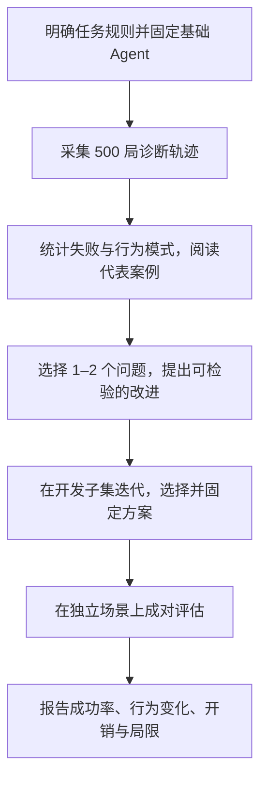

# CivRealm Agent Study

_认知推理课程任务二：DeepSeek Agent 的跨任务诊断、行为分析与改进。_

我们先在五种 CivRealm 小游戏中广泛运行同一个基础 Agent，找出跨任务重复出现的失败，再提出少量有依据的改进，最后在新场景上比较任务完成率与实际开销。

**已确定：五个任务、全部 normal，第一阶段每任务 100 个场景，共 500 局。** 本仓库目前处于框架和接口设计阶段，尚未提供可运行代码，也没有本轮实验结果。

新成员先读本页的研究流程和工作指南，再按职责阅读 [任务说明](docs/tasks/README.md)、[模块接口](docs/interfaces.md) 与 [日志规范](docs/logging_spec.md)。当前不提供尚未实现的安装或实验命令。

## 1. 🧭 项目范围与研究问题

只研究 LLM Agent，默认使用同一个 DeepSeek 模型比较基础版与改进版，不训练基座模型或开展 RL 实验。

| 类别 | 本轮任务 | 官方 task_type | 关注的决策 |
| --- | --- | --- | --- |
| 发展 | 建城 | `development_build_city` | 探索、比较位置、何时停止移动并建城 |
| 发展 | 跨海建城 | `development_transport` | 装载、运输、登陆、建城的顺序与多单位配合 |
| 战斗 | 古代陆战 | `battle_ancient_era` | 目标选择、移动与攻击、利用战斗反馈 |
| 战斗 | 守城 | `battle_defend_city` | 保护城市与单位、平衡进攻风险、推进回合 |
| 外交 | 科技交易 | `diplomacy_trade_tech` | 提出条款、理解回应、接受并执行条约 |

类型和任务简介来自官方小游戏说明。[^civrealm]

项目回答三个问题：

1. 相同基础 Agent 在不同任务上分别怎样失败？哪些行为问题跨任务出现？
2. 问题发生在输出、执行、目标理解、状态利用，还是行动安排与反馈更新？
3. 针对诊断提出的改进能否在新实例上提高完成率？需要增加多少调用、token、费用和时间？

第一阶段用于发现问题。记忆、反思、计划或规则提示都只是候选改进，不能在收集轨迹前写成已有结论。

## 2. 🗺️ 整体框架与场景安排

| 场景用途 | 每任务数量 | 五任务规模 | 如何使用 |
| --- | ---: | ---: | --- |
| 第一阶段诊断池 | **100，已确定** | 500 个不同场景、500 局基础版 | 统一配置采集，发现共性失败 |
| 其中的试运行 | 上述 100 个中的前 5 个 | 25 个，已包含在诊断池内 | 接通任务、确认日志、估算长度与费用 |
| 第二阶段开发子集 | 建议从诊断池预先选取 20 个 | 100 个，已包含在诊断池内 | 反复修改方法、比较候选方案 |
| 最终独立测试集 | 建议另留 50 个 | 250 个新场景，两个版本共 500 局 | 方法固定后评价改进 |

按当前建议，共 750 个不同初始场景，诊断与最终比较合计 1,000 局，开发重跑和必要消融另计。已确认的是第一阶段每任务 100 局；开发子集和最终测试数量在进入相应阶段前确定。

实例 ID 是任务和难度下的存档索引。各任务从 normal 的 0–999 中抽样，具体 ID 和抽样种子保存到 configs/；这些集合由我们划分，不是官方训练/测试划分。独立测试集不用于看错误或改提示词，已经分析过的旧实例仅用于诊断或开发。

## 3. 🛠️ 小组工作指南

### 第一步：把任务和执行链路说明白

用 [任务模板](docs/tasks/TEMPLATE.md) 为五个 task_type 各建一份任务说明。核实原生成功、失败、评分和回合限制，给所有版本相同的规则与玩家可见信息。守城可能需要坚持到原生期限才成功，不能把到期一律视作失败或人为截断。

按 [接口](docs/interfaces.md) 接通“观察 → 合法动作 → 模型选择 → 原生命令 → 反馈”，同时按 [日志规范](docs/logging_spec.md) 保存证据。模型返回当前动作编号、简短理由和可选聊天；执行器每次执行一个明确选择的动作。关闭我方内置 AI 代操，敌方保留场景规定的 AI。

前 25 个试运行场景属于诊断池，不另增加一套检查。确认必要链路和记录可靠后直接采集。若试运行中改过基础配置，受影响场景按最终配置重采集，旧尝试保留，不混入统一基线。

### 第二步：固定基础版，采集 500 局

保存模型与思考模式、提示词、上下文、输出协议、停止规则、代码版本和场景清单。五任务交替采集，使每类任务都有进展。第一阶段不边看错误边修改同名 Agent，配置变化另建版本。

每个场景基础版运行一次。输出失败、任务失败和宽上限截断都保留；基础设施故障单独记录，必要时从相同存档重跑，并保留每次尝试。

本阶段交付：500 局轨迹及逐局汇总、调用账本、任务覆盖数量和异常记录。若项目预算先耗尽，报告实际完成数与未运行清单，不能把未运行场景记作失败或声称已完成 500 局。

### 第三步：从轨迹中找共性

先区分环境故障、输出/执行失败、原生任务失败和资源截断。脚本统计重复动作、回退、长时间无进展、调用纠错等候选现象，再结合状态和任务阶段阅读代表性的成功、失败与截断轨迹。

形成“失败类型 × 任务”的分布和案例索引，解释每种标签对应的可观察证据。每局可以有多个标签，但一局内的多次动作不是多个独立样本。重复行动有时是合理等待或防守，不能仅因动作重复就判错。

本阶段交付：失败分类定义、跨任务频率、代表案例，以及事实与可能原因的区分。模型的简短理由用于辅助理解，不作为内部推理过程或因果证明。

### 第四步：根据发现提出改进

选最值得解决的 1–2 个问题，为每项改进写清“轨迹证据 → 原因假设 → 修改环节 → 预期行为变化 → 验证方式”。例如，只有实际发现反馈未被利用，才设计相应的记忆或反馈处理方法。

在诊断池的开发子集上迭代，保留基础版与必要单项对照。区分接口修复、上下文改动和策略变化。额外反思或规划调用属于该方法，必须完整计入用量；每次决策内部的结束规则也要写清楚。

本阶段交付：方法说明、实现、开发记录及选定方案。尚未验证的改动称为候选方法，不预写性能提升。

### 第五步：在新实例上验证

方法固定后，基础版与改进版从相同测试存档重新开始，各运行一次。保持相同任务规则、可见信息、模型、单次生成预算和宽松停止线，记录实际可控的游戏随机设置；不能假定场景抽样种子能控制远程模型随机性。

实例内的方法顺序随机交替。测试结果不再用于选择提示词。分别报告成功率、配对改善/退步、开销与截断；必要消融围绕主要组件开展。

## 4. ⚙️ 宽松限制与单局运行

调用次数是要测量的结果，因此本轮不设每局独立 API 调用上限。原生终局是主要停止条件，环境动作只保留宽松的异常停止线。

| 设置 | 本轮默认 | 用途 |
| --- | --- | --- |
| 游戏回合 | 沿用各场景与 Lua 的原生期限 | 保持任务定义 |
| 环境动作 | 最多 **2,000 次/局** | 结束同回合反复操作等长循环，触及后单列为截断 |
| API 调用次数 | **不设每局独立上限** | 自然记录决策、纠错和反思的实际调用量 |
| 模型 | `deepseek-flash`，thinking 开启，`reasoning_effort=high` | 各比较版本保持一致 |
| 单次生成 | `max_tokens=8192` | 开发阶段确认最终 JSON 能完整输出，正式运行前固定 |
| 输出纠错 | 每次决策最多 1 次 | 仍失败则结束并保留协议错误，不用规则动作替代 |
| 基础历史 | 最近 4 次动作与反馈，每局清空 | 长期记忆若加入，应列为方法变化 |
| 单次请求超时 | 180 秒 | 连接和服务故障处理，单列基础设施异常 |
| 项目累计 API 费用 | **50 USD** | 已有用量、诊断、开发、纠错、测试和消融共用 |

当前 thinking 模式忽略 temperature；固定 top_p 为 1.0，记录实际返回模型标识和日期，不宣称输出确定。[^deepseek-thinking] 生成参数与完成原因按官方接口记录。[^deepseek-api]

2,000 次环境动作是本项目选定的宽松停止线，不是论文规定。外交可以在一个回合内反复修改条款，仅有回合期限不能限制这种循环。记录无进展现象，不因为连续重复几次就自动改动作或结束。

一次向环境提交动作计一个 env step，结束回合也计一个；动作是否真正执行、是否产生状态变化另记。纠错调用不算环境动作，聊天单独记条数。达到原生终局提前结束；触及 2,000 步或项目费用边界时保留原生未决状态，单列停止原因。

基础版与改进版使用相同宽松停止线，允许自然消耗不同的调用量。比较实际开销，并从完整轨迹后处理 success@K：前 K 次调用内已被环境确认成功的场景占多少，而不用在第 K 次调用强行停止实验。

## 5. 📝 必须记录什么

| 层级 | 必须保存的内容 | 用来回答什么 |
| --- | --- | --- |
| 实验配置 | 方法、代码与提示词版本，模型和生成参数，任务规则版本，场景清单、随机设置、停止规则、费用口径 | 各组到底改变了什么，能否重跑 |
| 每步输入 | 玩家可见观察、事件、任务指标、有序合法动作，以及实际发给模型的上下文 | Agent 当时看到了什么，是否存在信息遗漏 |
| 模型输出 | 最终原始 content、解析结果、动作编号、简短理由、解析错误和纠错关联 | 输出或选择在哪里失败 |
| 环境执行 | 实际原生命令、聊天、执行响应、前后状态和关键事件 | 模型提议与游戏真实变化是否一致 |
| 每次 API 请求 | 调用用途、关联步骤、时间和延迟、输入/输出 token、缓存及思考 token（接口提供时）、完成原因、费用估算或未知用量预留 | 花了多少计算，在哪类调用上花费 |
| 每局结果 | 原生任务/玩家状态、是否成功、停止原因、初始/最终回合、环境动作、分类调用量、费用、时间、完整轨迹位置 | 怎样计算表现、开销和截断 |
| 人工分析 | 标签定义版本、现象、证据步骤、可能原因、标注者与复核说明 | 共性失败如何得到证据支持 |

所有 API 请求都记账，包含纠错、反思与实际重试；拿不到 usage 时标记未知并保守预留，不当成零费用。不要求保存模型内部思维链；最终简短理由和接口提供的用量统计足够用于本项目分析。

任务特定证据也要保留：建城位置和创建事件，运输装载/登陆，战斗伤亡与城市归属，守城存活及回合进展，外交条款、收到的回应、双方接受与科技实际转移。聊天或口头同意不等于任务成功。

字段、计数定义和存储安排见 [日志规范](docs/logging_spec.md)，模块之间如何传递这些信息见 [接口](docs/interfaces.md)。完整观察和上下文保存在服务器，可以通过文件引用关联，日志不复制凭据。

## 6. 📊 最后怎样比较和讲故事

| 维度 | 主要分析 |
| --- | --- |
| 任务表现 | 各任务成功次数/分母、成功率区间、原生得分及成功/失败/截断数量 |
| 行为模式 | 各任务哪些问题常见，哪些跨任务重复出现，发生在哪个阶段 |
| 配对变化 | 哪些相同测试实例由失败变成功，哪些发生退步，对应什么行为变化 |
| 实际开销 | 每局调用、token、费用、耗时、环境动作和回合的分布 |
| 表现与开销 | success@10/20/50/100/200 次调用等曲线，成功率与平均费用的关系 |
| 贡献与局限 | 改善来自哪个组件，是否只是花费更多计算，在哪些任务仍无效 |

端到端成功率只认环境确认的成功；输出失败和资源截断仍在已执行策略场景的分母中，基础设施异常和未运行场景单列。不同任务的原始分数不直接平均。

开销同时报告全部场景和成功/失败/截断各组，不能只展示成功局的低成本。可以补充“两版本均成功”的配对开销比较。success@K 的调用数包含纠错、反思和实际重试；样本提前被宽停止线或费用边界截断时，标明可观察范围，不推断未运行部分会怎样。

项目报告的主线是：共同失败证据 → 可检验的原因解释 → 对应方法 → 新实例的行为和结果变化。即使没有提升，可靠的失败分析、无效改进及其边界也是实际项目结果。

## 7. 📁 仓库与阅读入口

| 位置 | 内容 | 从这里开始做什么 |
| --- | --- | --- |
| [docs/tasks/](docs/tasks/README.md) | 任务规则与模板 | 写五份任务说明，核实原生判定和可见信息 |
| [docs/interfaces.md](docs/interfaces.md) | 环境、Agent、执行器和日志接口 | 让模块按同一份字段交换信息 |
| [docs/logging_spec.md](docs/logging_spec.md) | 逐步轨迹、调用账本和逐局结果规范 | 实现记录，再采集可分析的数据 |
| [docs/experiment_protocol.md](docs/experiment_protocol.md) | 实例划分、比较与异常约定 | 保持诊断、开发、测试的使用边界 |
| [docs/llm_study_design.md](docs/llm_study_design.md) | 场景数量、模型和宽松限制的具体设置 | 编写后续真实配置与实例清单 |
| [configs/](configs/README.md) | 后续的配置和场景清单 | 保存抽样、任务、方法和运行设置 |
| [prompts/](prompts/README.md) | 后续的提示词和方法差异 | 保留基础版，清楚描述每次变化 |
| [src/](src/README.md) | 待实现的环境、Agent、运行、记录与分析 | 先完成一条真实闭环，再开展批量采集 |
| [scripts/](scripts/README.md) | 待实现的运行入口 | 实现后补充真实安装和使用命令 |
| [reports/](reports/README.md) | 后续的图表、案例与报告 | 从记录生成结果，关联原始证据 |

当前以上入口提供设计文档和职责说明。实现完成时同步补上依赖、运行命令和真实输出位置。代码、配置、提示词和精简结果进入 Git；完整存档、原始轨迹、缓存和视频留在服务器，本地维护源码与精简交付物。密钥只从 DEEPSEEK_API_KEY 环境变量读取。

协作流程见 [CONTRIBUTING.md](CONTRIBUTING.md)。接口和实验设置变更先更新对应文档，已有轨迹保留原版本，避免下游组员读到混合配置的结果。

## 8. 📦 阶段交付与当前进度

当前完成的是研究框架、数量与记录约定。接下来按以下产出推进：

1. 五份任务说明、真实 Agent 闭环、日志与可复现配置。
2. 500 局基础诊断轨迹、覆盖清单、用量账本与异常汇总。
3. 共性失败分布、代表案例和有证据的候选解释。
4. 少量候选方法、开发记录、选定版本和必要消融。
5. 独立配对结果、成功率与开销图表、案例录屏、中文报告及提交包。

先用诊断池内的 25 局确认新参数下的开销，再安排批量采样，给开发和最终比较留出费用。100 局/任务是本轮目标；遇到预算不足时如实报告完成数与缺口，不静默缩小场景数量。项目不因改为无每局调用上限而增加原定累计 50 USD 的授权。

## 9. 📚 参考资料与文档说明

- [课程任务](https://yzhu.io/courses/core/projects/civilization/)
- [CivRealm 论文](https://arxiv.org/abs/2401.10568)
- [CivRealm 源码](https://github.com/bigai-ai/civrealm)
- [CivRealm 文档](https://bigai-ai.github.io/civrealm/)
- [官方小游戏设计说明](https://bigai-ai.github.io/civrealm/advanced_materials/minigame_create.html)
- [DeepSeek API 文档](https://api-docs.deepseek.com/)

本版框架文档由 AI 编程助手协助整理；实验设计与样本量规划工作流参考 Kassis, T., Agarwal, V., He, Y., Patel, D., & Brueckner, A. M. (2026), Scientific Agent Skills: A Library of Procedural Knowledge for Research Agents, [arXiv:2609.00065](https://doi.org/10.48550/arXiv.2609.00065)。该引用用于说明文档工作流，不构成本项目的实验结论。文档结构和 Mermaid 可读性也参考 markdown-mermaid-writing 技能，其文档模板来源为 [SuperiorByteWorks-LLC/agent-project](https://github.com/SuperiorByteWorks-LLC/agent-project)，作者 Clayton Young，Apache-2.0 许可。

[^civrealm]: CivRealm 官方小游戏类型与难度：https://bigai-ai.github.io/civrealm/advanced_materials/minigame_setting.html 。
[^deepseek-thinking]: DeepSeek thinking 模式参数，2026-11-01 核对：https://api-docs.deepseek.com/guides/thinking_mode/ 。
[^deepseek-api]: DeepSeek Chat Completions 参数及返回字段：https://api-docs.deepseek.com/api/create-chat-completion/ 。

## 10. 🤝 可能的分工（最后讨论）

先共同理解任务、日志和比较约定，再按工作包分配，暂不指定成员。一人可以承担相邻工作包。

| 工作包 | 主要交付 | 衔接 |
| --- | --- | --- |
| 环境与任务 | 五份任务说明、环境适配、原生判定和任务事件 | 提供可靠的状态、动作和任务指标 |
| 基础 Agent 与运行 | DeepSeek 管线、执行器、宽松停止规则、批量采集与 API 账本 | 按统一规范交付 500 局诊断材料 |
| 失败与行为分析 | 跨任务分布、证据索引、代表案例、原因假设 | 为改进提供具体问题和验证依据 |
| 改进与评估 | 候选方法、开发比较、独立评测、图表和报告 | 检验行为和表现是否改善及其实际开销 |
