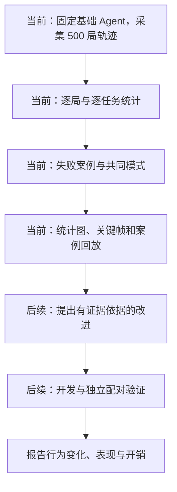

# CivRealm Agent Study

_认知推理课程任务二：DeepSeek Agent 的跨任务诊断、失败案例分析与改进。_

我们先在五种 CivRealm 小游戏中运行同一个 DeepSeek Agent，统计第一轮轨迹，找出跨任务共同的失败与行为模式；再根据证据提出改进，并在新场景上验证。

**当前要做：五个任务、全部 normal，每任务 100 局，共 500 局第一轮轨迹；完成逐局统计、失败案例分析和可视化。** 本仓库已提供环境检查、无 API smoke、单局 Agent 和可恢复批量运行入口；尚未产出完整首轮轨迹、结果图或正式结论。

全组统一使用 DeepSeek 当前最新发布模型。2026-11-01 核对为 **DeepSeek-V4.1-Flash-1017**，API 名称 `deepseek-flash`。[^latest-model] 首轮开始前统一核对版本，记录实际返回标识与日期；发现服务版本变化时分批记录，不混成同一模型结果。

新成员先看本页的当前工作和交付清单，再读 [任务说明](docs/tasks/README.md)、[模块接口](docs/interfaces.md)、[日志规范](docs/logging_spec.md) 和 [首轮可视化指南](docs/first_round_analysis.md)。

## 1. 🎯 目前要完成什么

| 工作 | 具体要做 | 本轮交付 |
| --- | --- | --- |
| 第一轮轨迹 | 固定基础 Agent 与配置，每任务采集 100 局，保存观察、输出、真实动作和环境反馈 | 场景清单、完整轨迹索引、逐局结果表 |
| 汇总统计 | 按任务统计成功、失败、输出/执行错误、截断、动作、回合、调用和耗时 | 每任务汇总表、异常与缺失清单 |
| 失败案例分析 | 定位失败发生的步骤、前后状态和任务阶段，归纳可观察的共同模式 | 问题标签、案例索引、带证据的案例说明 |
| 可视化 | 把总体分布、跨任务问题和代表轨迹展示出来 | 统计图、案例进展图、地图关键帧或短回放 |

首轮先收集和分析证据。记忆、反思或规划等改进方法在看到主要问题后再选择，不预先写成已有结论。

## 2. 🧭 任务范围与整体框架

只研究 LLM Agent，不训练基座模型或开展 RL 对照。五个任务使用同一模型、基础 Agent、生成设置与日志字段。

| 类别 | 任务 | 官方 task_type | 关注的决策 |
| --- | --- | --- | --- |
| 发展 | 建城 | `development_build_city` | 探索、比较位置、何时建城 |
| 发展 | 跨海建城 | `development_transport` | 装载、运输、登陆、建城与多单位配合 |
| 战斗 | 古代陆战 | `battle_ancient_era` | 目标选择、移动与攻击、利用战斗反馈 |
| 战斗 | 守城 | `battle_defend_city` | 保护城市与单位、平衡进攻风险、推进回合 |
| 外交 | 科技交易 | `diplomacy_trade_tech` | 提出条款、理解回应、接受并执行条约 |

任务类型和简介来自官方说明。[^civrealm]

实例 ID 是任务和难度下的存档索引。每个任务从 normal 的 0–999 中选 100 个不同实例，保存清单与抽样种子。每个场景首轮运行一次；已被阅读分析的实例不再当作后续独立测试。

## 3. 🛠️ 第一轮工作指南

### 第一步：确认任务规则和统一基础 Agent

用 [任务模板](docs/tasks/TEMPLATE.md) 写五份任务说明，核实原生成功、失败、评分和回合期限。所有人使用相同的模型配置与基础 Agent，不各自修改提示词后混合比较。

先按 [接口](docs/interfaces.md) 接通“玩家观察 → 合法动作 → DeepSeek 选择 → 原生命令 → 环境反馈”，按 [日志规范](docs/logging_spec.md) 同时保存记录。关闭我方内置 AI 代操，敌方使用任务规定的 AI。

每任务前 5 个场景兼作链路与记录确认，包含在各自 100 个场景内。确认必要链路后直接采集；如果这期间改过配置，受影响场景按最终基础版本重采集，旧尝试另存。

### 第二步：采集并整理第一轮轨迹

保存模型与版本、提示词、上下文、输出协议、停止规则、代码版本和实例清单。每局关联到实际配置，模型看到的上下文、输出内容和实际执行动作分别保存。

每位成员完成自己任务类别的采集，按统一结构交付逐局表与轨迹索引。输出失败、原生失败和宽停止线截断都保留；基础设施故障单列，重跑时保留所有尝试。未运行或缺失的场景列清单，不当作失败或补造结果。

### 第三步：统计轨迹并阅读失败案例

先按任务汇总结局、动作、回合、API 调用、token 和耗时。检查模型提案是否真的被执行、任务指标在哪一步变化、失败是环境判定还是运行停止。

再从轨迹中寻找重复或回退、长时间无进展、错过关键动作、计划未随反馈更新等候选现象。它们是分析方向，不是预设结论；合理等待、防守和工作中的重复要结合上下文判断。

案例按“初始目标 → 关键观察 → 模型选择 → 实际动作 → 状态变化 → 失败发生处”组织，注明证据步骤。区分直接可见的事实、可能的原因解释和仍需验证的假设。模型的简短理由用于辅助阅读，不代替游戏证据。

### 第四步：产出图表和案例回放

先形成每任务统计图，再汇总“问题类型 × 任务”的分布。代表案例展示进展曲线、关键事件和地图位置，帮助组员看清失败过程。

每任务优先选择 2 个失败案例和 1 个成功参照；按真实结局选取，没有对应结局就如实说明。批量阶段保存可绘制的状态和事件，选定案例后生成关键帧与短回放。具体图表、字段和交付命名见 [首轮可视化指南](docs/first_round_analysis.md)。

## 4. ⚙️ 统一模型与宽松运行限制

| 设置 | 本轮默认 | 说明 |
| --- | --- | --- |
| 模型 | 最新发布的 DeepSeek；当前为 `DeepSeek-V4.1-Flash-1017` | API `model=deepseek-flash`，全组统一，保存实际返回标识与日期 |
| 思考模式 | 开启，`reasoning_effort=high` | 各任务一致 |
| 单次生成 | `max_tokens=8192` | 先确认最终 JSON 能完整输出，正式采集前固定 |
| 游戏回合 | 沿用场景与 Lua 的原生期限 | 守城到期可能成功，以环境判定为准 |
| 环境动作 | 最多 2,000 次/局 | 宽松停止线，触及后单列截断 |
| API 调用次数 | 不设每局独立上限 | 正常决策、纠错、反思与实际重试都记录 |
| 输出纠错 | 每次决策最多 1 次 | 仍失败则保留协议错误，不由规则动作替代 |
| 基础历史 | 最近 4 次动作与反馈，每局清空 | 额外记忆作为后续方法变化说明 |
| 请求超时 | 180 秒 | 单列基础设施异常 |

当前 thinking 模式忽略 temperature；固定 top_p 为 1.0，不宣称输出完全确定。[^deepseek-thinking] 生成参数和返回字段按官方接口记录。[^deepseek-api]

原生终局优先。一次 env.step 提交计一个环境动作，结束回合也计一个；是否成功执行另记。聊天单独记条数。2,000 步仅用于结束同一回合反复操作等长循环，不因为重复几次就接管策略。非原生结束时保留原生未决状态与停止原因。

## 5. 📝 每局与每步记什么

| 层级 | 必须记录 |
| --- | --- |
| 实验条件 | 任务/难度/ID、方法与代码/提示词版本、模型与生成设置、规则来源、随机设置 |
| 每步输入 | 玩家可见观察、事件、原生指标、有序合法动作、实际发送的上下文 |
| 模型输出 | 最终原始 content、动作编号、简短理由、解析错误和纠错关联 |
| 实际执行 | 原生命令与参数、聊天、执行响应、前后状态、关键事件 |
| 每次调用 | 用途、关联步骤、输入/输出 token、缓存/思考用量（如提供）、完成原因、延迟与单次费用估算 |
| 每局汇总 | 原生结局、是否成功、停止原因、动作、初始/最终回合、分类调用量、费用、耗时、轨迹位置 |
| 人工分析 | 问题标签及定义版本、证据步骤、可观察现象、可能原因、标注与复核说明 |
| 绘图与回放 | 玩家可见地图、单位/城市位置、移动与交互、装载/登陆、伤亡、条约和科技转移等事件 |

不要求保存模型内部思维链。调用用量缺失时写明未知，不按零计算；生成图表时也保留缺失标记。原始日志不被人工标签覆盖。

记录细节见 [日志规范](docs/logging_spec.md)。地图只展示玩家可见信息；若使用观察者画面，必须标明视角，不把全局隐藏信息补入 Agent 输入。

## 6. 📊 本轮需要哪些可视化

| 图或回放 | 展示内容 | 主要用途 |
| --- | --- | --- |
| 各任务结局分布 | 成功、原生失败、输出/执行失败、截断及异常/未运行数量 | 看覆盖情况和主要失败环节 |
| 问题类型 × 任务热力图 | 各问题在每个任务中的场景数与比例 | 找跨任务共同问题 |
| 调用、动作与耗时分布 | 每局资源分布，按任务和结局区分 | 看长轨迹、早停与无进展消耗 |
| 案例进展曲线或事件时间线 | 分数/目标相关状态、调用或动作位置、关键事件 | 看进展在哪一步停止或偏离 |
| 地图关键帧或短回放 | 可见地图、单位路径、目标位置、关键交互 | 直观解释失败的具体过程 |

每张图注明样本数、分母、模型/配置与数据来源。失败标签可多选，不把标签比例堆成互斥结局；原始分数不跨任务平均。调用与耗时图包含失败和截断，不能只画成功局。

汇总时以场景为单位，一局的多次动作不是多个独立样本。优先从同一份逐局表和标签表生成图，所有案例能回到原始轨迹。以上是待第一轮数据产生的交付物，当前没有本轮结果图。

## 7. 🔬 首轮之后再做什么

先从失败分布与案例中挑选最值得解决的 1–2 个问题，再提出有针对性的改进，说明原因假设、修改环节和预期行为变化。在开发子集上迭代，保留基础版与必要对照。

方法确定后使用未参与开发的新实例成对评估，比较成功率、行为变化与实际开销。可后处理 success@K 调用曲线，不需在第 K 次调用强行停止。开发子集和独立测试的规模在进入后续阶段前确定；当前先完成第一轮的统计、案例和图。

## 8. 📁 仓库入口与交付位置

| 入口 | 用途 |
| --- | --- |
| [docs/tasks/](docs/tasks/README.md) | 五种任务的规则与模板 |
| [docs/interfaces.md](docs/interfaces.md) | 环境、Agent、执行与记录接口 |
| [docs/logging_spec.md](docs/logging_spec.md) | 逐步轨迹、调用与逐局字段 |
| [docs/first_round_analysis.md](docs/first_round_analysis.md) | 当前统计、失败案例与可视化的具体指南 |
| [docs/experiment_protocol.md](docs/experiment_protocol.md) | 实例使用、异常和比较口径 |
| [docs/llm_study_design.md](docs/llm_study_design.md) | 模型与运行设置 |
| [docs/implementation_plan.md](docs/implementation_plan.md) | 完整目录、模块职责和分阶段验收计划 |
| [configs/](configs/README.md) | 共享配置、本机模板和实例清单 |
| [prompts/](prompts/README.md) | 统一基础提示词和后续方法版本 |
| [src/](src/README.md)、[scripts/](scripts/README.md) | 已实现的环境、Agent、单局与可恢复批量运行入口 |
| [reports/](reports/README.md) | 精简统计表、标签、案例、图表与报告 |

源码、配置、实例清单和精简交付物进入 Git；完整观察、存档、轨迹、视频和缓存留在服务器。密钥通过 DEEPSEEK_API_KEY 环境变量读取。

当前入口及输出结构见 [scripts/README.md](scripts/README.md)。批量统计、失败标签和绘图尚待首轮数据产生后实现；不把示意文件名写成已经生成的实验结果。协作方式见 [CONTRIBUTING.md](CONTRIBUTING.md)。

## 9. 📚 参考资料与文档说明

- [课程任务](https://yzhu.io/courses/core/projects/civilization/)
- [CivRealm 论文](https://arxiv.org/abs/2401.10568)
- [CivRealm 源码](https://github.com/bigai-ai/civrealm)
- [小游戏设计与 Lua](https://bigai-ai.github.io/civrealm/advanced_materials/minigame_create.html)
- [DeepSeek 官方更新日志](https://api-docs.deepseek.com/updates/)

框架由 AI 编程助手协助整理。实验设计与样本量工作流参考 Kassis, T., Agarwal, V., He, Y., Patel, D., & Brueckner, A. M. (2026), Scientific Agent Skills: A Library of Procedural Knowledge for Research Agents, [arXiv:2609.00065](https://doi.org/10.48550/arXiv.2609.00065)；该引用不构成本项目的实验结论。文档结构参考 markdown-mermaid-writing 技能及 [SuperiorByteWorks-LLC/agent-project](https://github.com/SuperiorByteWorks-LLC/agent-project)（Clayton Young，Apache-2.0）。

[^latest-model]: DeepSeek 官方 2026-10-17 更新，2026-11-01 核对：https://api-docs.deepseek.com/updates/ 。
[^civrealm]: 官方小游戏类型与难度：https://bigai-ai.github.io/civrealm/advanced_materials/minigame_setting.html 。
[^deepseek-thinking]: DeepSeek thinking 模式：https://api-docs.deepseek.com/guides/thinking_mode/ 。
[^deepseek-api]: Chat Completions 字段：https://api-docs.deepseek.com/api/create-chat-completion/ 。

## 10. 🤝 成员分工

每位成员负责自己任务类别的第一轮采集、逐局统计、失败案例分析和可视化，使用同一基础 Agent、模型版本、字段与图表口径。

| 成员 | 类别 | 负责的任务 | 第一轮局数 |
| --- | --- | --- | ---: |
| jianzheli | 发展 | 建城 `development_build_city`；跨海建城 `development_transport` | 200，两个任务各 100 |
| junhaozhang | 战斗 | 古代陆战 `battle_ancient_era` | 100 |
| songluo | 战斗 | 守城 `battle_defend_city` | 100 |
| beibeideng | 外交 | 科技交易 `diplomacy_trade_tech` | 100 |

每人交付对应任务的结果表、轨迹索引、问题标签、代表案例与可视化；全组共同对齐标签定义和汇总图，再讨论后续改进方向。
