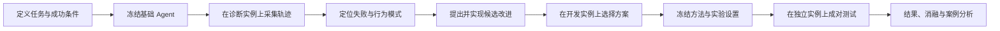

# CivRealm Agent Study

**DeepSeek 智能体的跨任务评测、失败分析与改进**

本项目面向认知推理课程任务二。我们在 CivRealm 的不同小游戏中运行同一个 DeepSeek Agent，保存观察、决策、真实动作与环境反馈，分析失败的具体原因和反复出现的行为模式，再设计有针对性的改进，并在独立实例上检验效果。

**当前阶段：研究框架与协作接口设计。** 已确定只研究 LLM Agent，选择两个发展、两个战斗和一个外交任务，全部使用 normal 难度。本仓库目前只有文档和目录约定，尚未提供可运行的 Agent 或实验结果。具体任务名称、场景数量和运行上限仍为建议，正式测试前冻结。

## 1. 我们要回答什么

我们关注三个问题：

1. 同一个 LLM Agent 在空间决策、战术行动和外交交易中，分别会在哪些环节失败？
2. 哪些失败来自输出和执行接口，哪些来自目标理解、状态利用或行动安排？哪些行为模式在多个任务中重复出现？
3. 根据轨迹诊断提出的改进，能否在新实例上提高任务完成率？改善是否伴随额外的调用、动作或费用？

研究对象是 **LLM Agent 的决策管线**。默认使用 DeepSeek 推理接口，不训练或微调基座模型。当前比较同一模型的基础版与改进版，只开展 LLM 实验。

## 2. 整体研究流程



单局运行形成另一个闭环：

**玩家观察与事件 → 状态整理和合法动作 → DeepSeek 决策 → 解析并执行真实命令 → 环境反馈。**

轨迹记录贯穿整个闭环。模型说了什么、执行器实际发送了什么、游戏发生了什么，需要分别保存。

## 3. 任务范围怎么选

任务范围为 **2 个发展 + 2 个战斗 + 1 个外交，全部 normal**。建议选择以下五项；具体名称尚待确定。

| 候选任务 | 官方类型 | 主要观察的行为 |
| --- | --- | --- |
| 发展：建城选址 | `development_build_city` | 探索、比较位置、判断何时建城 |
| 发展：跨海建城 | `development_transport` | 多单位配合、装载、运输、登陆与建城的多阶段安排 |
| 战斗：古代陆战 | `battle_ancient_era` | 目标选择、移动与攻击安排、利用反馈调整行动 |
| 战斗：守城 | `battle_defend_city` | 防守目标、单位保护、回合推进与进攻风险的平衡 |
| 外交：科技交易 | `diplomacy_trade_tech` | 理解条款、提出交易、根据回应调整并执行条约 |

上述类型来自 [CivRealm 官方小游戏说明](https://bigai-ai.github.io/civrealm/advanced_materials/minigame_setting.html)。这组选择比较单阶段与多阶段发展、主动歼敌与限时防守，以及外交交互；它们是否产生相同失败模式，需要由轨迹检验。

每个任务实施前都要写一份任务说明，明确：

- 玩家能看到哪些信息，哪些状态不能提供给 Agent。
- `mini_score` 的含义、变化方向及其与 `mini_goal` 的关系。
- 原生成功、失败和终止条件，以及任务相关动作。

不同任务的分数分别解释。**成功以环境确认的任务完成状态为准**；任务尚未完成时的高分、文字承诺或动作提案，不能直接计作成功。

任务说明放在 [docs/tasks/](docs/tasks/README.md)。

## 4. 基础 Agent 及模块接口

基础 Agent 接收玩家可见信息、任务说明、合法动作和近期反馈，返回一个动作选择及简短依据。执行器把选择转换成原生命令，并记录执行结果。

| 模块 | 负责什么 | 交给下游什么 |
| --- | --- | --- |
| 环境与任务适配 | 加载指定场景，提取观察、合法动作和原生指标 | `TaskSpec`、`StepContext` |
| Agent | 整理上下文，调用 DeepSeek，选择动作 | `Decision` |
| 执行与运行 | 检查选择、发送命令、推进游戏、控制预算 | `ExecutionResult` |
| 轨迹与分析 | 保存逐步证据，汇总结果，分析行为 | `StepRecord`、`EpisodeResult`、诊断报告 |

接口的具体字段见 [docs/interfaces.md](docs/interfaces.md)。接口变动先同步文档，再修改实现，减少模块各自生成不同日志的情况。

所有方法都使用同一份任务规则和玩家可见信息。模型输出失败时保留失败记录；若某种改进引入规则控制、动作筛选或额外调用，需要明确标为该方法的一部分。

## 5. 怎么分析失败和行为

先按运行记录区分：

- **环境故障**：场景加载、连接或服务异常。
- **输出与执行失败**：空输出、格式错误、非法动作编号、命令未能执行。
- **任务失败或预算截断**：命令可以执行，但没有完成任务，或用尽预定预算。

再结合任务和轨迹分析原因，例如：动作是否与当前目标相关，是否反复回到相同状态，是否在满足条件时错过关键动作，是否根据真实反馈更新计划，外交条款是否最终得到双方接受并执行。

这些是待数据检验的分析方向，不预先假定每个任务都会出现同样的问题。重复行动在有些情境中是合理的，需要结合状态和任务阶段判断。

每个重要发现应同时给出：**可复现的轨迹证据、发生频率、一个具体解释，以及能区分该解释的改进实验。** 简短决策依据用于辅助读轨迹，不要求采集模型内部思维链，也不以语言解释代替状态证据。

## 6. 怎么从诊断走向改进

根据实际出现的高频问题，选择一到两个改进方向。候选方向包括：

- 改善状态摘要和动作描述，减少遗漏、歧义与无关上下文。
- 保存关键进展、已尝试动作和环境回应，支持后续决策。
- 在关键动作前检查其前提条件，并在执行后核对预期与实际变化。
- 根据反馈调整计划，减少无进展的重复行动。

每个候选方法说明三个要点：它针对什么现象、修改了哪个环节、预期改变什么可观察行为。

**接口改进与策略改进分开比较。** 提高 JSON 可解析率和改善行动选择分别报告；更换模型、增加输出预算或调用次数也要单独说明。消融实验优先检验贡献最大的组件，不一次堆叠很多无法解释的改动。

## 7. 实验设计与指标

- **诊断/开发实例**：用来阅读失败、修改提示词、选择方法。
- **独立测试实例**：在方法冻结前不用于调参，最终用于比较基础版与改进版。

实例 ID 是官方存档索引；各集合具体选哪些编号由本项目在采样前确定。这里主要是推理与管线改进实验，不把开发集称为模型训练集。已经反复分析过的实例可以继续用于诊断，不再当作新的独立测试。

基础版与改进版使用相同的任务、难度、实例和游戏种子。固定模型、思考模式、动作上限及调用预算；确实需要改变的设置作为实验变量说明。运行顺序在实例内随机交替，比较以实例为单位，不能把同一局的多次动作当成独立样本。

主要指标是 **端到端成功率**。同时报告各任务原生得分、动作数/回合数、合法输出率、失败类型、API 调用量、费用和延迟。排除接口失败后的表现可以作为诊断，但不能替代端到端成功率。

先用小样本估算费用与每局长度，再固定正式样本量。默认沿用项目累计 **50 USD** 的 API 费用上限，实际实验统一记账。基础设施故障与策略失败分别保存，策略失败不为提高成功率而重跑。

建议每个任务 **20 个开发场景 + 50 个独立测试场景**，共 350 个不同初始场景。开发集前 5 个用于试运行及费用估算，不另增加一套检查实例。两个版本各运行一次全部测试集，共 500 局正式比较；开发运行与消融另计。

试运行初值为每局最多 **256 次环境动作、320 次模型调用**，每次请求最多 8,192 个生成 token。原生游戏回合限制保持场景规则。基础版与改进版在同一任务上使用相同预算；具体设置和样本量在开发阶段确定，不根据独立测试表现调整。

样本量依据、模型参数、预算口径见 [docs/llm_study_design.md](docs/llm_study_design.md)，通用约定见 [docs/experiment_protocol.md](docs/experiment_protocol.md)。

## 8. 仓库结构

```text
.
├── README.md                    # 项目框架；分工建议在文末
├── AGENTS.md                    # AI 助手在本仓库中的工作约定
├── CONTRIBUTING.md              # 分支、PR 与协作方式
├── docs/
│   ├── interfaces.md            # 模块与日志接口
│   ├── experiment_protocol.md   # 实验设计和记录约定
│   ├── llm_study_design.md      # 五任务、场景数与运行参数建议
│   └── tasks/                   # 每种任务的规则与评估说明
├── configs/                     # 后续保存实验配置与实例清单
├── prompts/                     # 后续保存基础版与改进版提示词
├── src/                         # 后续实现环境、Agent、运行与分析模块
├── scripts/                     # 后续提供可复现入口
└── reports/                     # 后续保存图表、案例和报告
```

当前各目录的 README 说明其职责；实现文件随后按接口逐步加入。这里没有可直接执行的训练或评估命令。

代码、配置、提示词和精简结果进入 Git。密钥从 `DEEPSEEK_API_KEY` 环境变量读取；模型、完整存档、原始轨迹和缓存存放在服务器或各自运行目录，不提交到仓库。

## 9. 阶段性产出

1. **可执行基线**：选定首轮任务，完成任务说明，跑通观察、动作、反馈和日志。
2. **跨任务诊断**：按固定配置采集开发实例，形成失败分布、行为统计与代表案例。
3. **候选方法**：实现少量有明确证据依据的改进，在开发实例上选择方案。
4. **独立比较**：冻结方法与配置，在新实例上完成成对评测及必要消融。
5. **项目交付**：提交代码、配置、实例清单、结果图表、案例录屏和报告，说明复用、改动及结论范围。

## 10. 参考资料与文档说明

- [课程任务](https://yzhu.io/courses/core/projects/civilization/)
- [CivRealm 源码](https://github.com/bigai-ai/civrealm)
- [CivRealm 文档](https://bigai-ai.github.io/civrealm/)
- [官方小游戏类型](https://bigai-ai.github.io/civrealm/advanced_materials/minigame_setting.html)
- [官方小游戏设计说明](https://bigai-ai.github.io/civrealm/advanced_materials/minigame_create.html)
- [DeepSeek API 文档](https://api-docs.deepseek.com/)

本版框架文档由 AI 编程助手协助整理；实验设计与样本量规划工作流参考 Kassis, T., Agarwal, V., He, Y., Patel, D., & Brueckner, A. M. (2026), *Scientific Agent Skills: A Library of Procedural Knowledge for Research Agents*, [arXiv:2609.00065](https://doi.org/10.48550/arXiv.2609.00065)。该引用用于说明文档工作流，不构成本项目的实验结论。

## 11. 可能的分工（最后讨论）

先共同确认整体框架，再按下列工作包分配。暂不指定人数或成员，一人可以承担相邻工作包。

| 工作包 | 主要交付 | 与其他模块的衔接 |
| --- | --- | --- |
| 环境与任务 | 任务说明、环境适配、原生成功/失败判定 | 向 Agent 和分析模块提供可靠状态与指标 |
| 基础 Agent 与运行 | DeepSeek 管线、执行器、预算记录、完整轨迹 | 按统一接口交付可复现的基线运行 |
| 失败与行为分析 | 行为统计、失败分类、代表案例、候选解释 | 向改进模块提供可检验的具体问题 |
| 改进与评估 | 候选方法、配对实验、消融、结果图和报告 | 使用统一基线与独立测试验证改进 |
