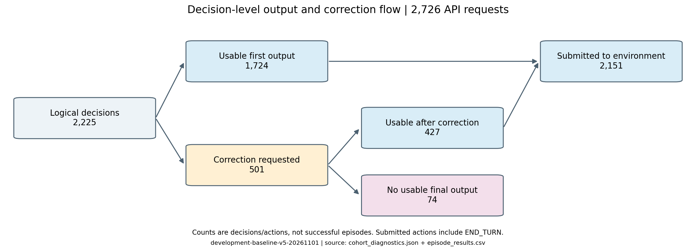
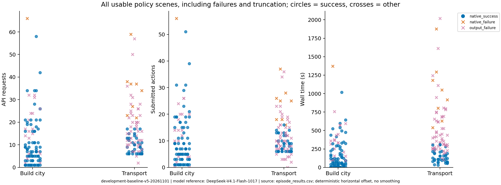

# 固定生成预算下的大语言模型发展任务评测与失败机制分析

## 基于CivRealm两个normal任务的200局轨迹

> 课程报告分析稿，整理日期：2026年11月1日。可作为总报告中“实验设置—结果—讨论”部分的基础。本文仅覆盖建城和跨海建城两个发展任务，所有结果来自同一正式配置；本轮保持`thinking/high + max_tokens=8192`。

## 摘要

本研究在CivRealm的建城与跨海建城任务中，使用统一的大语言模型Agent，对每个任务的100个normal场景分别运行一次，共获得200个可追溯的策略结果。Agent采用`deepseek-flash`、high思考强度和每次请求8192 tokens的生成上限，保留最近4次动作与反馈。建城任务的端到端成功率为80%，跨海任务为37%。在83个未成功实例中，74个最终因无法获得可执行输出而停止，9个由游戏给出原生失败判定。对2,225次逻辑决策的分析显示，501次触发纠错，427次恢复为可执行动作，纠错恢复比例为85.2%。对全部100局跨海轨迹的过程对照表明，63个未成功实例中，54个在建城前失去全部移民且未在后续记录中恢复，其中53个已尝试转产移民；全部8个原生失败均属于这一模式。成功局也普遍存在粮荒，因此关键区别是完成目标所需的单位能否持续可用，以及损失后能否实际恢复。另有跨案例证据显示，模型预期的动作效果与真实状态变化之间存在脱节。本研究将8K作为明确的计算预算条件，分别报告输出可靠性和任务过程问题，形成后续方法研究的诊断基线，不将案例解释当作已验证的干预效果。

## 1. 研究问题与分析思路

CivRealm为决策智能体提供了需要处理不完全信息、资源管理与多阶段目标的策略环境，并提供语言型智能体接口[1]。发展任务虽然目标相对集中，仍要求智能体把当前观察、合法动作、行动前提和长期目标联系起来。一个动作在局部上合法，并不保证它有利于最终目标；一段看似合理的计划，也可能在跨回合时因为维护成本或生产条件变化而失效。

本报告围绕三个问题组织对既有轨迹的描述性分析：第一，同一Agent配置在两个发展任务上的端到端表现如何；第二，未成功实例具体在哪个环节结束，输出纠错起到了什么作用；第三，哪些失效过程在多局中重复出现、它们与成功路径有何区别，资源消耗和初始条件又与结果呈现怎样的关联。

分析同时保留“运行如何结束”和“运行过程中发生了什么”。前者形成互斥的结局分布，后者通过原生事件、状态变化与案例解释呈现。这样既能保留固定预算下的完整表现，也能进一步理解失败发生的过程。

## 2. 实验设置

### 2.1 任务与样本

建城任务为`development_build_city`，跨海建城任务为`development_transport`，难度均为normal。分别使用抽样种子20261101和20261102，从各任务ID 0–999中无放回抽取100个实例。每个实例在正式配置下贡献一次策略结果；前5个实例用于确认链路与记录，并包含在各自100个实例中。

建城任务要求选择达到原生目标分数的位置并建城。移动时的`mini_score`描述当前候选位置，合法建城不代表已经达到分数目标。低分建城同样会触发原生终局。本批100个场景的原生回合期限均为30，目标分数在5.4–6.4之间，因此每局依据自己的`mini_goal`判断。

跨海任务要求完成运输并建城。本批100个场景的原生回合期限均为10。已核查的场景脚本在我方建城事件直接设置成功，`mini_score`可以仍为0，因此统计以原生成功字段为准。同时，额外核对同一单位的装载、载人船移动、登陆和建城证据，避免用文字声明或分数大小替代实际过程。

### 2.2 统一Agent与交互协议

| 项目 | 正式配置 |
|---|---|
| 模型请求标识 | `deepseek-flash` |
| 启动时核对的参考版本 | DeepSeek-V4.1-Flash-1017；核对日期2026-11-01 |
| 接口实际返回标识 | `deepseek-flash` |
| 思考模式与强度 | thinking enabled，reasoning effort high |
| 单次生成上限 | 8192 tokens |
| 采样设置 | `top_p=1.0`，不传入无效的temperature设置 |
| 历史 | 最近4次动作与反馈，每局清空 |
| 动作选择 | 从当前有序合法菜单选择一个动作编号，返回JSON及简短理由 |
| 输出纠错 | 每次逻辑决策最多追加一次纠错请求；仍不可执行则记录输出失败 |
| 场景停止规则 | 原生终局优先，另设最多2000次环境提交的宽停止线 |
| 调用量 | 不设每局独立API调用上限，所有实际请求均计数 |

参考模型版本与接口返回别名分别记录，避免把别名当作接口已经披露的精确服务端修订号。模型参数含义参见官方文档[2–3]。

模型输入包含玩家可见观察、任务指标、当前合法动作、原生事件与近期反馈。隐藏地图和存档中的评分矩阵不进入模型输入。研究者在事后解释案例时可以核对Lua或SDK，但不会把事后获得的规则知识假定为Agent当时已经明确收到的说明。

本轮在独立SDK中移除了继承的128步额外截断，保留场景的原生期限，并保存实际请求、最终输出、全部纠错、执行命令、动作前后状态和原生通知。正式运行前的适配与记录修复版本不混入本文的200局表现统计。本文分析的是修复后统一配置`development-baseline-v5-20261101`。

### 2.3 成功、失败与统计单位

本文的成功率定义为“获得原生成功确认的场景数/该任务正式策略场景数”，每任务分母均为100。输出失败保留在分母中。正式200局均已获得策略结果，无待补实例；本批没有触及2000步停止线，也没有因基础设施故障而待补的实例；输出失败局停止时的原生胜负仍未决。

原生失败由游戏给出失败字段；输出失败表示普通请求和一次纠错后仍无法取得可执行动作。74个输出失败停止时，原生小游戏状态均仍为`status=0、success=-1`，因此它们是完整Agent链路的失败，不另改写成原生游戏失败。

全文区分三个统计单位。一次逻辑决策可以包含普通与纠错两个API请求；一次可执行选择对应一次环境提交，包含结束回合；一局则包含多次决策。调用数、决策数和场景数分别作为相应比例的分母。

## 3. 总体结果

### 3.1 两个任务的端到端表现

| 任务 | 场景数 | 原生成功 | 原生失败 | 输出失败 | 端到端成功率 | 95% Wilson区间 |
|---|---:|---:|---:|---:|---:|---|
| 建城 | 100 | 80 | 1 | 19 | 80.0% | 71.1%–86.7% |
| 跨海建城 | 100 | 37 | 8 | 55 | 37.0% | 28.2%–46.8% |

数据来源：[逐局结果](../development/episode_results.csv)及[任务汇总](../development/task_summary.csv)。Wilson区间按场景作为统计单位，为本次成功比例提供描述性不确定性参考，不代表跨模型或多次随机运行的稳定性评估。

**图1. 两个发展任务的结局分布。** 每任务100个场景，三类实际出现的结局相互排斥。图例中未出现的停止类型计数为0。蓝色表示原生成功，橙色表示原生失败，粉色表示输出失败。数据来自全部200局，而非精选案例。

在当前样本和配置下，跨海建城的成功率比建城低43个百分点。差异同时伴随更高的输出失败数量和更多原生失败，后续分别分析这两个环节。由于两个任务的目标、期限和初始条件不同，这43个百分点描述的是任务间表现差异，不是某个干预方法的效果。

跨海任务的37个原生成功实例，全部能够从玩家可见记录中建立同一单位的装载、载运移动、登陆、建城顺序证据，见[运输过程逐局表](../development/transport_process.csv)。这一核对支持本批成功实例完成了可观察的海运建城过程；它不额外证明隐藏全地图上的大陆归属关系。

### 3.2 输出可靠性与纠错

200局共形成2,225次逻辑决策，提交环境2,151次，调用API 2,726次，其中纠错调用501次。

| 指标 | 计数/分母 | 比例 | 解释 |
|---|---|---:|---|
| 首轮直接获得可执行输出 | 1724/2225次决策 | 77.5% | 无需纠错即可提交动作 |
| 触发纠错 | 501/2225次决策 | 22.5% | 首轮输出未满足动作协议 |
| 纠错后恢复可执行输出 | 427/501次纠错决策 | 85.2% | 恢复交互，不等同于该局最终成功 |
| 纠错后仍无可执行输出 | 74/2225次决策 | 3.3% | 对应74个场景的终止 |
| 以输出失败结束的场景 | 74/200局 | 37.0% | 场景层面的端到端负结果 |

**图2. 输出和纠错在决策层面的计数关系。** 1,724次首轮可执行输出与427次纠错恢复合计形成2,151次环境提交，其余74次逻辑决策未提交新动作。图中节点是决策/提交数量，不能将“提交动作”理解为“任务成功”。输入数据来自[全体调用诊断](../failure_diagnosis/cohort_diagnostics.json)。

全体调用中，573次以`length`结束，其中565次最终内容为空，8次包含截断JSON。另外两次输出异常分别为非`length`的额外文本和空响应。74个终止性输出失败的最后两次请求均以`length`结束且最终内容为空；这148次响应的生成token全部被计为思考token，数量接近或达到8192。

这些记录支持“生成额度用尽、没有形成最终动作输出”作为本批终止性输出失败的直接机制。8K约束的是每次请求的生成量，1M上下文容量是另一项限制；例如建城254末次决策的输入约1.93万tokens，而两次生成均达到8192后没有最终动作输出。

本轮保持8K，将其作为明确的计算预算条件。纠错使大多数首轮异常能够恢复，但经过多次决策后，仍有37%的场景最终停在输出协议处。决策层面的3.3%与场景层面的37.0%描述不同统计单位。现有轨迹没有观察提高额度后的反事实结果，因而不能把这74局假定为增加预算后即可成功。

### 3.3 资源消耗及其与结局的关联

| 任务 | 动作总数 | API调用总数 | 每局动作中位数 | 每局调用中位数 | 每局耗时中位数 | 正式运行费用估算 |
|---|---:|---:|---:|---:|---:|---:|
| 建城 | 1012 | 1156 | 7 | 7 | 109.5秒 | 4.17 USD |
| 跨海建城 | 1139 | 1570 | 9 | 12 | 294.5秒 | 6.27 USD |

正式200局的费用估算合计10.44 USD，基于记录的实际用量和调用时单价；它是估算值，不是供应商账单。表中不计入准备版本的费用。动作总数包含结束回合；调用总数包含纠错。

**图3. 调用、动作和耗时分布。** 每个点对应一个场景；圆点为成功，叉号为其他结局。横向小幅偏移仅用于减少重叠，没有平滑或拟合。耗时为单局实际墙钟时间，还受到服务响应与运行并行度影响，不能直接解释为纯粹的认知计算难度。

进一步按结局分组，可以看出只比较成功局会忽略相当一部分资源负担。

| 任务与结局 | 场景数 | 动作中位数 | 调用中位数［Q1，Q3］ | 耗时中位数 |
|---|---:|---:|---|---:|
| 建城：成功 | 80 | 6 | 7［2.5，12.25］ | 69.8秒 |
| 建城：原生失败 | 1 | 56 | 66（单例） | 1371.4秒 |
| 建城：输出失败 | 19 | 14 | 16［6.5，24］ | 336.5秒 |
| 跨海：成功 | 37 | 8 | 9［6，12］ | 115.9秒 |
| 跨海：原生失败 | 8 | 25 | 35.5［26，37.25］ | 982.9秒 |
| 跨海：输出失败 | 55 | 10 | 15［10，21］ | 391.4秒 |

Q1、Q3采用线性插值，分位数可以不是整数。完整精度及其他统计量保存在[报告表格数据](report_tables.json)。

跨海原生失败实例的调用中位数为35.5，成功实例为9次；建城唯一原生失败消耗了66次请求。这些记录说明，本批失败并不普遍表现为交互很少或没有继续尝试。不同场景难度与恢复过程会影响轨迹长度，较长轨迹也增加了遭遇输出异常的机会，因此这里描述资源与结局的关联，不据此判定调用越多导致失败或增加调用必然无效。

### 3.4 单局实际需要多久

| 任务 | 每局中位数 | 每局平均 | 中间50%范围 | 90%分位数 | 最长一局 |
|---|---:|---:|---:|---:|---:|
| 建城，100局 | 1.8分钟 | 3.3分钟 | 0.5–5.3分钟 | 8.3分钟 | 22.9分钟 |
| 跨海，100局 | 4.9分钟 | 6.9分钟 | 2.6–8.8分钟 | 13.6分钟 | 33.6分钟 |

完整秒数由`episode_results.csv`的`duration_s`汇总，保存在[report_tables.json](report_tables.json)的`runtime_by_task`；中间50%范围指Q1–Q3。成功建城、成功跨海的耗时中位数分别为1.2、1.9分钟，跨海输出失败为6.5分钟，跨海原生失败为16.4分钟。单局耗时有明显长尾，安排运行资源时不能仅看成功局或中位数。

计时包括环境初始化、API等待与纠错、环境动作以及关闭，排队等待和事后回放生成不在其中。正式配置每任务4个工作进程，共8局并行；这些仍是每局自身的墙钟时间，不能再除以8，也不是改进方案未来的耗时预测。

## 4. 失败的共同模式及其证据

### 4.1 共同模式一：阶段动作完成后，没有保住最终目标的必要条件

重新读取全部100局跨海轨迹后，可以比较同一现象在不同结局中的出现范围。

| 可观察现象 | 成功37局 | 原生失败8局 | 输出失败55局 |
|---|---:|---:|---:|
| 至少一次粮荒损失 | 29/37 | 8/8 | 52/55 |
| 至少一次实际登陆 | 37/37 | 6/8 | 29/55 |
| 已登陆移民在随后首次结束回合时损失 | 10/37 | 6/8 | 29/55 |
| 建城前全部移民损失 | 0/37 | 8/8 | 46/55 |
| 收到人口不足、无法生产移民的通知 | 0/37 | 5/8 | 6/55 |

数据来自[逐局共性统计](../failure_diagnosis/common_failure_patterns.csv)。各行是可以重叠的事件，不能相加作为失败原因分解。实际登陆要求同一移民执行登陆命令后仍存在，载运状态从真变假；全部移民损失要求观察到我方移民从非零变为零，且未出现新城，排除建城正常消耗移民。详细定义与证据步骤见[共性数据](../failure_diagnosis/common_failure_patterns.json)。

63个跨海未成功实例中，54个在建城前失去全部移民，占85.7%，覆盖全部8个原生失败和46个输出失败。54次关键转移全部发生在结束回合时，同时收到粮荒损失通知；发生后的回合为2–5，早于第10回合期限。后续已记录状态中均没有重新出现移民。

35个曾实际登陆的未成功实例，都至少发生过一名已登陆移民在下一次结束回合时损失。它们完成了阶段动作，却没有把建城所需单位保留到下一步。跨回合维护与行动前提之间的衔接，是多局中反复出现的过程问题。

成功参照限定了这一解释：成功局中29/37也发生粮荒，10/37也损失过已登陆移民，但仍有幸存者完成建城。因此，“出现粮荒”或“损失过一个单位”都不足以解释失败；更有区分力的是关键单位是否全部损失，以及之后是否真正恢复。等待也可能是恢复移动力所必需的动作，其效果应结合回合结算判断。

### 4.2 共同模式二：恢复操作持续进行，但没有恢复完成目标的能力

上述54局中，53局在失去全部移民后提交过`produce_Settlers`，11局购买过生产，但到各自记录停止时均未出现新移民。Agent通常有恢复意图和操作，问题在于这些操作没有在实际轨迹中满足恢复所需的条件。

全部8个跨海原生失败都尝试重新生产移民。失去最后一名移民后，它们仍提交7–26次环境动作，中位数15.5次；继续调用API的中位数为23.5次，结束回合中位数为6次。这8局失去全部移民后的回合为3–5，最终均走到原生期限。它们共同呈现“关键单位耗尽—尝试生产恢复—未观察到单位恢复—到期”的链条，增加的交互消耗未在这些轨迹中转化为可用移民。

其中5/8收到城市人口不足、无法生产Settlers的明确通知。不过，4局首次收到该提示时已是终局那一步，只有351在提示后还有后续决策，不能把5例一概写成“无视警告”。351在0023收到城市size=1、单位人口成本=1的提示，0024仍预计下回合完工并继续等待，随后再次受阻并到期。这里可直接定位“生产投入”和“生产前提已经满足”之间的混淆，见[351时间线](../failure_diagnosis/cases/development_transport-normal-351/index.html#d0023)。

输出失败组中46例也经历了全部移民损失且未恢复，但它们的游戏状态仍未决。现有记录只证明停止前没有恢复，不能据此断言后续生产必然不可能。

### 4.3 跨案例共同问题：预期效果没有稳定地由真实反馈检验

下列3例支持一项解释性归纳：模型简短理由中的预期进展，没有稳定地转化为已观察到的任务进展。该项尚未完成200局人工语义标注，因此不给总体发生率。

| 案例 | 预期或意图 | 实际命令与状态 | 反馈使用问题 |
|---|---|---|---|
| 建城349，0048–0055 | 工程增产将5.6分提高到6.0，最后先建城 | 工程切换和等待后仍为5.6，低分建城原生失败 | 评分假设未得到观察支持，最终把分数目标让步为建城动作 |
| 跨海329，0000–0001 | 用`plant`建城 | SDK中`plant`为造林，没有新城出现 | 动作意图与命令含义不一致 |
| 跨海351，0023–0024 | 买过生产、盾数足够，下回合就会完工 | 人口不足提示已在前一步反馈中，仍未出现移民 | 未将生产投入与人口前提同时纳入下一步判断 |

349是建城唯一原生失败，56次动作、66次请求。第25回合连续`build_road → mine → build_road`，此后多次等待仍为5.6，最终第29回合低分建城失败。

**图4. 反馈没有支持预期的评分提升。** 横轴为环境提交次数，上图为候选分数与目标，下图为回合。0048–0050工程切换，0051–0054等待，0055在低于目标的分数下建城。该局未等到第30回合期限便触发失败。

研究者核对349的Lua后发现评分按坐标查询预置矩阵，不根据工程后产出重算。Agent实际任务文字未明确说明静态矩阵，所以不能称其违反了一条已明确给出的规则；可观察的问题是持续不变的分数没有使工程增分假设及时改变。329的`plant/build_city`区别则有直接SDK证据，属于命令语义理解问题。351提示就在前一次反馈中，不能直接认定增加历史长度足以解决。上述解释均依据可见状态与最终简短理由，不推断未保存的内部思考过程。

### 4.4 成功参照：区分共同失效环节与表面现象

跨海631将两名移民同船载运并都登陆，虽先后发生粮荒损失，仍有111在第3回合建城。同一单位111的装载0001、载运移动0002、登陆0005、建城0007可逐步定位。

**图5. 资源损失后仍保住最终建城单位的成功参照。** 三帧为开始、首次结束回合后和建城后。U为单位、C为城市，深色区域为未发现地图；图像依据玩家观察重建。完整过程见[631时间线](../failure_diagnosis/cases/development_transport-normal-631/index.html)。

该例解释了为什么关键执行单位的持续可用性比“是否发生粮荒”更有分析价值；由于初始条件不同，它不证明备用单位策略的独立改善效果。建城93因移动力为零而合法等待后成功，948经历51次动作、58次请求后成功，分别约束了“等待就是拖延”和“长轨迹就是无效”的概括。

### 4.5 过程问题与输出停止可以叠加

74个终止性输出失败具有相同的末次请求模式：普通与纠错均以`length`结束且没有最终动作。与此同时，跨海55个输出失败中，46个此前已经失去全部移民且未恢复。最后停止原因和此前的策略过程应分别记录，单个最终标签不足以说明整局发生了什么。

本轮可归纳的主要链条是：局部运输进展没有保住关键单位，恢复流程未产生新移民，随后原生到期或输出停止。它在各实例中的分支不同，不要求每局都经历登陆、购买生产或人口警告。更完整的共性对照图、54局覆盖口径及证据入口见[失败共性分析](失败共性分析.md)。

## 5. 初始条件与结果异质性

| 跨海初始粮食盈余 | 场景数 | 成功 | 输出失败 | 原生失败 |
|---|---:|---:|---:|---:|
| 等于0 | 8 | 8 | 0 | 0 |
| 小于0 | 92 | 29 | 55 | 8 |

另有5个初始无可用运输船的实例，均属于负盈余组，最终全部以输出失败结束，不能另加为第三个互斥分组。上述结果来自[全体场景初始条件与结局表](../failure_diagnosis/episode_diagnostics.csv)。

初始盈余为0的8例还都具有一名非运输单位和一艘运输船，和负盈余组的单位数、船数及其他条件一起变化。因此，分组结果支持将维护压力和初始条件纳入分析，但不足以推断把任意场景的粮食调整为0就会成功。无船5例也没有获得原生失败判定，现有记录不能用于宣称它们不可解。

在解释跨海结果时，适合同时报告初始条件和过程事件，而不是只按一个表面标签给所有失败归因。对“粮食赤字时单位损失”等现象的量化标签，可作为进一步定位轨迹的入口；它们与胜负不是互斥类别，也不自动构成因果解释。

## 6. 讨论与研究边界

本轮最直接的观察是：固定8K预算下，输出可靠性是最主要的停止环节；跨海过程中的突出共性则是关键单位在跨回合时全部损失，以及恢复流程没有产生新移民。54/63个未成功跨海实例存在这条共同路径；输出失败可以在这些过程问题之后发生。高层目标“建城”不能替代对具体分数、合法动作、单位存活和人口条件的核对，完成运输子步骤也不等于已经形成可完成的整体计划。

### 6.1 保持8K的Agent改进思路

建议优先加入由程序维护的简短任务状态，并在同一次模型决策中使用它，持续跟踪关键单位、回合结算风险、恢复前提和真实反馈。基础Agent已经提供状态、载运关系、最近4次动作反馈和简短JSON要求；这里新增的是跨越4步窗口的任务状态及对预期效果的核对，而非重复加入已有能力。方案尚未实现或评测。

| 优先方向 | 对应失败证据 | 具体改法 |
|---|---|---|
| 保住最终目标所需单位 | 54/63未成功跨海实例失去全部移民 | 从已见观察维护移民ID、移动力、载运/登陆状态及城市粮食；结束回合前同时考虑恢复行动力和维护损失风险 |
| 恢复计划满足实际前提 | 53/54转产但未恢复；5/8原生失败收到人口提示 | 并列呈现生产进度、人口、增长预测和剩余期限；购买生产不能自动计为移民恢复，以单位实际出现更新状态 |
| 预期由反馈检验 | 349评分不变、329造林当建城、351受人口阻碍仍预计完工 | 使用已有简短`expected_effect`，将预期与实际指标/单位/城市变化并列；未解决的阻碍持续保留并附来源步骤 |
| 公开动作语义与输出可靠性 | 329动作键误读、74局连续触顶空输出 | 补充相关动作类型的简短说明；区分格式错误与触顶无输出的纠错提示，合并重复输入，保留完整合法菜单与所需可见状态 |

这些方向不要求额外规划或反思调用，继续保持thinking/high、每请求8192、最多一次纠错和原生期限。最近4次原始动作反馈保留，新增摘要只来自本局已观察信息，不访问隐藏地图、评分矩阵或未来状态。负粮食盈余作为风险供模型判断，不一律禁止结束回合；成功局中的部分损失和必要等待已经说明，这种禁令会误伤可行路径。

351提供了具体的摘要例子：第9回合、期限10，移民0，城市人口1、盾库存45，界面生产预测1回合、增长预测14回合，前一步已有城市人口不足提示。把这些信息放在一起，才能检验“下回合就会完工”的判断。改善目标是减少缺少前提的持续等待；不因摘要预测失败而提前停局，也不预先声称一定存在可挽救该例的动作。

一般方法参考包括通过行动和观察更新计划的ReAct[5]，以及利用语言反馈和记忆的Reflexion[6]。本方案依据本批轨迹采用同一局内的程序状态，不直接复现这些方法，也不将它们在其他环境的效果外推到CivRealm。详细设计、代码落点和评测口径见[固定8K的Agent改进方案](固定8K的Agent改进方案.md)。

### 6.2 后续怎样判断改进是否有效

沿用项目约定，建议先固定每任务20个已分析实例用于开发，覆盖不同结局与初始条件；方法冻结后，在每任务50个未使用实例上让基础版与改进版按实例配对比较。若要分离动作语义补充与状态/反馈利用的作用，再增加仅补充公开语义的对照。这些是后续建议，本次没有启动新实验。

比较时保留相同模型、high、8K、一次纠错、原生期限和2000次环境提交宽停止线。相同单次上限不等于相同总计算量，仍需完整报告调用、tokens、费用和耗时。主要结论依据全部预定实例的端到端成功率，同时报告结局、关键单位全部损失及恢复情况；输出可靠性兼看决策和场景两个层面，避免把轨迹变短、暴露于异常的机会减少误写成单次输出能力必然提高。运行更快也要与成功率一起看，提前失败不是效率提升。

### 6.3 当前证据的范围

本研究的范围有四点限制。第一，只覆盖两个normal发展任务，不能由此推断战斗、外交或完整游戏的表现。第二，每个实例只运行一次，固定了抽样清单但没有测量同一实例多次生成的波动。第三，案例与条件分组属于事后描述性诊断，没有通过独立干预确认各机制的改善幅度。第四，评估对象包含模型、提示词、状态组织、动作协议与固定预算，任务说明并未穷尽原生规则；结果应对应这套完整配置。后续方向已经由失败共性具体化，但当前没有改进后的成功率、耗时或挽救数量。

## 7. 结论

在统一`thinking/high + 8192 tokens/请求`配置下，Agent在100个建城场景中成功80局，在100个跨海场景中成功37局。结局拆分显示74局停在输出协议阶段，9局获得原生失败判定；纠错恢复了427次首轮异常决策，但没有消除场景层面的输出终止。全量跨海轨迹进一步显示，54/63个未成功实例在建城前失去全部移民，53个随后转产移民，但均未在已记录状态中恢复；全部8个原生失败都属于这一共同模式。成功局也常出现粮荒和部分单位损失，提示分析应围绕最终目标所需条件的持续可用性。跨案例另显示预期效果与实际反馈脱节，尚待进一步标注和验证。本轮结果构成两个发展任务的可追溯诊断基线，为保持相同预算条件下的后续方法比较提供了具体问题与证据。

## 数据与图表入口

正式运行标识为`development-baseline-v5-20261101`。总体统计使用全部200局，19个本地精选案例仅用于诊断展示，包含全部9个原生失败以及代表性输出失败和成功参照。原始结果中的服务器路径保持不变，本地映射见对应索引。

| 材料 | 入口 |
|---|---|
| 全部200局的逐局结果 | [episode_results.csv](../development/episode_results.csv) |
| 按任务汇总与成功率区间 | [task_summary.csv](../development/task_summary.csv) |
| 调用、纠错、原生失败事件证据 | [cohort_diagnostics.json](../failure_diagnosis/cohort_diagnostics.json) |
| 共同模式的100局统计与步骤证据 | [common_failure_patterns.json](../failure_diagnosis/common_failure_patterns.json)及[CSV](../failure_diagnosis/common_failure_patterns.csv) |
| 逐局运输顺序证据 | [transport_process.csv](../development/transport_process.csv) |
| 19例的离线回放与逐决策页面 | [本地浏览入口](../failure_diagnosis/index.html) |
| 本地/服务器原始路径映射 | [local_case_index.csv](../failure_diagnosis/local_case_index.csv) |
| 本报告新增汇总表的完整精度 | [report_tables.json](report_tables.json) |
| 固定8K下的具体改进思路及耗时解释 | [固定8K的Agent改进方案](固定8K的Agent改进方案.md) |
| 图表来源及PNG/PDF文件 | [图表说明](figures/README.md) |

图1、3、4、5复用已有真实数据图，图2由同一批决策计数生成；独立共性分析中的对照图来自全部100局跨海的新增事件统计。绘图和表格可由本目录`build_assets.py`在已有绘图环境中重建，不发起模型调用。文稿组织与图表整理使用AI编程助手协助，写作工作流参考[4]；该工具来源不用于支持本实验的性能结论。

## 参考资料

1. Qi, S., Chen, S., Li, Y., et al. (2024). *CivRealm: A Learning and Reasoning Odyssey in Civilization for Decision-Making Agents*. [arXiv:2401.10568](https://doi.org/10.48550/arXiv.2401.10568)。
2. DeepSeek. *Models & Pricing*. [官方模型规格](https://api-docs.deepseek.com/quick_start/pricing/)。模型与单价核对日期：2026-11-01；接口实际返回标识另见正式记录。
3. DeepSeek. *Chat Completions API*. [官方参数说明](https://api-docs.deepseek.com/api/create-chat-completion/)。本文参数定义与本轮实际请求共同确定实验条件。
4. Kassis, T., Agarwal, V., He, Y., Patel, D., & Brueckner, A. M. (2026). *Scientific Agent Skills: A Library of Procedural Knowledge for Research Agents*. [arXiv:2609.00065](https://doi.org/10.48550/arXiv.2609.00065)。
5. Yao, S., Zhao, J., Yu, D., Du, N., Shafran, I., Narasimhan, K., & Cao, Y. (2023). *ReAct: Synergizing Reasoning and Acting in Language Models*. ICLR 2023 camera-ready版本，[论文](https://arxiv.org/abs/2210.03629)。用于说明行动与观察交替更新计划的一般思路。
6. Shinn, N., Cassano, F., Gopinath, A., Narasimhan, K., & Yao, S. (2023). *Reflexion: language agents with verbal reinforcement learning*. NeurIPS 2023，[会议论文](https://proceedings.neurips.cc/paper_files/paper/2023/hash/1b44b878bb782e6954cd888628510e90-Abstract-Conference.html)。用于说明反馈与记忆的一般思路，不作为本实验改善效果证据。
