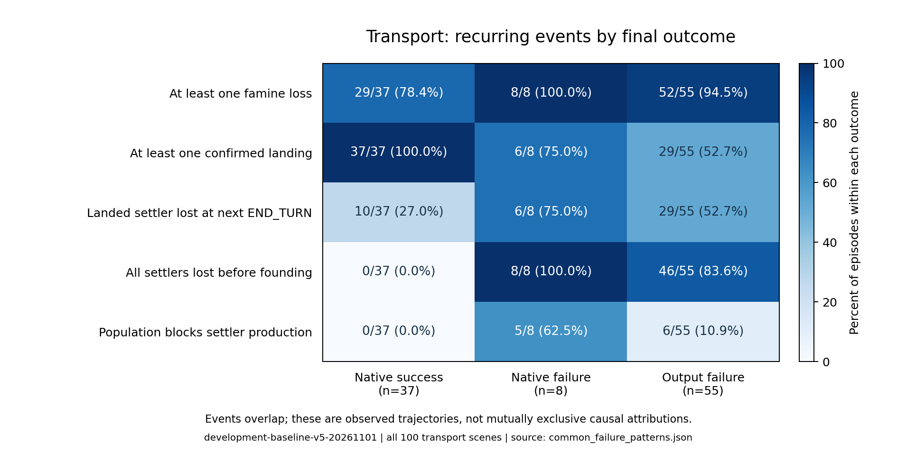

# 失败的共性：局部进展没有转化为最终目标

本分析重新读取正式批次`development-baseline-v5-20261101`的全部100局跨海轨迹，并结合200局输出诊断、唯一建城原生失败及成功参照。保持原来的`thinking/high + 8192 tokens/请求`，没有新增模型调用。这里的“共性”优先指在多局中可重复定位的状态变化；少量案例支持的解释另外标明。

**最值得写进报告的判断是：Agent能执行装载、运输和登陆等局部动作，但在跨回合时没有持续保住建城所需的单位；失去单位后，又反复进入未能恢复建城能力的生产流程。** 输出异常是另一个共同停止环节，两者可以在同一局先后发生。

## 1. 共性需要与成功实例比较

| 可观察现象 | 成功37局 | 原生失败8局 | 输出失败55局 |
|---|---:|---:|---:|
| 至少一次粮荒损失通知 | 29/37 | 8/8 | 52/55 |
| 至少一次实际登陆 | 37/37 | 6/8 | 29/55 |
| 至少一名已登陆移民在随后首次结束回合时损失 | 10/37 | 6/8 | 29/55 |
| 建城前全部移民损失 | 0/37 | 8/8 | 46/55 |
| 收到人口不足、无法生产移民的通知 | 0/37 | 5/8 | 6/55 |

来源：[逐局共性统计](../failure_diagnosis/common_failure_patterns.csv)、[定义与事件证据](../failure_diagnosis/common_failure_patterns.json)。每列分母是对应结局组的全部场景；各行可以重叠，不能相加解释为失败原因占比。



**共性对照图。** 颜色表示对应结局组内的比例，格内同时给出原始计数。粮荒和登陆后损失在成功局中也出现；“全部移民损失”更接近任务所需条件的中断。该表描述实际路径，不能据此证明某种干预的效果。

## 2. 第一类共性：完成了阶段动作，却没有维持后续动作的前提

跨海63个未成功实例中，54个在建城前失去全部移民，占85.7%，包括全部8个原生失败和46个输出失败。这54次首次失去全部移民的转移都发生在`END_TURN`，同时收到粮荒损失通知；发生后的原生回合为第2–5回合，早于第10回合期限。后续已记录状态中均没有再出现我方移民。

这比“粮荒导致失败”更具体：成功局中29/37也发生粮荒，10/37甚至损失过已经登陆的移民，但最后仍有移民完成建城。区别在于，损失是否切断了继续完成目标所需的单位条件，以及该条件之后是否恢复。

35个曾实际登陆的未成功实例，都至少发生过一名已登陆移民在下一次结束回合时损失。Agent已经把单位运到岸上，阶段进度却没有保留到下一步建城。这支持将问题概括为**跨回合的计划衔接与维护约束**。仅统计“是否会登陆”，会漏掉这一共同失效环节。

需要保留两个边界：首先，结束回合可能是恢复移动力所必需的动作，不能直接把等待全部判为错误；其次，输出失败实例在停止时游戏仍未决，已经损失全部移民也不等于研究者有权改判其原生结局。

## 3. 第二类共性：有恢复动作，但没有实际恢复建城能力

在上述54局中，53局在失去全部移民后提交过`produce_Settlers`，11局还购买过生产；到各自记录停止时，没有一局重新出现移民。说明这些轨迹大多尝试了恢复，问题在于恢复流程未产生最终所需的单位。

全部8个跨海原生失败都尝试重新生产移民。它们在失去最后一名移民后，仍提交了7–26次环境动作，中位数15.5次；继续调用API的中位数为23.5次，结束回合中位数为6次。恢复并非只剩最后一步才启动：这8局失去全部移民后的回合为3–5，最终都走到原生期限。相关资源消耗没有在这些轨迹中转化为重新可用的移民。

可写成一个反复出现的行为链：

```text
运输或登陆取得局部进展
          ↓
结束回合时粮荒损失，最终失去全部移民
          ↓
转产移民，部分实例购买生产、调整工作地块或等待
          ↓
记录中没有新移民出现
          ↓
原生到期，或在恢复过程中输出失败
```

这条链的“全部移民损失且未恢复”覆盖54局；其中转产覆盖53局。粮荒前是否登陆、恢复时是否买生产并不相同，不能把所有分支写成每一局都经历过的固定流程。

城市人口是一个具体的恢复障碍：5/8原生失败收到不能生产移民的人口提示。但其中4局的提示首次出现在终局那一步，只有351在提示后还有后续决策。因此，证据支持“恢复前提未满足”在多局出现，**不支持“这5局都无视了明确警告”**。46个输出失败中断的恢复过程也不能一律判成生产必然不可行。

## 4. 第三类共性：把预期中的进展当作已经发生的状态变化

这一点是跨案例的解释性归纳，目前由以下3例直接支持，尚未给全部200局做人工语义标注，不能报告总体发生率。

| 案例 | 模型的预期或简短理由 | 实际执行与反馈 | 共同问题 |
|---|---|---|---|
| 建城349，0048–0055 | 工程改善会让5.6分升到6.0；最后先建城 | 工程切换与等待后评分仍5.6，低分建城立即失败 | 一般游戏知识没有得到任务指标变化的支持，最终目标被弱化 |
| 跨海329，0000–0001 | 选择`plant`是建城 | `plant`是造林，没有创建城市 | 意图与命令语义不一致，没有用新城出现确认进展 |
| 跨海351，0023–0024 | 买过生产、盾数足够，下回合将出现移民 | 前一步已明确提示城市人口不足，下一步仍等待并再次受阻 | 生产投入被当作可完成生产的充分条件 |

共同点可以表述为：**简短理由里预计的效果，没有稳定地由动作后的真实状态检验并修正。** 349的评分保持不变、329没有出现新城、351没有出现移民，分别提供了可以核对的进度证据。这里分析的是保存的简短输出和行为，不推断未保存的内部思考过程。

349的任务说明没有明确公开静态评分矩阵，因此不能称其“明知静态规则仍违背”；329与351则分别呈现动作语义、人口前提方面的具体问题。351的人口警告就在上一条反馈中，不能直接认定增加历史长度就能解决这一现象。

## 5. 共同停止环节：生成额度用尽后没有最终动作

全部200局的74个终止性输出失败，末次逻辑决策的普通请求和纠错请求都以`length`结束、最终内容为空，148次响应的生成量均被记为思考tokens。这是跨任务重复出现的共同停止路径。

但跨海55个输出失败中，有46个此前已经失去全部移民且未恢复。所以报告应同时呈现两个事实：最后停止于输出协议；此前不少轨迹已经存在资源与恢复问题。不能由最后一次空输出推断此前策略没有问题，也不能推断放宽生成额度就会挽救这些实例。本轮继续把8K保留为固定预算条件。

## 6. 可以直接用于报告的概括

> 失败分析表明，Agent的主要过程困难并非仅表现为无法执行某个运输动作，而是局部动作与最终目标之间的条件衔接不足。在63个跨海未成功实例中，54个在建城前因回合结算失去全部移民，后续记录均未观察到移民恢复；其中53个已尝试转产移民。全部8个原生失败均属于这一模式，6个甚至完成过登陆，却未保住建城所需单位。成功参照中也存在粮荒和登陆后单位损失，因此更有解释力的观察是关键执行单位是否持续可用，而非是否出现资源损失。跨案例还可观察到预期效果与真实反馈脱节，但该解释尚需全量语义标注或受控实验进一步验证。输出失败则构成另一共同停止路径，与此前的过程问题可以叠加。

## 7. 针对这些共性，下一步怎样改Agent

建议保持8K，优先补充本局任务状态与反馈核对：持续追踪关键移民和回合结算风险；恢复时同时看生产、人口、增长与期限；用真实单位/城市/评分变化检验预期，避免“已转产、已购买”替代“已恢复”。再补充相关动作的公开语义，并区分格式错误与触顶无输出的纠错提示。摘要由程序从已见观察更新，不增加独立规划调用。

详细方案与单局耗时统计见[固定8K的Agent改进方案](固定8K的Agent改进方案.md)。当前仅提出设计，没有实施或获得改善结果；54局的过程覆盖不等于可挽救数量。

## 证据入口与复现

- [共性指标逐局CSV](../failure_diagnosis/common_failure_patterns.csv)：完整100局跨海的结局、事件标签、关键损失步骤与损失后动作/调用数。
- [指标定义及逐步JSON证据](../failure_diagnosis/common_failure_patterns.json)：登陆、单位损失、人口提示及后续动作的原始决策编号。
- [19例本地完整浏览入口](../failure_diagnosis/index.html)：包含全部9个原生失败和成功参照，可定位原始轨迹与视频。
- [课程报告正文](发展任务_结果分析报告.md)：实验设置、总体统计与共同模式的整合稿。

指标只使用玩家可见的我方单位、城市、载运状态和原生通知。建城消耗移民时同时出现新城，不计作“全部移民损失”；没有返回下一状态的输出失败决策也不计作单位变为零。所有比例均来自完整正式样本，不以19例精选材料代替分母。

服务器项目目录加载`scripts/env.sh`后，运行`python scripts/analyze_common_failure_patterns.py`可重建共性数据；在已有绘图环境运行`python reports/course_report/build_assets.py`可重建对照图。两个入口均只读既有结果，不调用模型。
