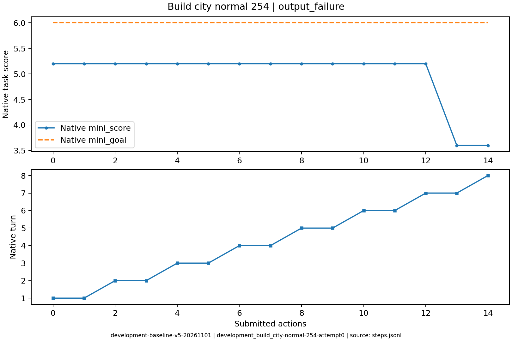
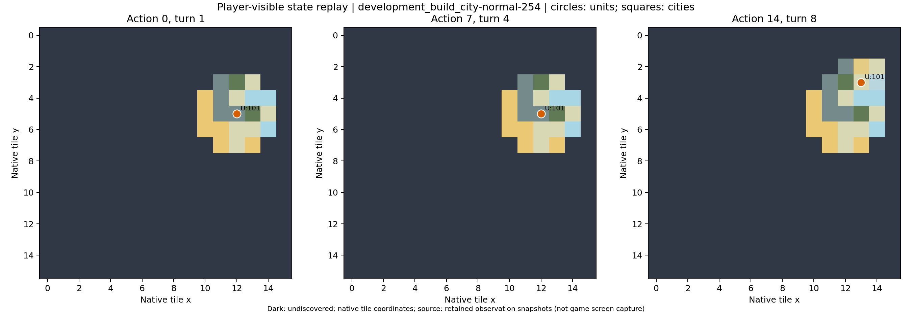

# development_build_city-normal-254

原生状态：-1；运行结束原因：output_failure。
动作 14；调用 16；原始轨迹 `/data/ubuntu-home/jianzheli/University/conginitve_reasoning/civrealm-agent-study/runs/development-baseline-v5-20261101/episodes/development_build_city-normal-254/attempt0`。

失败发生在输出协议阶段，最后一次决策经过一次纠错后仍没有可执行的最终 JSON。
对应请求的 finish_reason 为 length、length；模型思考内容未用作分析证据。

下表摘录关键决策、简短理由、真实状态变化和玩家通知。通知单条最多展示500字，完整连续过程见原始轨迹。

| 决策 | 回合 | 模型选择依据 | 实际动作 | 状态变化 | 玩家通知 |
|---|---:|---|---|---|---|
| development_build_city-normal-254-attempt0-decision0000 | 1 | 当前选址评分5.2低于目标6.0，先向西移动到相邻丘陵，靠近煤和鱼资源，观察新位置评分。 | ['unit', 101, 'goto_3'] | [{'type': 'unit_x', 'id': '101', 'before': 12, 'after': 11}, {'type': 'unit_moves_left', 'id': '101', 'before': 3, 'after': 0}] |  No action probability query needed. |
| development_build_city-normal-254-attempt0-decision0001 | 1 | 当前拓荒者移动力为0，无法移动或建城；先结束回合恢复移动力，下回合再寻找评分≥6.0的建城位置。 | END_TURN | [{'type': 'unit_moves_left', 'id': '101', 'before': 0, 'after': 3}] | Year: 3950 BCE |
| development_build_city-normal-254-attempt0-decision0002 | 2 | 当前选址评分5.2低于目标6.0；向东移动可接近煤资源并继续探索东部未知区域，观察相邻丘陵的评分。 | ['unit', 101, 'goto_4'] | [{'type': 'unit_x', 'id': '101', 'before': 11, 'after': 12}, {'type': 'unit_moves_left', 'id': '101', 'before': 3, 'after': 0}] |  No action probability query needed. |
| development_build_city-normal-254-attempt0-decision0011 | 6 | 拓荒者移动力为0，当前菜单无移动或建城动作；先结束回合恢复移动力，下回合再向东/北探索并寻找评分≥6.0的资源富集点建城。 | END_TURN | [{'type': 'unit_moves_left', 'id': '101', 'before': 0, 'after': 3}] |  No action probability query needed. / Year: 3700 BCE |
| development_build_city-normal-254-attempt0-decision0012 | 7 | 当前评分5.2低于目标，向东北冻土移动以探查更多东侧山地与北部未知地形，寻找资源更丰富且评分≥6.0的建城点。 | ['unit', 101, 'goto_2'] | [{'type': 'unit_x', 'id': '101', 'before': 12, 'after': 13}, {'type': 'unit_y', 'id': '101', 'before': 4, 'after': 3}, {'type': 'unit_moves_left', 'id': '101', 'before': 3, 'after': 0}] |  |
| development_build_city-normal-254-attempt0-decision0013 | 7 | 拓荒者移动力为0，当前无移动/建城动作；先结束回合恢复移动力，下回合再探索高资源点。 | END_TURN | [{'type': 'unit_moves_left', 'id': '101', 'before': 0, 'after': 3}] |  No action probability query needed. / Year: 3650 BCE |
| development_build_city-normal-254-attempt0-decision0014 | 8 | [{'call_id': 'development_build_city-normal-254-attempt0-decision0014-call0', 'error': 'Expecting value: line 1 column 1 (char 0)'}, {'call_id': 'development_build_city-normal-254-attempt0-decision0014-call1', 'error': 'Expecting value: line 1 column 1 (char 0)'}] | 未提交 | [] |  |

状态回放依据 SDK 玩家观察重建；末步地图缺失时明确标注，不补入隐藏地图。
