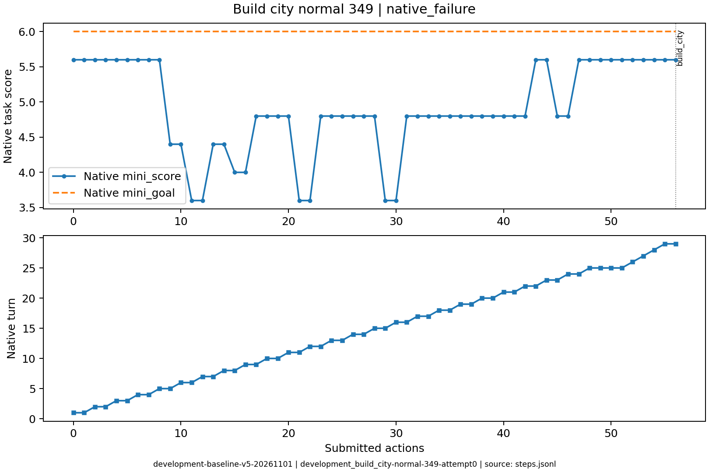

# development_build_city-normal-349

原生状态：0；运行结束原因：native_failure。
动作 56；调用 66；原始轨迹 `/data/ubuntu-home/jianzheli/University/conginitve_reasoning/civrealm-agent-study/runs/development-baseline-v5-20261101/episodes/development_build_city-normal-349/attempt0`。

最后提交了建城动作；终局 mini_score=5.6，mini_goal=6.0，原生反馈判定失败。

下表摘录关键决策、简短理由、真实状态变化和玩家通知。通知单条最多展示500字，完整连续过程见原始轨迹。

| 决策 | 回合 | 模型选择依据 | 实际动作 | 状态变化 | 玩家通知 |
|---|---:|---|---|---|---|
| development_build_city-normal-349-attempt0-decision0000 | 1 | 当前山地候选分5.6低于目标6.0，向东北移动到冻土邻接绿洲的位置，以寻找更高资源评分的建城点。 | ['unit', 101, 'goto_2'] | [{'type': 'unit_x', 'id': '101', 'before': 8, 'after': 9}, {'type': 'unit_y', 'id': '101', 'before': 2, 'after': 1}, {'type': 'unit_moves_left', 'id': '101', 'before': 3, 'after': 0}] |  No action probability query needed. |
| development_build_city-normal-349-attempt0-decision0001 | 1 | 当前定居者移动力已耗尽，需结束回合恢复移动力，以便前往更高评分地点建城。 | END_TURN | [{'type': 'unit_moves_left', 'id': '101', 'before': 0, 'after': 3}] | Year: 3950 BCE |
| development_build_city-normal-349-attempt0-decision0002 | 2 | 当前冻土候选分5.6低于目标6.0；向东移动到邻接绿洲的沙漠格，以寻找更高资源评分建城点。 | ['unit', 101, 'goto_4'] | [{'type': 'unit_x', 'id': '101', 'before': 9, 'after': 10}, {'type': 'unit_moves_left', 'id': '101', 'before': 3, 'after': 0}] |  No action probability query needed. |
| development_build_city-normal-349-attempt0-decision0052 | 26 | 当前城址评分5.6，距目标差0.4且开矿尚未完成。结束回合让矿山继续施工，完工后评分有望升至6.0，再立即建城。 | END_TURN | [] | Year: 2700 BCE |
| development_build_city-normal-349-attempt0-decision0053 | 27 | 当前丘陵城址评分5.6，矿山尚未完工。再结束一回合让开矿推进，若评分升至6.0即可立即建城达标；回合数仍允许。 | END_TURN | [] | Year: 2650 BCE |
| development_build_city-normal-349-attempt0-decision0054 | 28 | 当前丘陵城址评分5.6，距目标仅0.4，且道路施工仍在进行。先结束回合让工程推进，完工后评分有望达到6.0，再立即建城。 | END_TURN | [] | Year: 2600 BCE |
| development_build_city-normal-349-attempt0-decision0055 | 29 | 已邻近回合上限(30)，此前多回合仅等待开矿未果，评分仍为5.6。立即在当前丘陵建城以完成建城目标，避免超时无城。 | ['unit', 101, 'build_city'] | [{'type': 'unit_no_longer_observed', 'id': '101'}, {'type': 'city_appeared', 'id': '102', 'state': {'name': 'Erfurt', 'owner': 0, 'size': 1, 'x': 9, 'y': 3}}] | You have founded Erfurt. / You scored 5.6<6.0, unfortunately this mission failed! /  No action probability query needed. |

状态回放依据 SDK 玩家观察重建；末步地图缺失时明确标注，不补入隐藏地图。
