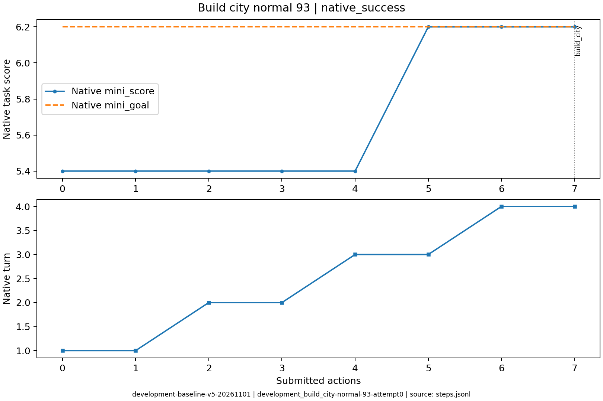

# development_build_city-normal-93

原生状态：1；运行结束原因：native_success。
动作 7；调用 7；原始轨迹 `/data/ubuntu-home/jianzheli/University/conginitve_reasoning/civrealm-agent-study/runs/development-baseline-v5-20261101/episodes/development_build_city-normal-93/attempt0`。

环境确认成功。

下表摘录关键决策、简短理由、真实状态变化和玩家通知。通知单条最多展示500字，完整连续过程见原始轨迹。

| 决策 | 回合 | 模型选择依据 | 实际动作 | 状态变化 | 玩家通知 |
|---|---:|---|---|---|---|
| development_build_city-normal-93-attempt0-decision0000 | 1 | 向北移动，接近已知的皮毛资源点，争取在更富饶的地块建城，使城市评分超过目标。 | ['unit', 101, 'goto_1'] | [{'type': 'unit_y', 'id': '101', 'before': 8, 'after': 7}, {'type': 'unit_moves_left', 'id': '101', 'before': 3, 'after': 0}] |  No action probability query needed. |
| development_build_city-normal-93-attempt0-decision0001 | 1 | 移民已耗尽移动力，当前地块评分5.4低于目标6.2；结束回合恢复移动力，随后前往更富饶的(8,6)冻土地块建城。 | END_TURN | [{'type': 'unit_moves_left', 'id': '101', 'before': 0, 'after': 3}] | Year: 3950 BCE |
| development_build_city-normal-93-attempt0-decision0002 | 2 | 当前地块评分仅5.4，低于目标6.2；向西北移动到已知的皮毛冻土地块，以其丰富资源提高建城评分。 | ['unit', 101, 'goto_0'] | [{'type': 'unit_x', 'id': '101', 'before': 9, 'after': 8}, {'type': 'unit_y', 'id': '101', 'before': 7, 'after': 6}, {'type': 'unit_moves_left', 'id': '101', 'before': 3, 'after': 0}] |  |
| development_build_city-normal-93-attempt0-decision0003 | 2 | 移民移动力已耗尽，当前地块评分5.4低于目标6.2，先结束回合恢复移动力，再前往更高评分地块建城。 | END_TURN | [{'type': 'unit_moves_left', 'id': '101', 'before': 0, 'after': 3}] |  No action probability query needed. / Year: 3900 BCE |
| development_build_city-normal-93-attempt0-decision0004 | 3 | 当前评分5.4仍低于目标6.2，向西北探索未知区域，寻找包含更多资源的建城点。 | ['unit', 101, 'goto_0'] | [{'type': 'unit_x', 'id': '101', 'before': 8, 'after': 7}, {'type': 'unit_y', 'id': '101', 'before': 6, 'after': 5}, {'type': 'unit_moves_left', 'id': '101', 'before': 3, 'after': 0}] |  |
| development_build_city-normal-93-attempt0-decision0005 | 3 | 当前位于(7,5)评分6.2已达标，但移民移动力为0无法建城；结束回合恢复移动力，下回合就地建城。 | END_TURN | [{'type': 'unit_moves_left', 'id': '101', 'before': 0, 'after': 3}] |  No action probability query needed. / Year: 3850 BCE |
| development_build_city-normal-93-attempt0-decision0006 | 4 | 当前位于(7,5)，评分6.2已达到目标6.2，且移动力充足，立即就地建城以达成任务。 | ['unit', 101, 'build_city'] | [{'type': 'unit_no_longer_observed', 'id': '101'}, {'type': 'city_appeared', 'id': '102', 'state': {'name': 'Weimar', 'owner': 0, 'size': 1, 'x': 7, 'y': 5}}] | You have founded Weimar. / You scored 6.2>=6.2, congratulations on the successful completion of this mission! /  No action probability query needed. |

状态回放依据 SDK 玩家观察重建；末步地图缺失时明确标注，不补入隐藏地图。
