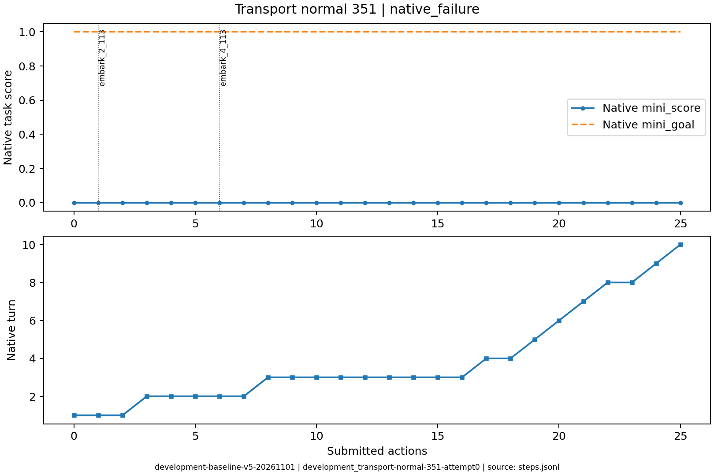

# development_transport-normal-351

原生状态：0；运行结束原因：native_failure。
动作 25；调用 34；原始轨迹 `/data/ubuntu-home/jianzheli/University/conginitve_reasoning/civrealm-agent-study/runs/development-baseline-v5-20261101/episodes/development_transport-normal-351/attempt0`。

到达原生回合期限 10 时，环境判定任务失败。关键步骤需结合地图、移动力与剩余任务阶段阅读。
玩家可见过程证据：装载=True，载人船移动=True，登陆=False，同一单位有序建城链=False。逐阶段步骤见 transport_process.csv；False 表示该项证据未建立。

下表摘录关键决策、简短理由、真实状态变化和玩家通知。通知单条最多展示500字，完整连续过程见原始轨迹。

| 决策 | 回合 | 模型选择依据 | 实际动作 | 状态变化 | 玩家通知 |
|---|---:|---|---|---|---|
| development_transport-normal-351-attempt0-decision0000 | 1 | 让一名移民登上相邻的三列桨船，开始跨海运输，前往新大陆建立城市。 | ['unit', 112, 'embark_2_113'] | [{'type': 'unit_x', 'id': '112', 'before': 2, 'after': 3}, {'type': 'unit_y', 'id': '112', 'before': 5, 'after': 4}, {'type': 'unit_moves_left', 'id': '112', 'before': 3, 'after': 0}, {'type': 'unit_transported', 'id': '112', 'before': False, 'after': True}, {'type': 'unit_transported_by', 'id': '112', 'before': 0, 'after': 113}, {'type': 'unit_occupied', 'id': '113', 'before': False, 'after': True}] |  |
| development_transport-normal-351-attempt0-decision0001 | 1 | 将载有移民的三列桨船向东北移动，靠近已发现的隔海新陆地，为下一步登陆建城做准备。 | ['unit', 113, 'goto_2'] | [{'type': 'unit_x', 'id': '112', 'before': 3, 'after': 4}, {'type': 'unit_y', 'id': '112', 'before': 4, 'after': 3}, {'type': 'unit_x', 'id': '113', 'before': 3, 'after': 4}, {'type': 'unit_y', 'id': '113', 'before': 4, 'after': 3}, {'type': 'unit_moves_left', 'id': '113', 'before': 9, 'after': 6}] |  |
| development_transport-normal-351-attempt0-decision0002 | 1 | 移民112本回合移动力已耗尽，无法登陆。结束回合以恢复其移动力，下回合即可从三列桨船登陆东侧(5,3)草原新岛并建城。 | END_TURN | [{'type': 'unit_no_longer_observed', 'id': '112'}, {'type': 'unit_moves_left', 'id': '113', 'before': 6, 'after': 9}, {'type': 'unit_occupied', 'id': '113', 'before': True, 'after': False}] | Famine feared in Hannover, Settlers lost! / Warning: Famine feared in Hannover. / Year: 3950 BCE |
| development_transport-normal-351-attempt0-decision0005 | 2 | 让移民111登上东侧(3,5)的三列桨船113，准备渡海前往新大陆建城。 | ['unit', 111, 'embark_4_113'] | [{'type': 'unit_x', 'id': '111', 'before': 2, 'after': 3}, {'type': 'unit_moves_left', 'id': '111', 'before': 3, 'after': 0}, {'type': 'unit_transported', 'id': '111', 'before': False, 'after': True}, {'type': 'unit_transported_by', 'id': '111', 'before': 0, 'after': 113}, {'type': 'unit_occupied', 'id': '113', 'before': False, 'after': True}] |  |
| development_transport-normal-351-attempt0-decision0007 | 2 | 三列桨船和移民已在新大陆岸边，但本回合移动力耗尽；结束回合以恢复移动，下回合登陆(5,3)并建城。 | END_TURN | [{'type': 'unit_no_longer_observed', 'id': '111'}, {'type': 'unit_moves_left', 'id': '113', 'before': 0, 'after': 9}, {'type': 'unit_occupied', 'id': '113', 'before': True, 'after': False}] |  No action probability query needed. / Famine feared in Hannover, Settlers lost! / Year: 3900 BCE |
| development_transport-normal-351-attempt0-decision0021 | 7 | 尚无移民，汉诺威还需约3回合完成生产；结束回合推进，待移民出现后立即登船驶向新大陆建城。 | END_TURN | [] | Year: 3650 BCE |
| development_transport-normal-351-attempt0-decision0022 | 8 | 紧急购买汉诺威当前生产（定居者），立即获得移民以便登船赶赴新大陆，避免错过回合期限。 | ['city', 110, 'city_buy_production'] | [] | You bought Settlers in Hannover. |
| development_transport-normal-351-attempt0-decision0023 | 8 | 城中唯一可控单位是三列桨战船(113)，尚无移民可登船。结束回合让汉诺威完成定居者生产，下回合即可让定居者登上战船出海建城。 | END_TURN | [] | Hannover can't build Settlers yet. (city size: 1, unit population cost: 1) / Year: 3600 BCE |
| development_transport-normal-351-attempt0-decision0024 | 9 | 城内盾牌45、下回合即可完工生产。三列桨战船停泊城中待命，结束回合让生产完成；若产出移民即在城内登船，随后驶向新大陆建城。 | END_TURN | [] | Hannover can't build Settlers yet. (city size: 1, unit population cost: 1) / Year: 3550 BCE / You scored 0<1, unfortunately this mission failed! |

状态回放依据 SDK 玩家观察重建；末步地图缺失时明确标注，不补入隐藏地图。
