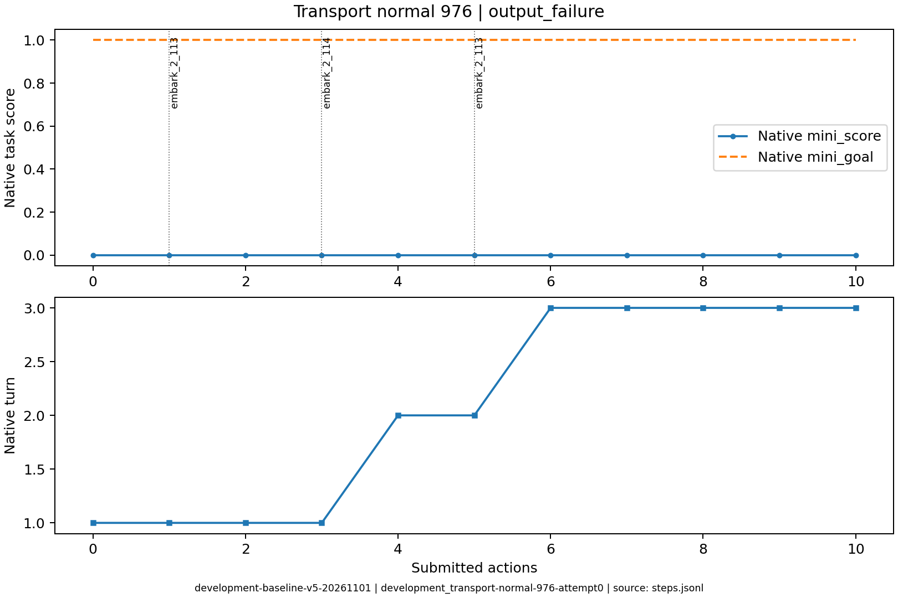
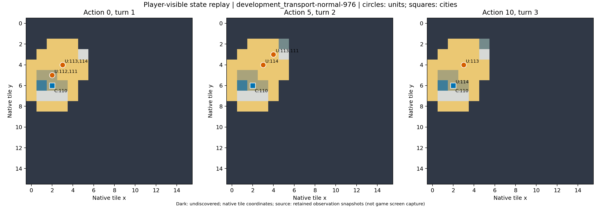

# development_transport-normal-976

原生状态：-1；运行结束原因：output_failure。
动作 10；调用 15；原始轨迹 `/data/ubuntu-home/jianzheli/University/conginitve_reasoning/civrealm-agent-study/runs/development-baseline-v5-20261101/episodes/development_transport-normal-976/attempt0`。

失败发生在输出协议阶段，最后一次决策经过一次纠错后仍没有可执行的最终 JSON。
对应请求的 finish_reason 为 length、length；模型思考内容未用作分析证据。
玩家可见过程证据：装载=True，载人船移动=True，登陆=False，同一单位有序建城链=False。逐阶段步骤见 transport_process.csv；False 表示该项证据未建立。

下表摘录关键决策、简短理由、真实状态变化和玩家通知。通知单条最多展示500字，完整连续过程见原始轨迹。

| 决策 | 回合 | 模型选择依据 | 实际动作 | 状态变化 | 玩家通知 |
|---|---:|---|---|---|---|
| development_transport-normal-976-attempt0-decision0000 | 1 | 让一队移民登上三列桨船，准备渡海前往新大陆建城。 | ['unit', 112, 'embark_2_113'] | [{'type': 'unit_x', 'id': '112', 'before': 2, 'after': 3}, {'type': 'unit_y', 'id': '112', 'before': 5, 'after': 4}, {'type': 'unit_moves_left', 'id': '112', 'before': 3, 'after': 0}, {'type': 'unit_transported', 'id': '112', 'before': False, 'after': True}, {'type': 'unit_transported_by', 'id': '112', 'before': 0, 'after': 113}, {'type': 'unit_occupied', 'id': '113', 'before': False, 'after': True}] |  |
| development_transport-normal-976-attempt0-decision0001 | 1 | 将已载移民的三列桨船向东北移动到可见新大陆旁的海域，靠近可登陆点。 | ['unit', 113, 'goto_2'] | [{'type': 'unit_x', 'id': '112', 'before': 3, 'after': 4}, {'type': 'unit_y', 'id': '112', 'before': 4, 'after': 3}, {'type': 'unit_x', 'id': '113', 'before': 3, 'after': 4}, {'type': 'unit_y', 'id': '113', 'before': 4, 'after': 3}, {'type': 'unit_moves_left', 'id': '113', 'before': 9, 'after': 6}] |  |
| development_transport-normal-976-attempt0-decision0002 | 1 | 让移民111登上相邻的114号三列桨船，提前装船以便下回合直接登陆新大陆。 | ['unit', 111, 'embark_2_114'] | [{'type': 'unit_x', 'id': '111', 'before': 2, 'after': 3}, {'type': 'unit_y', 'id': '111', 'before': 5, 'after': 4}, {'type': 'unit_moves_left', 'id': '111', 'before': 3, 'after': 0}, {'type': 'unit_occupied', 'id': '114', 'before': False, 'after': True}, {'type': 'unit_transported', 'id': '111', 'before': False, 'after': True}, {'type': 'unit_transported_by', 'id': '111', 'before': 0, 'after': 114}] |  |
| development_transport-normal-976-attempt0-decision0003 | 1 | 两艘三列桨船已载着移民抵达新大陆旁海域（113在(4,3)，东侧(5,3)为草地），但移民本回合移动力已耗尽。结束回合让移民恢复移动力，下回合登陆并建城。 | END_TURN | [{'type': 'unit_no_longer_observed', 'id': '112'}, {'type': 'unit_moves_left', 'id': '111', 'before': 0, 'after': 3}, {'type': 'unit_moves_left', 'id': '113', 'before': 6, 'after': 9}, {'type': 'unit_occupied', 'id': '113', 'before': True, 'after': False}] | Famine feared in Hannover, Settlers lost! / Warning: Famine feared in Hannover. / Year: 3950 BCE |
| development_transport-normal-976-attempt0-decision0004 | 2 | 让移民111换乘相邻的113号三列桨船，靠近东侧新大陆草地；下回合可登陆并建城。 | ['unit', 111, 'embark_2_113'] | [{'type': 'unit_x', 'id': '111', 'before': 3, 'after': 4}, {'type': 'unit_y', 'id': '111', 'before': 4, 'after': 3}, {'type': 'unit_moves_left', 'id': '111', 'before': 3, 'after': 0}, {'type': 'unit_transported_by', 'id': '111', 'before': 114, 'after': 113}, {'type': 'unit_occupied', 'id': '113', 'before': False, 'after': True}] |  |
| development_transport-normal-976-attempt0-decision0005 | 2 | 移民已载于113号船且紧邻东侧草地，但其本回合移动力耗尽。结束回合以恢复移动力，下回合即可登陆建城。 | END_TURN | [{'type': 'unit_no_longer_observed', 'id': '111'}, {'type': 'unit_occupied', 'id': '114', 'before': True, 'after': False}, {'type': 'unit_occupied', 'id': '113', 'before': True, 'after': False}] | Famine feared in Hannover, Settlers lost! / Year: 3900 BCE |
| development_transport-normal-976-attempt0-decision0007 | 3 | 114号三列桨船向南靠近哈诺威，准备接运新生产的移民并可能入城加速生产。 | ['unit', 114, 'goto_6'] | [{'type': 'unit_y', 'id': '114', 'before': 4, 'after': 5}, {'type': 'unit_moves_left', 'id': '114', 'before': 9, 'after': 6}] |  |
| development_transport-normal-976-attempt0-decision0008 | 3 | 让114号三列桨船先驶入哈诺威，准备随后解散以加速移民生产，同时为运输保留113号船。 | ['unit', 114, 'goto_5'] | [{'type': 'unit_x', 'id': '114', 'before': 3, 'after': 2}, {'type': 'unit_y', 'id': '114', 'before': 5, 'after': 6}, {'type': 'unit_moves_left', 'id': '114', 'before': 6, 'after': 3}] |  |
| development_transport-normal-976-attempt0-decision0009 | 3 | 将113号三列桨船驶向哈诺威，准备入城解散以加速移民生产。 | ['unit', 113, 'goto_5'] | [{'type': 'unit_x', 'id': '113', 'before': 4, 'after': 3}, {'type': 'unit_y', 'id': '113', 'before': 3, 'after': 4}, {'type': 'unit_moves_left', 'id': '113', 'before': 9, 'after': 6}] |  |
| development_transport-normal-976-attempt0-decision0010 | 3 | [{'call_id': 'development_transport-normal-976-attempt0-decision0010-call0', 'error': 'Expecting value: line 1 column 1 (char 0)'}, {'call_id': 'development_transport-normal-976-attempt0-decision0010-call1', 'error': 'Expecting value: line 1 column 1 (char 0)'}] | 未提交 | [] |  |

状态回放依据 SDK 玩家观察重建；末步地图缺失时明确标注，不补入隐藏地图。
