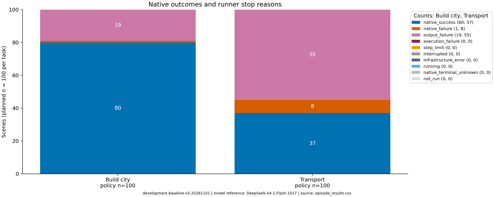
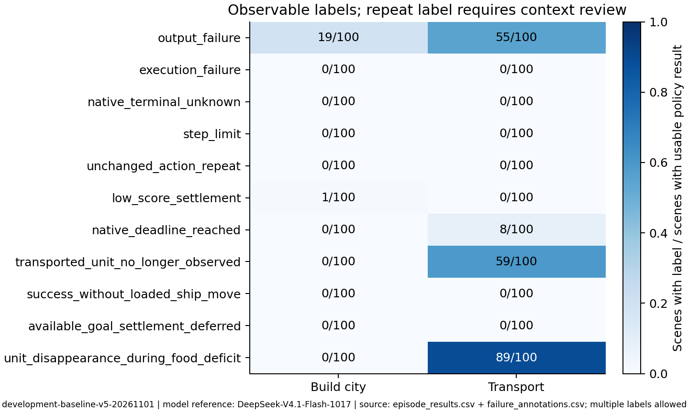

# 两个发展任务第一轮分析

生成时间：2026-11-01 09:36:08（北京时间）。运行 `development-baseline-v5-20261101`。
当前有策略结果 200/200；已完成全部预定场景。

模型参考：DeepSeek-V4.1-Flash-1017；实际返回标识：deepseek-flash。
thinking/high，8192 输出 tokens，最近 4 次动作历史，2000 环境动作宽停止线。

| 任务 | 预定 | 有策略结果 | 已确认成功 | 确认成功比例（分母为策略场景） |
|---|---:|---:|---:|---|
| development_build_city | 100 | 100 | 80 | 80.0% |
| development_transport | 100 | 100 | 37 | 37.0% |

全部尝试共 5157 次 API 请求；已知用量费用估算 21.452895 USD；费用未知请求 11 次。费用估算不是供应商账单。
其中正式版本共 2726 次请求，已知费用 10.444878 USD，费用未知 0 次；其余为被替换版本的准备开销。

按场景统计；输出失败、执行失败与步数截断计入策略分母，基础设施故障及未运行单列。不同任务的原始分数不合并求均值。token 用量有未知请求时，表中总量留空，_known 字段保留已知小计。

跨海任务的 Lua 在我方建城事件直接设置成功，mini_score 可能仍为 0。原生成功与实际装载、运输、登陆过程分别展示。

正式策略结果只来自当前 run_id。准备期间被替换版本的尝试列在 superseded_attempts.csv，不计入当前场景表现，但其请求与费用计入全部开销。

v4 的通知累计游标与 SDK 每回合清空列表不匹配，遗漏部分玩家通知；v5 在独立 SDK 中保留跨回合通知，所有受影响实例按修复后的基础配置重新采集。旧轨迹原样保留，没有用其缺失通知作因果判断。

完整玩家可见状态回放视频 200 个，逐决策从真实初始状态及轨迹重建，非游戏屏幕录制；服务器路径与帧数见 video_index.csv。视频只显示玩家已知地图，完整请求和事件见对应 steps.jsonl。

SDK 已终止但小游戏胜负仍未知的场景单列为 native_terminal_unknown，不改写原生状态，也不记作原生失败。它们计入已执行策略的场景数，但没有得到成功确认；原始停止标签另保留在 recorded_stop_reason 中。

问题标签记录直接可见的停止原因；unchanged_action_repeat 仅表示动作与任务相关状态连续相同，仍需结合上下文判断其合理性。标签不是已经验证的因果解释。

代表案例共 6 个：先按常见失败类型分组，在最多两类中选择动作数居中的实例，成功参照也选动作数居中的实例；只有一种失败类型时取两个不同实例。缺少相应结局时不补造。见 case_index.csv。

跨海原生成功的 37 局中，37 局观察到了同一单位按装载（或初始已载运）、载人船移动、登陆、在登陆后位置建城的有序证据链。没有建立完整证据链时，不自动改写原生判定；逐局阶段与证据步骤见 transport_process.csv。玩家可见记录中的运输链也不等于隐藏全地图上的大陆归属证明。

正式版本中，573/2726 次有完成原因记录的请求以 length 结束；其中 565 次最终 content 为空。逐请求证据保留在各局 api_calls.jsonl；这与游戏原生失败分开统计。

| 任务 | 原生失败 | 输出失败 | 原生胜负未知 | 动作总数 | 调用中位数 | 动作中位数 | 耗时中位数（秒） |
|---|---:|---:|---:|---:|---:|---:|---:|
| development_build_city | 1 | 19 | 0 | 1012 | 7.0 | 7.0 | 109.5 |
| development_transport | 8 | 55 | 0 | 1139 | 12.0 | 9.0 | 294.5 |

development_build_city 的可观察现象为：低于目标分数时建城并原生失败：1/100 局。标签可重叠，粮食赤字同现与单位消失本身不证明具体因果机制。

development_transport 的可观察现象为：结束回合时粮食赤字与我方单位消失同现：89/100 局；运输中的我方单位随后不再可见：59/100 局。标签可重叠，粮食赤字同现与单位消失本身不证明具体因果机制。

其中 554 次请求的 completion_tokens 与 reasoning_tokens 都为 8192，最终 content 为空，与生成预算耗尽的解释一致。是否调整思考强度或输出预算能改善端到端成功率，仍需独立干预验证，本轮没有进行该比较。

后续待验证原因应从具体轨迹提出：对到期或关键单位损失案例，区分剩余回合判断、路线选择和城市资源维护；建城349还涉及静态任务评分与实时产出的区别，以及最后选择是否仍符合分数目标。案例中的观察、理由和后继状态只支持该过程的解释，不能替代干预试验。当前汇总仅覆盖本次两个 normal 发展任务。

具体轨迹的补充解释见 [案例复核](review_notes.md)，该文件注明复核者、场景和证据步骤。

复现：服务器中 source scripts/env.sh 后运行 python -m civstudy.analysis。表格、静态图和案例均从保留轨迹生成。

图表工作流参考 Kassis, T., Agarwal, V., He, Y., Patel, D., & Brueckner, A. M. (2026). Scientific Agent Skills: A Library of Procedural Knowledge for Research Agents. [arXiv:2609.00065](https://doi.org/10.48550/arXiv.2609.00065)；本报告未使用示意数据。
