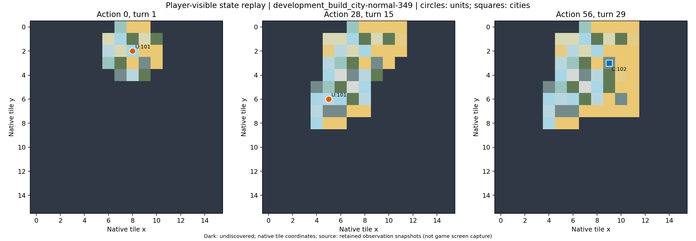

# development_build_city-normal-349：原生失败

唯一建城原生失败：反复探索、误把工程增产当评分提高，最后低于目标建城。

原生成功=False；停止原因=native_failure；动作=56；调用=66；耗时=1371.4秒。

[完整状态回放](../../../../runs/local_review/development-baseline-v5-20261101/episodes/development_build_city-normal-349/attempt0/player_visible_replay.mp4) · [本地交互时间线](index.html) · [逐步结构化摘要](timeline.json) · [全部请求与输出](../../../../runs/local_review/development-baseline-v5-20261101/episodes/development_build_city-normal-349/attempt0/api_calls.jsonl) · [原始轨迹](../../../../runs/local_review/development-baseline-v5-20261101/episodes/development_build_city-normal-349/attempt0/steps.jsonl)

回放依据真实玩家观察重建，并非游戏屏幕录制。原始JSON中的服务器路径保持不变，本地映射见本材料索引。

| 决策 | 回合 | 实际动作 | 模型简短理由 | 原生通知/输出错误 |
|---|---:|---|---|---|
| 0000 | 1 | ['unit', 101, 'goto_2'] | 当前山地候选分5.6低于目标6.0，向东北移动到冻土邻接绿洲的位置，以寻找更高资源评分的建城点。 |  No action probability query needed. |
| 0001 | 1 | END_TURN | 当前定居者移动力已耗尽，需结束回合恢复移动力，以便前往更高评分地点建城。 | Year: 3950 BCE |
| 0002 | 2 | ['unit', 101, 'goto_4'] | 当前冻土候选分5.6低于目标6.0；向东移动到邻接绿洲的沙漠格，以寻找更高资源评分建城点。 |  No action probability query needed. |
| 0003 | 2 | END_TURN | 当前定居者移动力为0，无法继续移动或建城；先结束回合恢复移动力，再前往更高评分地点建城。 | Year: 3900 BCE |
| 0004 | 3 | ['unit', 101, 'goto_3'] | 当前绿洲城址评分仅5.6，未达6.0；先向西移动深入内陆，寻找周边资源更丰富的建城点。 |  |
| 0005 | 3 | END_TURN | 当前定居者移动力为0，无法移动或建城；结束回合恢复移动力，再寻找评分≥6.0的城址。 |  No action probability query needed. / Year: 3850 BCE |
| 0006 | 4 | ['unit', 101, 'goto_3'] | 当前冻土、东侧绿洲和西南山地评分均仅5.6，未达6.0；向西探索未考察的沙漠格，寻找更高资源城址。 |  |
| 0007 | 4 | END_TURN | 定居者移动力为0，当前无法移动或建城；先结束回合恢复移动力，下回合继续寻找评分≥6.0的城址。 |  No action probability query needed. / Year: 3800 BCE |
| 0008 | 5 | ['unit', 101, 'goto_5'] | 当前城址评分5.6未达6.0；向西南移动到冻土，靠近未探索的南部内陆，以寻找资源更丰富、评分≥6.0的城址。 |  No action probability query needed. |
| 0009 | 5 | END_TURN | 定居者当前移动力为0，无法移动或建城；先结束回合恢复移动力，下回合继续寻找评分≥6.0的资源丰富城址。 | Year: 3750 BCE |
| 0010 | 6 | ['unit', 101, 'goto_3'] | 当前城址评分仅4.4，需继续探索资源更丰富处；向西移动可揭示大片未探索陆地，寻找评分≥6.0的城址。 |  |
| 0011 | 6 | END_TURN | 定居者当前移动力为0，无法移动或建城；先结束回合恢复移动力，下回合返回东侧评分较高的区域继续寻找≥6.0城址。 |  No action probability query needed. / Year: 3700 BCE |
| 0012 | 7 | ['unit', 101, 'goto_7'] | 当前城址仅3.6分，需继续探索南部未知区域；向东南移动至沙漠可保留2点移动力，便于继续向丘陵/南部寻找评分≥6.0的城址。 |  |
| 0013 | 7 | END_TURN | 定居者移动力为0，无法移动或建城；先结束回合恢复移动力，下回合继续向东南/东部高评分区域探索，寻找≥6.0的城址。 |  No action probability query needed. / Year: 3650 BCE |
| 0014 | 8 | ['unit', 101, 'goto_5'] | 当前城址仅4.4，低于目标6.0；已知东北区域最高仅5.6。向西南草原移动可探查大片未探索陆地，寻找资源更丰富城址。 |  |
| 0015 | 8 | END_TURN | 定居者当前移动力为0，无法移动或建城；先结束回合恢复移动力，下回合继续前往已知较高评分区域寻找≥6.0城址。 |  No action probability query needed. / Year: 3600 BCE |
| 0016 | 9 | ['unit', 101, 'goto_7'] | 当前城址评分仅4.0，低于目标6.0；向东南移动到草原可保留移动力，并探查南部和东部未探索区域，寻找更高评分城址。 |  No action probability query needed. |
| 0017 | 9 | END_TURN | 定居者移动力为0，当前无法移动或建城；先结束回合恢复移动力，下回合继续探查更高评分城址。 | Year: 3550 BCE |
| 0018 | 10 | ['unit', 101, 'goto_6'] | 当前城址评分4.8低于目标6.0。向南进入未探索陆地，寻找更高资源评分城址；暂不建城以免提前结束任务。 |  |
| 0019 | 10 | END_TURN | 定居者当前移动力为0，无法移动或建城；先结束回合恢复移动力，下回合继续向北前往已知评分5.6的区域寻找≥6.0城址。 |  No action probability query needed. / Year: 3500 BCE |
| 0020 | 11 | ['unit', 101, 'goto_0'] | 当前城址仅4.8，低于目标6.0。向西北移动至沙漠，保留移动力并接近西部未探索区域，继续寻找更高评分城址。 |  |
| 0021 | 11 | END_TURN | 定居者移动力为0，当前无法移动或建城。先结束回合恢复移动力，下回合向已知评分较高的北部绿洲/海岸区域探索，寻找≥6.0城址。 |  No action probability query needed. / Year: 3450 BCE |
| 0022 | 12 | ['unit', 101, 'goto_5'] | 当前城址评分仅3.6，远低于目标6.0。向西南进入丛林并探索未揭示的南部/西部陆地，寻找资源更丰富的城址；暂不建城以免提前失败。 |  |
| 0023 | 12 | END_TURN | 定居者当前移动力为0，无法移动或建城；先结束回合恢复移动力，下回合向北探索已知评分5.6的绿洲区域，寻找评分≥6.0的城址。 |  No action probability query needed. / Year: 3400 BCE |
| 0024 | 13 | ['unit', 101, 'goto_6'] | 当前城址评分4.8低于目标6.0；向南进入丘陵，探索靠近海岸的未知区域，寻找可能含海洋资源且评分≥6.0的城址。 |  |
| 0025 | 13 | END_TURN | 定居者移动力为0，当前评分4.8低于目标6.0；先结束回合恢复移动力，下回合向已知评分较高的北部湖岸/绿洲区域探索，寻找≥6.0的城址。 |  No action probability query needed. / Year: 3350 BCE |
| 0026 | 14 | ['unit', 101, 'goto_1'] | 当前城址评分4.8低于目标6.0，不能建城。向北进入丛林，向已知评分5.6的东北高资源区域前进，保留2点移动力继续靠近候选城址。 |  |
| 0027 | 14 | END_TURN | 定居者当前移动力为0，无法移动或建城；先结束回合恢复移动力，下回合继续寻找评分≥6.0的城址。 |  No action probability query needed. / Year: 3300 BCE |
| 0028 | 15 | ['unit', 101, 'goto_2'] | 当前评分4.8低于目标6.0，不能建城；向东北移动前往已知高分区，继续寻找评分≥6.0的城址。 | [{'call_id': 'development_build_city-normal-349-attempt0-decision0028-call0', 'error': 'Expecting value: line 1 column 1 (char 0)'}] |
| 0029 | 15 | END_TURN | 定居者移动力为0，当前评分3.6远低于目标6.0，无法移动或建城；先结束回合恢复移动力，下回合继续向已知高分区探索。 |  No action probability query needed. / Year: 3250 BCE |
| 0030 | 16 | ['unit', 101, 'goto_4'] | 当前评分3.6低于目标6.0，不能建城；向东进入草地，靠近已知评分5.6的东北高资源区(8,2)，继续寻找≥6.0城址。 | [{'call_id': 'development_build_city-normal-349-attempt0-decision0030-call0', 'error': 'Expecting value: line 1 column 1 (char 0)'}] |
| 0031 | 16 | END_TURN | 定居者移动力为0，无法移动或建城；当前评分4.8低于目标6.0，先结束回合恢复移动力，下回合继续寻找≥6.0城址。 |  No action probability query needed. / Year: 3200 BCE |
| 0032 | 17 | ['unit', 101, 'goto_4'] | 当前评分4.8低于目标6.0，不能建城；向东移动进入未探索的东部区域，寻找评分≥6.0的城址。 | [{'call_id': 'development_build_city-normal-349-attempt0-decision0032-call0', 'error': 'Expecting value: line 1 column 1 (char 0)'}] |
| 0033 | 17 | END_TURN | 当前定居者移动力为0，评分4.8低于目标6.0，无法建城；先结束回合恢复移动力，下回合继续向高资源区探索。 |  No action probability query needed. / Year: 3150 BCE |
| 0034 | 18 | ['unit', 101, 'goto_4'] | 当前评分4.8低于目标6.0，不能建城；向东进入沙漠未探索区，继续寻找评分≥6.0的城址。 |  |
| 0035 | 18 | END_TURN | 定居者移动力为0，当前城址评分4.8低于目标6.0，不能建城；先结束回合恢复移动力，下回合继续寻找评分≥6.0的城址。 |  No action probability query needed. / Year: 3100 BCE |
| 0036 | 19 | ['unit', 101, 'goto_7'] | 当前评分4.8低于目标6.0，不能建城；向东南丘陵移动，探索尚未揭开且可能连通南部陆地的区域。 |  |
| 0037 | 19 | END_TURN | 定居者移动力已耗尽，当前地格评分4.8低于目标6.0且无可建城动作；结束回合恢复移动力，下回合继续前往更高评分地点。 |  No action probability query needed. / Year: 3050 BCE |
| 0038 | 20 | ['unit', 101, 'goto_0'] | 当前格(10,6)评分4.8低于目标6.0，无法建城；仅西北可通行，返回(9,5)继续向西北高分区（曾达5.6）及未探索陆地寻找≥6.0的城址。 |  No action probability query needed. |
| 0039 | 20 | END_TURN | 定居者移动力为0且无可移动/建城动作；当前评分4.8低于目标6.0，不能建城。结束回合恢复移动力，随后继续寻找评分≥6.0的城址。 | Year: 3000 BCE |
| 0040 | 21 | ['unit', 101, 'goto_0'] | 当前(9,5)评分4.8低于目标6.0；向西北进入(8,4)丛林，朝西侧未探索陆地推进，寻找更高资源城址。 |  |
| 0041 | 21 | END_TURN | 当前(8,4)评分4.8低于目标6.0，且定居者移动力为0，菜单中无建城或移动动作。结束回合以恢复移动力，下回合继续寻找评分≥6.0的城址。 |  No action probability query needed. / Year: 2950 BCE |
| 0042 | 22 | ['unit', 101, 'goto_2'] | 当前(8,4)评分4.8不足6.0。东北(9,3)丘陵靠近(10,1)绿洲且尚未测评分，先移动至该高潜力城址评估资源。 |  No action probability query needed. |
| 0043 | 22 | END_TURN | 当前(9,3)评分5.6低于目标6.0，且定居者移动力为0；结束回合恢复移动力，下回合继续寻找评分≥6.0的城址。 | Year: 2900 BCE |
| 0044 | 23 | ['unit', 101, 'goto_6'] | 当前(9,3)评分5.6低于目标6.0；向南移动至未评估的(9,4)沙漠，检查其城址资源评分，若≥6.0则建城。 |  No action probability query needed. |
| 0045 | 23 | END_TURN | 当前(9,4)评分4.8不足6.0，且定居者移动力为0，菜单无移动或建城动作。结束回合恢复移动力，下回合继续寻找评分≥6.0的城址。 | Year: 2850 BCE |
| 0046 | 24 | ['unit', 101, 'goto_1'] | 当前(9,4)评分4.8不足目标6.0。北移至已知高分城址(9,3)，其基础评分5.6；下回合在建路提升产出后再评估建城。 | [{'call_id': 'development_build_city-normal-349-attempt0-decision0046-call0', 'error': 'Expecting value: line 1 column 1 (char 0)'}] |
| 0047 | 24 | END_TURN | 定居者当前移动力为0，无法移动或建城；且(9,3)评分5.6低于目标6.0。结束回合以恢复移动力，下回合继续寻找评分≥6.0的城址。 |  No action probability query needed. / Year: 2800 BCE |
| 0048 | 25 | ['unit', 101, 'build_road'] | 当前(9,3)评分5.6，需+0.4达6.0。在丘陵建路可增加1点贸易产出，使评分升至6.0，完成后再建城；剩余回合足够。 | [{'call_id': 'development_build_city-normal-349-attempt0-decision0048-call0', 'error': 'Expecting value: line 1 column 1 (char 0)'}] |
| 0049 | 25 | ['unit', 101, 'mine'] | 当前(9,3)评分5.6，距目标差0.4。丘陵开矿可增加1点产出，预计候选分升至6.0；完工后再建城，避免低于目标。 |  |
| 0050 | 25 | ['unit', 101, 'build_road'] | 当前丘陵评分5.6，距目标6.0仅差0.4。先修建道路以增加贸易产出、提高城址评分，完成后立即建城；剩余回合足够。 |  |
| 0051 | 25 | END_TURN | 当前(9,3)评分5.6，已在丘陵开矿；结束回合让工程推进，待矿山完工评分升至6.0后再建城。 | Year: 2750 BCE |
| 0052 | 26 | END_TURN | 当前城址评分5.6，距目标差0.4且开矿尚未完成。结束回合让矿山继续施工，完工后评分有望升至6.0，再立即建城。 | Year: 2700 BCE |
| 0053 | 27 | END_TURN | 当前丘陵城址评分5.6，矿山尚未完工。再结束一回合让开矿推进，若评分升至6.0即可立即建城达标；回合数仍允许。 | Year: 2650 BCE |
| 0054 | 28 | END_TURN | 当前丘陵城址评分5.6，距目标仅0.4，且道路施工仍在进行。先结束回合让工程推进，完工后评分有望达到6.0，再立即建城。 | Year: 2600 BCE |
| 0055 | 29 | ['unit', 101, 'build_city'] | 已邻近回合上限(30)，此前多回合仅等待开矿未果，评分仍为5.6。立即在当前丘陵建城以完成建城目标，避免超时无城。 | You have founded Erfurt. / You scored 5.6<6.0, unfortunately this mission failed! /  No action probability query needed. |
