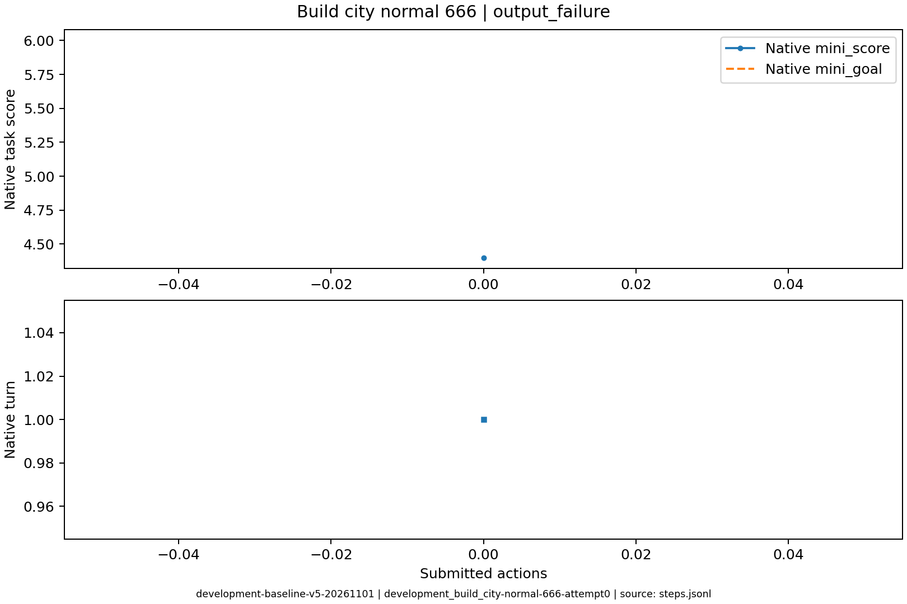
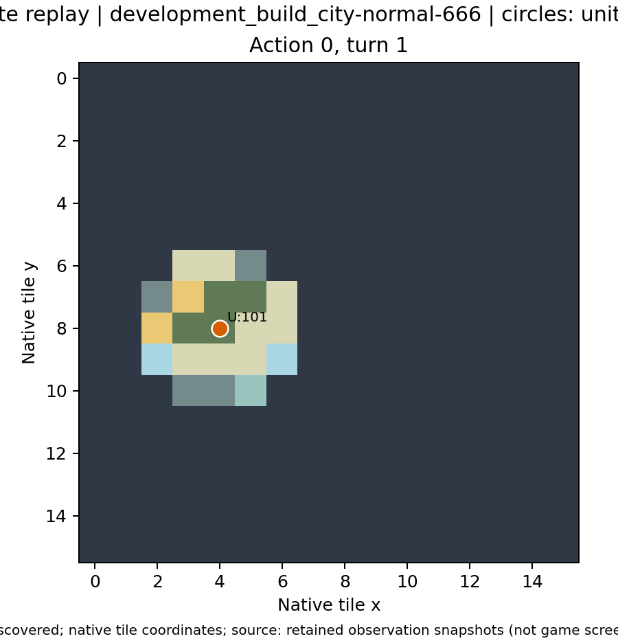

# development_build_city-normal-666：输出失败

零环境动作即停止，隔离展示输出问题不能被归因于错误游戏操作。

原生成功=False；停止原因=output_failure；动作=0；调用=2；耗时=101.1秒。

[完整状态回放](../../../../runs/local_review/development-baseline-v5-20261101/episodes/development_build_city-normal-666/attempt0/player_visible_replay.mp4) · [本地交互时间线](index.html) · [逐步结构化摘要](timeline.json) · [全部请求与输出](../../../../runs/local_review/development-baseline-v5-20261101/episodes/development_build_city-normal-666/attempt0/api_calls.jsonl) · [原始轨迹](../../../../runs/local_review/development-baseline-v5-20261101/episodes/development_build_city-normal-666/attempt0/steps.jsonl)

回放依据真实玩家观察重建，并非游戏屏幕录制。原始JSON中的服务器路径保持不变，本地映射见本材料索引。

| 决策 | 回合 | 实际动作 | 模型简短理由 | 原生通知/输出错误 |
|---|---:|---|---|---|
| 0000 | 1 | 未提交动作 |  | [{'call_id': 'development_build_city-normal-666-attempt0-decision0000-call0', 'error': 'Expecting value: line 1 column 1 (char 0)'}, {'call_id': 'development_build_city-normal-666-attempt0-decision0000-call1', 'error': 'Expecting value: line 1 column 1 (char 0)'}] |
