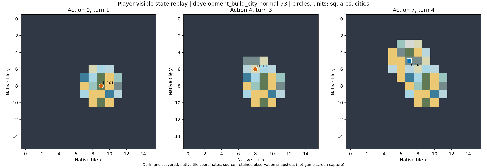

# development_build_city-normal-93：成功参照

达到目标后因移动力为零合法等待，再就地建城；避免将合理等待误标为拖延。

原生成功=True；停止原因=native_success；动作=7；调用=7；耗时=76.4秒。

[完整状态回放](../../../../runs/local_review/development-baseline-v5-20261101/episodes/development_build_city-normal-93/attempt0/player_visible_replay.mp4) · [本地交互时间线](index.html) · [逐步结构化摘要](timeline.json) · [全部请求与输出](../../../../runs/local_review/development-baseline-v5-20261101/episodes/development_build_city-normal-93/attempt0/api_calls.jsonl) · [原始轨迹](../../../../runs/local_review/development-baseline-v5-20261101/episodes/development_build_city-normal-93/attempt0/steps.jsonl)

回放依据真实玩家观察重建，并非游戏屏幕录制。原始JSON中的服务器路径保持不变，本地映射见本材料索引。

| 决策 | 回合 | 实际动作 | 模型简短理由 | 原生通知/输出错误 |
|---|---:|---|---|---|
| 0000 | 1 | ['unit', 101, 'goto_1'] | 向北移动，接近已知的皮毛资源点，争取在更富饶的地块建城，使城市评分超过目标。 |  No action probability query needed. |
| 0001 | 1 | END_TURN | 移民已耗尽移动力，当前地块评分5.4低于目标6.2；结束回合恢复移动力，随后前往更富饶的(8,6)冻土地块建城。 | Year: 3950 BCE |
| 0002 | 2 | ['unit', 101, 'goto_0'] | 当前地块评分仅5.4，低于目标6.2；向西北移动到已知的皮毛冻土地块，以其丰富资源提高建城评分。 |  |
| 0003 | 2 | END_TURN | 移民移动力已耗尽，当前地块评分5.4低于目标6.2，先结束回合恢复移动力，再前往更高评分地块建城。 |  No action probability query needed. / Year: 3900 BCE |
| 0004 | 3 | ['unit', 101, 'goto_0'] | 当前评分5.4仍低于目标6.2，向西北探索未知区域，寻找包含更多资源的建城点。 |  |
| 0005 | 3 | END_TURN | 当前位于(7,5)评分6.2已达标，但移民移动力为0无法建城；结束回合恢复移动力，下回合就地建城。 |  No action probability query needed. / Year: 3850 BCE |
| 0006 | 4 | ['unit', 101, 'build_city'] | 当前位于(7,5)，评分6.2已达到目标6.2，且移动力充足，立即就地建城以达成任务。 | You have founded Weimar. / You scored 6.2>=6.2, congratulations on the successful completion of this mission! /  No action probability query needed. |
