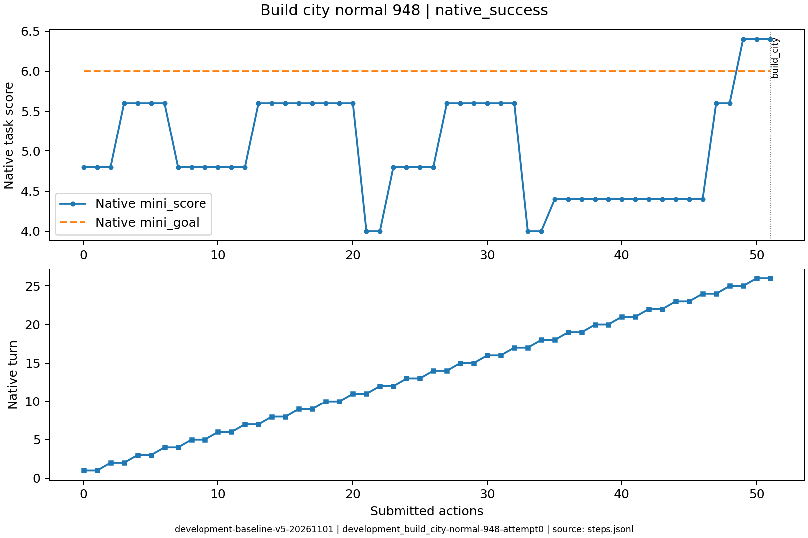
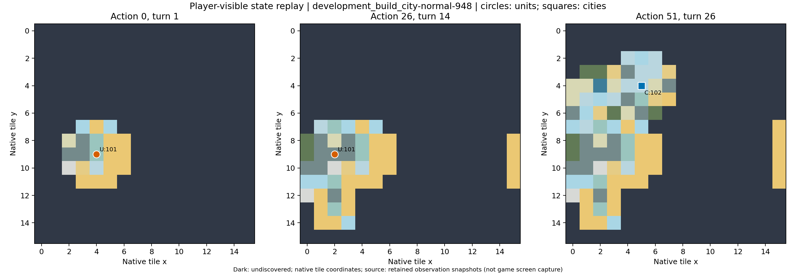

# development_build_city-normal-948：成功参照

51次动作、58次调用后仍成功，包含截断JSON后的纠错恢复；与349的长轨迹失败对照。

原生成功=True；停止原因=native_success；动作=51；调用=58；耗时=1018.6秒。

[完整状态回放](../../../../runs/local_review/development-baseline-v5-20261101/episodes/development_build_city-normal-948/attempt0/player_visible_replay.mp4) · [本地交互时间线](index.html) · [逐步结构化摘要](timeline.json) · [全部请求与输出](../../../../runs/local_review/development-baseline-v5-20261101/episodes/development_build_city-normal-948/attempt0/api_calls.jsonl) · [原始轨迹](../../../../runs/local_review/development-baseline-v5-20261101/episodes/development_build_city-normal-948/attempt0/steps.jsonl)

回放依据真实玩家观察重建，并非游戏屏幕录制。原始JSON中的服务器路径保持不变，本地映射见本材料索引。

| 决策 | 回合 | 实际动作 | 模型简短理由 | 原生通知/输出错误 |
|---|---:|---|---|---|
| 0000 | 1 | ['unit', 101, 'goto_3'] | 向西移动到丘陵，靠近湖泊和草原，寻找评分更高的城址。 |  No action probability query needed. |
| 0001 | 1 | END_TURN | 定居者已无移动力；结束回合以恢复移动力，再前往评分更高的城址。 | Year: 3950 BCE |
| 0002 | 2 | ['unit', 101, 'goto_5'] | 向西南移动到草原，靠近湖泊且地形产出更高，有望获得更高建城评分。 |  |
| 0003 | 2 | END_TURN | 定居者当前移动力已耗尽；先结束回合恢复移动力，下回合再前往更优地块建城。 |  No action probability query needed. / Year: 3900 BCE |
| 0004 | 3 | ['unit', 101, 'goto_6'] | 当前草原评分5.6仍低于目标6.0，南方为未知区域；先南移到沼泽以探索更南侧地形，寻找更肥沃的建城点。 |  |
| 0005 | 3 | END_TURN | 定居者当前移动力为0，无法移动；结束回合恢复移动力后继续寻找评分≥6.0的城址。 |  No action probability query needed. / Year: 3850 BCE |
| 0006 | 4 | ['unit', 101, 'goto_6'] | 当前沼泽评分5.6不足；南移丘陵可邻接两片海洋资源，预期评分升至6.0以上，下回合建城。 |  |
| 0007 | 4 | END_TURN | 定居者移动力已耗尽，当前丘陵评分4.8低于目标；先结束回合恢复移动力，再前往更高评分地块建城。 |  No action probability query needed. / Year: 3800 BCE |
| 0008 | 5 | ['unit', 101, 'goto_6'] | 当前位置评分4.8低于目标6.0，北侧已知仍只有5.6；向南进入未知区域探索更优城址。 | [{'call_id': 'development_build_city-normal-948-attempt0-decision0008-call0', 'error': 'Expecting value: line 1 column 1 (char 0)'}] |
| 0009 | 5 | END_TURN | 定居者移动力已耗尽，当前沼泽评分仅4.8。先结束回合恢复移动力，下回合北返并探索更高评分城址。 |  No action probability query needed. / Year: 3750 BCE |
| 0010 | 6 | ['unit', 101, 'goto_1'] | 当前位置评分4.8低于目标，东南山地对建城未必有利；北返已知5.6高分区域，再向西探索更高评分地块。 |  |
| 0011 | 6 | END_TURN | 定居者移动力已耗尽，当前丘陵评分4.8低于目标6.0；结束回合恢复移动力，再探索更高评分地块建城。 |  No action probability query needed. / Year: 3700 BCE |
| 0012 | 7 | ['unit', 101, 'goto_0'] | 当前位置评分4.8，已知北侧最高仅5.6，均低于目标6.0。向西北进入山地，便于随后探索未知西侧区域寻找更高分城址。 |  |
| 0013 | 7 | END_TURN | 定居者移动力为0，当前山地评分5.6仍低于目标6.0。结束回合恢复移动力，之后继续探索西侧未知区域以寻找评分至少6.0的城址。 |  No action probability query needed. / Year: 3650 BCE |
| 0014 | 8 | ['unit', 101, 'goto_0'] | 当前位置评分5.6低于目标6.0；西北(0,10)丘陵产出极高（贸易6），更适合作为城址候选。先移动过去确认评分，再决定建城。 |  No action probability query needed. |
| 0015 | 8 | END_TURN | 定居者移动力为0，当前丘陵评分5.6仍低于目标6.0。结束回合恢复移动力，之后继续向未见区域探索以寻找评分≥6.0的城址。 | Year: 3600 BCE |
| 0016 | 9 | ['unit', 101, 'goto_1'] | 当前丘陵评分5.6仍低于目标6.0，建城会提前失败。向北进入沙漠可揭示未探索的北部区域，继续寻找评分至少6.0的城址。 |  |
| 0017 | 9 | END_TURN | 定居者移动力为0，当前评分5.6仍低于目标6.0。结束回合恢复移动力后继续向未探索区域寻找评分至少6.0的城址。 |  No action probability query needed. / Year: 3550 BCE |
| 0018 | 10 | ['unit', 101, 'goto_4'] | 当前位置评分5.6低于目标6.0；向东进入丘陵(1,9)可接近湖畔丘陵群，揭示更多地形并检查更高评分城址。 |  No action probability query needed. |
| 0019 | 10 | END_TURN | 定居者移动力已耗尽，当前位置评分5.6仍低于目标6.0；结束回合恢复移动力后继续探索更高评分城址。 | Year: 3500 BCE |
| 0020 | 11 | ['unit', 101, 'goto_2'] | 当前位置评分5.6低于目标6.0。向东北进入苔原仅耗1移动力，可保留移动力继续探明北部未探索区域，寻找评分至少6.0的城址。 |  No action probability query needed. |
| 0021 | 11 | END_TURN | 定居者移动力已耗尽，当前城址评分4.0远低于目标6.0。结束回合恢复移动力，下回合继续探索北部未揭示区域以寻找评分至少6.0的城址。 | Year: 3450 BCE |
| 0022 | 12 | ['unit', 101, 'goto_7'] | 当前评分4.0过低；向东南进入丘陵(3,9)，紧邻湖泊、草原与丘陵群，有望达到6.0目标，为下回合建城做准备。 | [{'call_id': 'development_build_city-normal-948-attempt0-decision0022-call0', 'error': 'Expecting value: line 1 column 1 (char 0)'}] |
| 0023 | 12 | END_TURN | 定居者移动力已耗尽，当前位置评分4.8低于目标6.0。结束回合恢复移动力，下回合继续向东/北探查未揭示地形，寻找评分≥6.0的城址。 |  No action probability query needed. / Year: 3400 BCE |
| 0024 | 13 | ['unit', 101, 'goto_3'] | 当前城址评分4.8低于目标6.0。向西进入未定居的丘陵(2,9)，靠近草原、湖泊与丘陵群，评估更富集的城址，为达6.0目标探查。 |  No action probability query needed. |
| 0025 | 13 | END_TURN | 定居者移动力已耗尽，当前城址评分4.8低于目标6.0。结束回合恢复移动力，下回合前往丘陵(1,10)探查更富集的城址。 | Year: 3350 BCE |
| 0026 | 14 | ['unit', 101, 'goto_5'] | 当前评分4.8低于目标6.0。向西南进入丘陵(1,10)，紧邻高产出丘陵(0,10)、湖泊与草原，最有希望达到6.0，为建城选址。 |  |
| 0027 | 14 | END_TURN | 定居者移动力为0，当前评分5.6未达6.0。结束回合恢复移动力，下回合继续寻找更高评分城址。 |  No action probability query needed. / Year: 3300 BCE |
| 0028 | 15 | ['unit', 101, 'goto_1'] | 当前城址评分5.6未达6.0。向北进入(1,9)，再继续北上未探索内陆，寻找资源更丰富的城址。 |  No action probability query needed. |
| 0029 | 15 | END_TURN | 定居者移动力为0，当前城址评分5.6仍低于目标6.0。结束回合恢复移动力，下回合继续寻找评分至少6.0的建城位置。 | Year: 3250 BCE |
| 0030 | 16 | ['unit', 101, 'goto_0'] | 当前评分5.6未达6.0。向西北移动到(0,8)沙漠，可侦察未探索的(0,7)，并保留移动力继续向北寻找更优城址。 |  |
| 0031 | 16 | END_TURN | 定居者移动力为0，当前评分5.6未达6.0。结束回合恢复移动力，下回合继续侦察更优城址。 |  No action probability query needed. / Year: 3200 BCE |
| 0032 | 17 | ['unit', 101, 'goto_2'] | 当前评分5.6未达6.0，需继续侦察。向东北进入(1,7)丛林，接近北侧未探索内陆，寻找资源更丰富的城址。 | [{'call_id': 'development_build_city-normal-948-attempt0-decision0032-call0', 'error': 'Unterminated string starting at: line 1 column 29 (char 28)'}] |
| 0033 | 17 | END_TURN | 当前位于(1,7)丛林，评分仅4.0且定居者移动力为0。结束回合恢复移动力，下回合返回西北侧5.6评分区域继续寻找至少6.0的城址。 |  No action probability query needed. / Year: 3150 BCE |
| 0034 | 18 | ['unit', 101, 'goto_1'] | 当前评分4.0远低于6.0，需继续探索未知北方；向北进入(1,6)山地可侦察北侧未探索格，寻找更优城址。 |  |
| 0035 | 18 | END_TURN | 定居者位于(1,6)评分仅4.4，且当前移动力为0无法行动。结束回合以按规则恢复移动力，之后继续返回西侧5.6评分区或探索未探明区域，寻找≥6.0的城址。 |  No action probability query needed. / Year: 3100 BCE |
| 0036 | 19 | ['unit', 101, 'goto_1'] | 当前评分4.4低于目标6.0，定居者应继续向北探索未知内陆；进入(1,5)丛林消耗少，便于本回合继续侦察北部潜在高资源城址。 |  |
| 0037 | 19 | END_TURN | 定居者移动力已耗尽(0/3)，当前无可用的建城或移动动作。结束回合恢复移动力，下回合南下返回已知最高5.6评分区(约0,8-2,11)择优建城，避免超时失败。 |  No action probability query needed. / Year: 3050 BCE |
| 0038 | 20 | ['unit', 101, 'goto_6'] | 当前评分4.4远低于目标6.0；向南进入(1,6)山地，朝已知评分5.6的南部区域移动，并寻找更高资源城址。 |  No action probability query needed. |
| 0039 | 20 | END_TURN | 定居者当前移动力为0且所在(1,6)评分4.4偏低，本回合无可用移动或建城动作。结束回合以恢复移动力，下回合尽快南下前往已知最佳5.6评分区(约0,8-2,11)建城，避免在第30回合前超时失败。 | Year: 3000 BCE |
| 0040 | 21 | ['unit', 101, 'goto_1'] | 当前4.4，已知南部最高仅5.6未达6.0；先北移至(1,5)丛林，利用剩余移动力探索北部未知平原/苔原，争取期限前找到≥6.0城址。 |  |
| 0041 | 21 | END_TURN | 定居者移动力为0，无法移动或建城。结束回合恢复3点移动力，下回合南下前往已知5.6评分区，并沿途探索更高资源点，争取期限前达到6.0。 |  No action probability query needed. / Year: 2950 BCE |
| 0042 | 22 | ['unit', 101, 'goto_2'] | 当前评分4.4远低于6.0；向东北进入(2,4)平原，探索东部未知区域，并保留移动力继续寻找高资源城址。 |  |
| 0043 | 22 | END_TURN | 定居者移动力为0，无法移动或建城。结束回合恢复移动力，下回合向已知5.6评分区（如2,10附近）前进，并沿途探索，争取第30回合前找到≥6.0城址。 |  No action probability query needed. / Year: 2900 BCE |
| 0044 | 23 | ['unit', 101, 'goto_4'] | 当前评分4.4，已知南部最高仅5.6。向未探索的东部苔原推进，利用3点移动力寻找资源更丰富的城址，争取达到6.0。 |  No action probability query needed. |
| 0045 | 23 | END_TURN | 定居者当前移动力为0，无法移动或建城。结束回合以恢复移动力，下回合继续寻找评分≥6.0的城址。 | Year: 2850 BCE |
| 0046 | 24 | ['unit', 101, 'goto_7'] | 当前评分4.4不足6.0。向东南丘陵移动，靠近已知海岸并揭示周边未知格，寻找含海洋资源的更高评分城址；丘陵移动成本较低，保留后续移动力。 |  |
| 0047 | 24 | END_TURN | 定居者移动力为0，无法移动或建城。结束回合恢复移动力，下回合继续向未探索的东部寻找评分≥6.0的城址（当前5.6，距目标仅差0.4）。 |  No action probability query needed. / Year: 2800 BCE |
| 0048 | 25 | ['unit', 101, 'goto_2'] | 当前5.6仍低于目标。向东北宝石丛林移动，中心城市可得宝石产出并保留东南煤矿，同时揭示更多内陆格，争取评分≥6.0。 |  |
| 0049 | 25 | END_TURN | 当前城址评分6.4已超过目标6.0，但定居者移动力为0，无法立即建城；结束回合恢复移动力，下回合即可建城完成任务。 |  No action probability query needed. / Year: 2750 BCE |
| 0050 | 26 | ['unit', 101, 'build_city'] | 当前城址评分6.4已超过目标6.0，定居者仍有移动力，立即在此建城即可达成任务目标。 | You have founded Gera. / You scored 6.4>=6.0, congratulations on the successful completion of this mission! /  No action probability query needed. |
