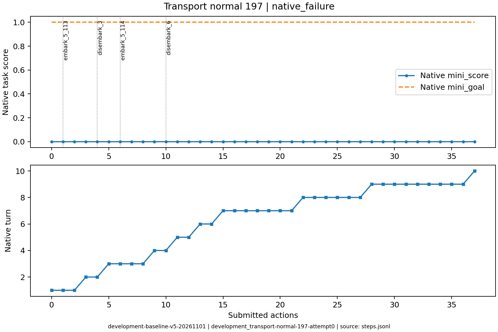
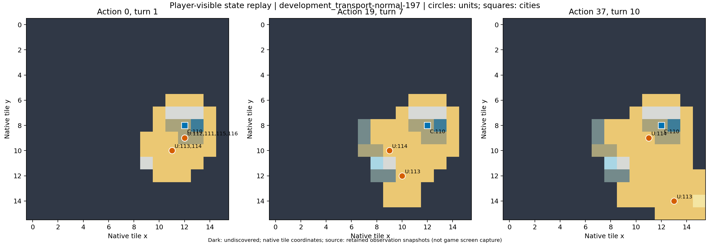

# development_transport-normal-197：原生失败

跨海调用最多的失败：37次动作、59次调用，多次登陆仍未建城，展示高开销恢复过程。

原生成功=False；停止原因=native_failure；动作=37；调用=59；耗时=1876.2秒。

[完整状态回放](../../../../runs/local_review/development-baseline-v5-20261101/episodes/development_transport-normal-197/attempt0/player_visible_replay.mp4) · [本地交互时间线](index.html) · [逐步结构化摘要](timeline.json) · [全部请求与输出](../../../../runs/local_review/development-baseline-v5-20261101/episodes/development_transport-normal-197/attempt0/api_calls.jsonl) · [原始轨迹](../../../../runs/local_review/development-baseline-v5-20261101/episodes/development_transport-normal-197/attempt0/steps.jsonl)

回放依据真实玩家观察重建，并非游戏屏幕录制。原始JSON中的服务器路径保持不变，本地映射见本材料索引。

| 决策 | 回合 | 实际动作 | 模型简短理由 | 原生通知/输出错误 |
|---|---:|---|---|---|
| 0000 | 1 | ['unit', 112, 'embark_5_113'] | 让开拓者112登上相邻的三列桨战船113，开始跨海运输。 |  |
| 0001 | 1 | ['unit', 113, 'goto_5'] | 让载有开拓者112的三列桨战船113向西南移动到(10,11)，紧邻海上草原小岛(9,11)，为下一步靠岸登陆并由开拓者建立新城市做准备。 |  |
| 0002 | 1 | END_TURN | 当前载有开拓者的三列桨战船已贴近新大陆，但开拓者本回合移动力已耗尽且没有可用登陆动作；先结束回合，待下回合刷新移动力后再执行登陆并建城。 | Famine feared in Hannover, Settlers lost! / Warning: Famine feared in Hannover. / Year: 3950 BCE |
| 0003 | 2 | ['unit', 112, 'disembark_3'] | 载有开拓者112的三列桨战船已位于(10,11)，其正西(9,11)为独立的草原新陆地。先让112在该处登陆，下回合再就地建城完成运输建城目标。 |  |
| 0004 | 2 | END_TURN | 开拓者112已成功登陆新大陆草原(9,11)，但本回合移动力为0，无可用建城动作。先结束回合刷新移动力，下回合就地建城完成目标。 | Famine feared in Hannover, Settlers lost! / Warning: Famine feared in Hannover. / Year: 3900 BCE |
| 0005 | 3 | ['unit', 111, 'embark_5_114'] | 让开拓者111在西南方向登上三列桨战船114，准备下回合运往新大陆登陆建城。 | [{'call_id': 'development_transport-normal-197-attempt0-decision0005-call0', 'error': 'Expecting value: line 1 column 1 (char 0)'}] |
| 0006 | 3 | ['unit', 114, 'goto_3'] | 三列桨战船114载有开拓者111，先向西移动到(10,10)，贴近新大陆草原(9,11)；下回合即可让111登陆并随后建城。 | [{'call_id': 'development_transport-normal-197-attempt0-decision0006-call0', 'error': 'Expecting value: line 1 column 1 (char 0)'}] |
| 0007 | 3 | ['unit', 114, 'goto_3'] | 三列桨战船114载有开拓者111，位于(10,10)。向西移动到(9,10)海格，下回合即可让111向南登陆草原(9,11)建城。 | [{'call_id': 'development_transport-normal-197-attempt0-decision0007-call0', 'error': 'Expecting value: line 1 column 1 (char 0)'}] |
| 0008 | 3 | END_TURN | 开拓者111已在三列桨战船114上，位于(9,10)，其南侧(9,11)即为新大陆草原。但111本回合移动力为0，无法登陆。先结束回合刷新移动力，下回合即可让111向南登陆并就地建城。 | Famine feared in Hannover, Settlers lost! / Warning: Famine feared in Hannover. / Year: 3850 BCE |
| 0009 | 4 | ['unit', 111, 'disembark_6'] | 开拓者111已在(9,10)船上，本回合有移动力；立即向南登陆草原(9,11)，随后即可建城。 |  |
| 0010 | 4 | END_TURN | 开拓者111已登陆(9,11)草原，但本回合移动力为0，无法就地建城。结束回合刷新移动力，下回合即可让111在此建城完成任务。 | Famine feared in Hannover, Settlers lost! / Year: 3800 BCE |
| 0011 | 5 | ['city', 110, 'produce_Settlers'] | 汉诺威的开拓者已损失；立即将城市生产设为Settlers，下回合可购买并派往新大陆建城。 | Hannover is building Settlers. |
| 0012 | 5 | END_TURN | 汉诺威已在建造Settlers（约12回合完成），本回合无可用登陆/建城单位；三列桨战船无法提供新单位。此回合让城市继续积累盾值，等待新开拓者完成后再由港口运往新大陆建城。 | Year: 3750 BCE |
| 0013 | 6 | ['unit', 113, 'goto_6'] | 汉诺威已设为建造Settlers但需时较长且本回无现成开拓者；派三列桨战船113向南沿岸探索新大陆海岸，为后续运送开拓者登陆建城做准备。 | [{'call_id': 'development_transport-normal-197-attempt0-decision0013-call0', 'error': 'Expecting value: line 1 column 1 (char 0)'}] |
| 0014 | 6 | END_TURN | 汉诺威仍在建造Settlers，当前无其他可用开拓者；结束回合积累盾值，继续等待新开拓者完成。 | Year: 3700 BCE |
| 0015 | 7 | ['unit', 114, 'goto_0'] | 当前无现成开拓者可运送，且城市仍需多回合才能造出Settlers。派三列桨战船114向西北未探索海域探路，寻找可登陆的新大陆海岸，为后续运载开拓者建城做准备。 |  |
| 0016 | 7 | ['unit', 113, 'goto_6'] | 暂无现成开拓者；派113号三列桨战船继续向南探索未知海域，寻找可登陆的新大陆海岸，为后续运送 settlers 做准备。 | [{'call_id': 'development_transport-normal-197-attempt0-decision0016-call0', 'error': 'Expecting value: line 1 column 1 (char 0)'}] |
| 0017 | 7 | ['unit', 113, 'goto_1'] | 汉诺威仍在造 Settlers，本回合无开拓者可载运；令113号三列桨战船向北靠近(9,11)草原海岸，为后续登陆建城选点。 | [{'call_id': 'development_transport-normal-197-attempt0-decision0017-call0', 'error': 'Expecting value: line 1 column 1 (char 0)'}] |
| 0018 | 7 | ['unit', 114, 'goto_7'] | 城市暂无可用开拓者；令114号三列桨战船向东南驶近(9,10)海域，靠近(9,11)草原海岸，为运载并登陆建城做准备。 | [{'call_id': 'development_transport-normal-197-attempt0-decision0018-call0', 'error': 'Expecting value: line 1 column 1 (char 0)'}] |
| 0019 | 7 | ['unit', 114, 'goto_2'] | 令114号三列桨战船向东北驶近汉诺威，靠近城市相邻海域，为后续接载开拓者做准备。 | [{'call_id': 'development_transport-normal-197-attempt0-decision0019-call0', 'error': 'Expecting value: line 1 column 1 (char 0)'}] |
| 0020 | 7 | ['unit', 113, 'goto_2'] | 汉诺威仍在产出移民；派113号三列桨战船向东北驶近(11,9)海域，靠近城市旁海岸，为后续接载移民登陆建城做准备。 |  |
| 0021 | 7 | END_TURN | 两艘三列桨船移动力均为0，且尚无移民单位；汉诺威正在生产移民（约需10回合）。此时无可用载运/登陆动作，结束回合以推进生产并为下回合恢复船只移动力。 |  No action probability query needed. / Year: 3650 BCE |
| 0022 | 8 | ['unit', 114, 'goto_4'] | 汉诺威为内陆城，无法直接入港。令114号三列桨战船东移至(11,9)海域，紧邻(12,9)森林海岸，便于开拓者出城后在此登船，再驶向新大陆建城。 | [{'call_id': 'development_transport-normal-197-attempt0-decision0022-call0', 'error': 'Expecting value: line 1 column 1 (char 0)'}] |
| 0023 | 8 | ['unit', 113, 'goto_7'] | 令113号三列桨战船向东南探索未知海域，寻找可登陆的新大陆，同时保留114号在汉诺威附近海岸等待接载开拓者。 | [{'call_id': 'development_transport-normal-197-attempt0-decision0023-call0', 'error': 'Expecting value: line 1 column 1 (char 0)'}] |
| 0024 | 8 | ['unit', 114, 'goto_2'] | 让114号三列桨战船进入汉诺威城，便于移民生产完成后同格登船，再运往新大陆建城。 |  |
| 0025 | 8 | ['unit', 113, 'goto_4'] | 让113号三列桨船向东探索未发现海域，寻找可供移民登陆建城的新大陆；114号继续留港等待移民完成后装船。 | [{'call_id': 'development_transport-normal-197-attempt0-decision0025-call0', 'error': 'Expecting value: line 1 column 1 (char 0)'}] |
| 0026 | 8 | ['unit', 113, 'goto_7'] | 汉诺威正在生产移民，114号船留港等待接载；派113号三列桨船向东南未探索海域侦察，寻找可登陆建城的新大陆海岸。 |  |
| 0027 | 8 | END_TURN | 汉诺威正在生产移民，让114号三列桨船留港等待装载；结束回合以推进生产，为运移民到新大陆建城争取时间。 | Year: 3600 BCE |
| 0028 | 9 | ['unit', 113, 'goto_6'] | 让113号三列桨船向南探索未揭示海域，寻找可登陆建城的新大陆海岸；114号继续留港等待移民完成后装载。 | [{'call_id': 'development_transport-normal-197-attempt0-decision0028-call0', 'error': 'Expecting value: line 1 column 1 (char 0)'}] |
| 0029 | 9 | ['unit', 113, 'goto_6'] | 派113号三列桨船继续向南探索未揭示海域，寻找可登陆建城的新大陆海岸；114号留港待移民完成后装载。 | [{'call_id': 'development_transport-normal-197-attempt0-decision0029-call0', 'error': 'Expecting value: line 1 column 1 (char 0)'}] |
| 0030 | 9 | ['unit', 113, 'goto_0'] | 无移民可造，回合将尽；让113号船向西北未探索海域（已知有森林草原丘陵的新陆块）航行，继续寻找建城登陆点。 | [{'call_id': 'development_transport-normal-197-attempt0-decision0030-call0', 'error': 'Expecting value: line 1 column 1 (char 0)'}] |
| 0031 | 9 | ['unit', 114, 'goto_5'] | 让114号三列桨船向西南驶入城市旁海域，朝西侧未开发新大陆探索；该格以后可接应城市造出的移民登船。 |  |
| 0032 | 9 | ['unit', 114, 'goto_3'] | 让114号三列桨船向西驶向已知x=7处的丘陵/森林新大陆（西侧未开发陆地），靠近可登陆的建城海岸；本回合先移动到(10,9)海域继续向新大陆接近。 | [{'call_id': 'development_transport-normal-197-attempt0-decision0032-call0', 'error': 'Expecting value: line 1 column 1 (char 0)'}] |
| 0033 | 9 | ['city', 110, 'city_unwork_15_-1_-2'] | 调整汉诺威市民工作地块，腾出海洋格让市民改耕草原以增加粮食、促使城市增长，为建造移民并通过三列桨船运送建城做准备。 | [{'call_id': 'development_transport-normal-197-attempt0-decision0033-call0', 'error': 'Expecting value: line 1 column 1 (char 0)'}] |
| 0034 | 9 | ['city', 110, 'city_work_4_1_0'] | 汉诺威正处饥荒，改耕(13,8)平原可增加粮食、避免城市消失，并为日后增长后生产移民、再用船只运输建城做准备。 |  |
| 0035 | 9 | ['unit', 114, 'goto_4'] | 让114号三列桨船向东驶到(11,9)海域，紧邻汉诺威城，为即将建成的移民提供相邻登船点，以便运往西侧新大陆建城。 |  |
| 0036 | 9 | END_TURN | 当前无可用移民或登陆行动，且两艘三列桨船均已耗尽移动力；先结束回合以恢复单位行动并等待城防生产推进。 |  No action probability query needed. / Year: 3550 BCE / You scored 0<1, unfortunately this mission failed! |
