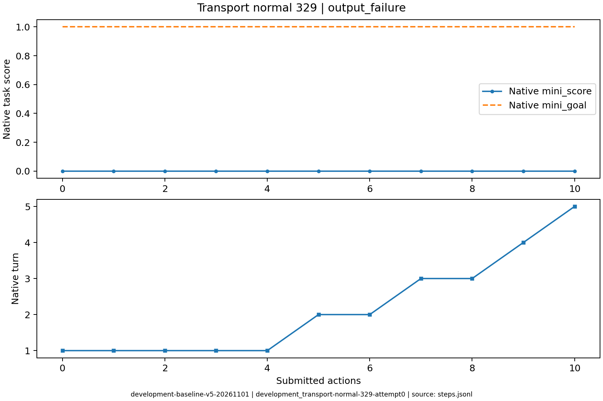
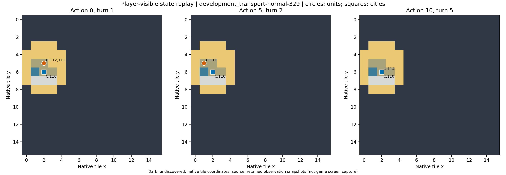

# development_transport-normal-329：动作语义/初始条件

初始无运输船；前两次把plant误认为建城，随后移民损失，最后输出失败。

原生成功=False；停止原因=output_failure；动作=10；调用=18；耗时=682.1秒。

[完整状态回放](../../../../runs/local_review/development-baseline-v5-20261101/episodes/development_transport-normal-329/attempt0/player_visible_replay.mp4) · [本地交互时间线](index.html) · [逐步结构化摘要](timeline.json) · [全部请求与输出](../../../../runs/local_review/development-baseline-v5-20261101/episodes/development_transport-normal-329/attempt0/api_calls.jsonl) · [原始轨迹](../../../../runs/local_review/development-baseline-v5-20261101/episodes/development_transport-normal-329/attempt0/steps.jsonl)

回放依据真实玩家观察重建，并非游戏屏幕录制。原始JSON中的服务器路径保持不变，本地映射见本材料索引。

| 决策 | 回合 | 实际动作 | 模型简短理由 | 原生通知/输出错误 |
|---|---:|---|---|---|
| 0000 | 1 | ['unit', 112, 'plant'] | 立即用移民在当前地块建立新城，触发建城事件以完成目标；当前无可用船只且回合有限。 |  |
| 0001 | 1 | ['unit', 111, 'plant'] | 立即用移民111在当前地块建城，触发人类建城事件；这是当前唯一可用的建城行动。 | [{'call_id': 'development_transport-normal-329-attempt0-decision0001-call0', 'error': 'Expecting value: line 1 column 1 (char 0)'}] |
| 0002 | 1 | ['unit', 112, 'goto_7'] | 当前两处移民紧邻汉诺威（距离过近无法建城），先让112号移民向东南移动到(3,6)，下一回合可再南下至(3,7)草原，拉开与现有城市的距离后建城。 | [{'call_id': 'development_transport-normal-329-attempt0-decision0002-call0', 'error': 'Expecting value: line 1 column 1 (char 0)'}] |
| 0003 | 1 | ['unit', 111, 'goto_3'] | 将移民111向西移至(1,5)森林，使其与汉诺威(2,6)呈对角关系（对角可建城），下一步即可在此建城触发建城事件完成目标。 |  |
| 0004 | 1 | END_TURN | 两移民本回合移动力已耗尽，且无可用登船或建城动作；先结束回合恢复移动力，下回合继续向海岸移动寻找船只。 |  No action probability query needed. / Famine feared in Hannover, Settlers lost! / Warning: Famine feared in Hannover. / Year: 3950 BCE |
| 0005 | 2 | ['unit', 111, 'goto_6'] | 先让移民111向南进入平原，沿东南路线接近未知新大陆(4,8)，为建立远离汉诺威的新城做准备。 |  No action probability query needed. |
| 0006 | 2 | END_TURN | 当前菜单中没有移民111的移动或建城动作（移动力为0，且(1,6)紧邻汉诺威无法建城），先结束回合恢复行动力，下回合继续向海岸和新大陆推进。 | Hannover is finished building Warriors. / Famine feared in Hannover, Settlers lost! / Year: 3900 BCE |
| 0007 | 3 | ['city', 110, 'produce_Settlers'] | 当前没有移民，必须先让汉诺威生产移民，之后才能登船前往新大陆建城。 | Hannover is building Settlers. |
| 0008 | 3 | END_TURN | 当前仅有战士且汉诺威正在生产移民，尚无移民或船只可操作；先结束回合以推进移民生产，待其完成后继续运输与建城。 | Year: 3850 BCE |
| 0009 | 4 | END_TURN | 当前仅剩战士114，没有可用的移民或船只；汉诺威规模为1且菜单中无 produce_Settlers（需人口≥2才能造移民），无法立刻建城。先结束回合推进城市生产与游戏时钟，等待移民产出后再运输建城。 | Year: 3800 BCE |
| 0010 | 5 | 未提交动作 |  | [{'call_id': 'development_transport-normal-329-attempt0-decision0010-call0', 'error': 'Expecting value: line 1 column 1 (char 0)'}, {'call_id': 'development_transport-normal-329-attempt0-decision0010-call1', 'error': 'Expecting value: line 1 column 1 (char 0)'}] |
