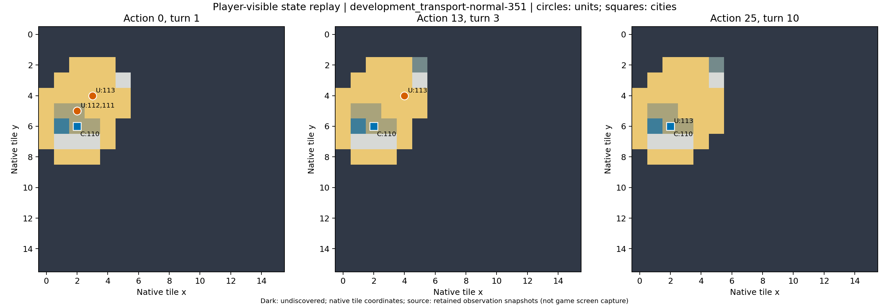

# development_transport-normal-351：原生失败

粮荒损失两名移民，购买生产后仍受城市人口前提限制，明确反馈后继续等待至到期。

原生成功=False；停止原因=native_failure；动作=25；调用=34；耗时=916.9秒。

[完整状态回放](../../../../runs/local_review/development-baseline-v5-20261101/episodes/development_transport-normal-351/attempt0/player_visible_replay.mp4) · [本地交互时间线](index.html) · [逐步结构化摘要](timeline.json) · [全部请求与输出](../../../../runs/local_review/development-baseline-v5-20261101/episodes/development_transport-normal-351/attempt0/api_calls.jsonl) · [原始轨迹](../../../../runs/local_review/development-baseline-v5-20261101/episodes/development_transport-normal-351/attempt0/steps.jsonl)

回放依据真实玩家观察重建，并非游戏屏幕录制。原始JSON中的服务器路径保持不变，本地映射见本材料索引。

| 决策 | 回合 | 实际动作 | 模型简短理由 | 原生通知/输出错误 |
|---|---:|---|---|---|
| 0000 | 1 | ['unit', 112, 'embark_2_113'] | 让一名移民登上相邻的三列桨船，开始跨海运输，前往新大陆建立城市。 |  |
| 0001 | 1 | ['unit', 113, 'goto_2'] | 将载有移民的三列桨船向东北移动，靠近已发现的隔海新陆地，为下一步登陆建城做准备。 |  |
| 0002 | 1 | END_TURN | 移民112本回合移动力已耗尽，无法登陆。结束回合以恢复其移动力，下回合即可从三列桨船登陆东侧(5,3)草原新岛并建城。 | Famine feared in Hannover, Settlers lost! / Warning: Famine feared in Hannover. / Year: 3950 BCE |
| 0003 | 2 | ['unit', 113, 'goto_6'] | 先将三列桨船向南移到(4,4)，下一步再靠近移民所在海岸，准备登船后运往新大陆建城。 |  |
| 0004 | 2 | ['unit', 113, 'goto_5'] | 将三列桨船向西南移到(3,5)，紧邻移民111所在的(2,5)，以便下一步让移民登船并运往新大陆建城。 | [{'call_id': 'development_transport-normal-351-attempt0-decision0004-call0', 'error': 'Expecting value: line 1 column 1 (char 0)'}] |
| 0005 | 2 | ['unit', 111, 'embark_4_113'] | 让移民111登上东侧(3,5)的三列桨船113，准备渡海前往新大陆建城。 |  |
| 0006 | 2 | ['unit', 113, 'goto_2'] | 三列桨船载着移民，先向北东驶向(4,4)，靠近新大陆(5,3)草原，为下一步登陆并在新大陆建城做准备。 |  |
| 0007 | 2 | END_TURN | 三列桨船和移民已在新大陆岸边，但本回合移动力耗尽；结束回合以恢复移动，下回合登陆(5,3)并建城。 |  No action probability query needed. / Famine feared in Hannover, Settlers lost! / Year: 3900 BCE |
| 0008 | 3 | ['city', 110, 'produce_Settlers'] | 移民已在饥荒中损失，汉诺威必须立即生产新移民，才能继续渡海并在新大陆建城。 | Hannover is building Settlers. |
| 0009 | 3 | ['city', 110, 'city_unwork_17_1_-2'] | 汉诺威正在生产移民；调整当前低产出地块，让市民改耕更高盾牌的森林，以加快移民生产并赶在期限前渡海建城。 | [{'call_id': 'development_transport-normal-351-attempt0-decision0009-call0', 'error': 'Expecting value: line 1 column 1 (char 0)'}] |
| 0010 | 3 | ['city', 110, 'city_work_1_-1_0'] | 汉诺威正因缺粮濒临饥荒，改耕平原（1,-1,0）可让粮食盈余转正，同时保留部分盾牌继续生产移民。 | [{'call_id': 'development_transport-normal-351-attempt0-decision0010-call0', 'error': 'Expecting value: line 1 column 1 (char 0)'}] |
| 0011 | 3 | ['city', 110, 'city_unwork_1_-1_0'] | 汉诺威正生产移民，但剩余7回合偏慢；解除低盾牌海洋地块，让市民改耕森林以增加盾牌产出，加速移民完成，以便及时渡海建城。 | [{'call_id': 'development_transport-normal-351-attempt0-decision0011-call0', 'error': 'Expecting value: line 1 column 1 (char 0)'}] |
| 0012 | 3 | ['city', 110, 'city_work_1_-1_0'] | 汉诺威濒临饥荒，重新耕作平原（1,-1,0）以恢复粮食盈余，保住人口和移民生产。 | [{'call_id': 'development_transport-normal-351-attempt0-decision0012-call0', 'error': 'Expecting value: line 1 column 1 (char 0)'}] |
| 0013 | 3 | ['unit', 113, 'goto_5'] | 让三列桨战船向西南驶回汉诺威，准备在移民完成后接运其渡海。 |  |
| 0014 | 3 | ['unit', 113, 'goto_4'] | 汉诺威暂无可用移民，三列桨战船应先向东探索未知海域，寻找可登陆的新大陆，为随后运载移民建城做准备。 | [{'call_id': 'development_transport-normal-351-attempt0-decision0014-call0', 'error': 'Expecting value: line 1 column 1 (char 0)'}] |
| 0015 | 3 | ['unit', 113, 'goto_3'] | 汉诺威正在生产移民（约7回合）。把三列桨战船向西移到(3,5)，紧邻汉诺威城，待移民完成后即可就近登船，随后驶向新大陆建城。 |  |
| 0016 | 3 | END_TURN | 汉诺威正在生产移民，三列桨战船本回合无移动力。先结束回合以推进生产并恢复船只行动力，下回合再安排接运与登陆建城。 |  No action probability query needed. / Year: 3850 BCE |
| 0017 | 4 | ['unit', 113, 'goto_5'] | 让三列桨战船驶回汉诺威城内待命，准备在移民完成后立即接运，前往新大陆建城。 | [{'call_id': 'development_transport-normal-351-attempt0-decision0017-call0', 'error': 'Expecting value: line 1 column 1 (char 0)'}] |
| 0018 | 4 | END_TURN | 汉诺威正在生产移民，三列桨战船已回城待命。先结束回合推进生产，待移民完成后立即登船驶向新大陆建城。 | Year: 3800 BCE |
| 0019 | 5 | END_TURN | 汉诺威正在建造移民，三列桨战船留城待命。结束回合以推进移民生产并恢复船只行动力；待移民完成即登船，经东北方海域(3,5)驶向新大陆建城。 | Year: 3750 BCE |
| 0020 | 6 | END_TURN | 汉诺威仍在生产定居者，三列桨战船已在城内待命。结束回合推进定居者生产，待其完成后立即登船前往新大陆建城。 | Year: 3700 BCE |
| 0021 | 7 | END_TURN | 尚无移民，汉诺威还需约3回合完成生产；结束回合推进，待移民出现后立即登船驶向新大陆建城。 | Year: 3650 BCE |
| 0022 | 8 | ['city', 110, 'city_buy_production'] | 紧急购买汉诺威当前生产（定居者），立即获得移民以便登船赶赴新大陆，避免错过回合期限。 | You bought Settlers in Hannover. |
| 0023 | 8 | END_TURN | 城中唯一可控单位是三列桨战船(113)，尚无移民可登船。结束回合让汉诺威完成定居者生产，下回合即可让定居者登上战船出海建城。 | Hannover can't build Settlers yet. (city size: 1, unit population cost: 1) / Year: 3600 BCE |
| 0024 | 9 | END_TURN | 城内盾牌45、下回合即可完工生产。三列桨战船停泊城中待命，结束回合让生产完成；若产出移民即在城内登船，随后驶向新大陆建城。 | Hannover can't build Settlers yet. (city size: 1, unit population cost: 1) / Year: 3550 BCE / You scored 0<1, unfortunately this mission failed! |
