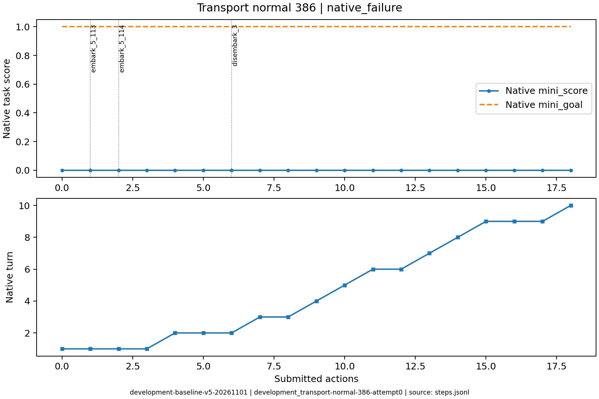
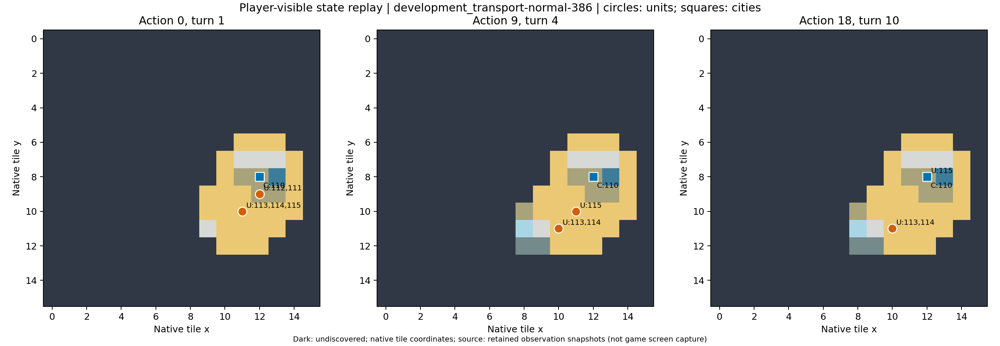

# development_transport-normal-386：原生失败

已登陆的移民在建城前损失，后续重新生产受人口限制，保留全部原生失败之一。

原生成功=False；停止原因=native_failure；动作=18；调用=27；耗时=801.8秒。

[完整状态回放](../../../../runs/local_review/development-baseline-v5-20261101/episodes/development_transport-normal-386/attempt0/player_visible_replay.mp4) · [本地交互时间线](index.html) · [逐步结构化摘要](timeline.json) · [全部请求与输出](../../../../runs/local_review/development-baseline-v5-20261101/episodes/development_transport-normal-386/attempt0/api_calls.jsonl) · [原始轨迹](../../../../runs/local_review/development-baseline-v5-20261101/episodes/development_transport-normal-386/attempt0/steps.jsonl)

回放依据真实玩家观察重建，并非游戏屏幕录制。原始JSON中的服务器路径保持不变，本地映射见本材料索引。

| 决策 | 回合 | 实际动作 | 模型简短理由 | 原生通知/输出错误 |
|---|---:|---|---|---|
| 0000 | 1 | ['unit', 112, 'embark_5_113'] | 让一名移民登上相邻的三角帆船，开始跨海运输。 |  |
| 0001 | 1 | ['unit', 111, 'embark_5_114'] | 让移民111登上空载的三列桨战船114，准备随船前往新大陆。 | [{'call_id': 'development_transport-normal-386-attempt0-decision0001-call0', 'error': 'Expecting value: line 1 column 1 (char 0)'}] |
| 0002 | 1 | ['unit', 113, 'goto_5'] | 让载有移民的三角帆船113向西南驶向已知的（9,11）草原，靠近新大陆以便下回合登陆建城。 |  |
| 0003 | 1 | END_TURN | 当前移民已上船但移动力为0；结束回合以恢复移动力，下回合即可在邻近陆地登陆并建城。 | Famine feared in Hannover, Settlers lost! / Warning: Famine feared in Hannover. / Year: 3950 BCE |
| 0004 | 2 | ['unit', 114, 'goto_5'] | 让载有移民的114号三列桨战船向西南移动到(10,11)，靠近西侧独立陆地，准备随后让移民登陆建城。 |  |
| 0005 | 2 | ['unit', 111, 'disembark_3'] | 让移民111从船上向西登陆(9,11)草原，靠近可建城的新大陆。 |  |
| 0006 | 2 | END_TURN | 移民111已在新大陆(9,11)草原登陆但移动力为0，无法本回合建城；结束回合恢复移动力，下回合执行found city建城即可完成目标。 | Famine feared in Hannover, Settlers lost! / Year: 3900 BCE |
| 0007 | 3 | ['city', 110, 'produce_Settlers'] | 移民111因饥荒损失，当前无移民单位。需先在汉诺威生产新的移民，随后用三列桨船运往新大陆登陆建城。 | Hannover is building Settlers. |
| 0008 | 3 | END_TURN | 移民111已因饥荒损失，只能依靠汉诺威继续生产新移民。结束回合推进移民生产；三列桨船已在新大陆海岸附近待命，待新移民完成后立即装船转运、登陆建城。 | Year: 3850 BCE |
| 0009 | 4 | END_TURN | 汉诺威已在生产移民（约12回合），暂无移民单位可装船；先结束回合推进生产，三列桨船在海岸待命。 | Year: 3800 BCE |
| 0010 | 5 | END_TURN | 当前无移民可用，汉诺威仅1级、无食物盈余，移民仍需约11回合（超期）；三列桨船已在新大陆海岸待命。先结束回合推进生产，待移民完成后立即装船登陆建城。 | Year: 3750 BCE |
| 0011 | 6 | ['unit', 115, 'goto_1'] | 让三列桨船115北上至(11,9)，该格是紧邻汉诺威的唯一海岸格。待城中移民完成后即可从城内直接登船，缩短转运时间。 | [{'call_id': 'development_transport-normal-386-attempt0-decision0011-call0', 'error': 'Expecting value: line 1 column 1 (char 0)'}] |
| 0012 | 6 | END_TURN | 汉诺威的移民还需约10回合（盾12/40），当前无移民可装船。三列桨船115已在(11,9)海岸待命，可接应出城移民登船；先结束回合推进生产与积累金币，以便后续加速。 | Year: 3700 BCE |
| 0013 | 7 | END_TURN | 移民仍在建造（约9回合），115已在汉诺威旁海岸待命；无其他可加速手段，结束回合推进生产，待移民完成后立即登船运往西侧新大陆建城。 | Year: 3650 BCE |
| 0014 | 8 | END_TURN | 汉诺威当前正在建造移民（约8回合完成），尚无移民可装船；其余选项均不影响这一关键生产。结束回合推进建造，待移民出城后由115号三列桨船在(11,9)海岸接应运往新大陆建城。 | Year: 3600 BCE |
| 0015 | 9 | ['city', 110, 'city_buy_production'] | 汉诺威正在建造移民(约40盾,尚差约19盾,需7回合)。现有58金、买价56金,立即购买可当场产出移民,省下7回合用于装船运往新大陆并建城,是赶在死线前完成目标的关键一步。 | You bought Settlers in Hannover. |
| 0016 | 9 | ['unit', 115, 'goto_2'] | 将115号三列桨船从(11,9)驶入汉诺威城，以便装载刚购买的移民并运往新大陆建城。 | [{'call_id': 'development_transport-normal-386-attempt0-decision0016-call0', 'error': 'Expecting value: line 1 column 1 (char 0)'}] |
| 0017 | 9 | END_TURN | 汉诺威的移民生产仅剩1回合，先结束回合使其出城；115号船留在城内待装载，随后运往西侧新大陆建城。 | Hannover can't build Settlers yet. (city size: 1, unit population cost: 1) / Year: 3550 BCE / You scored 0<1, unfortunately this mission failed! |
