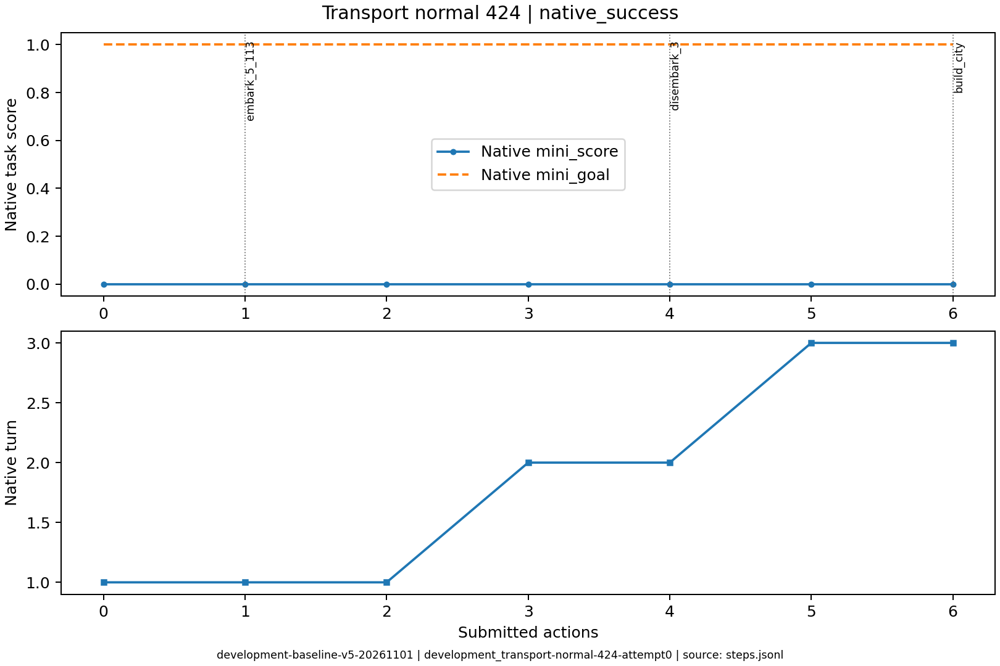
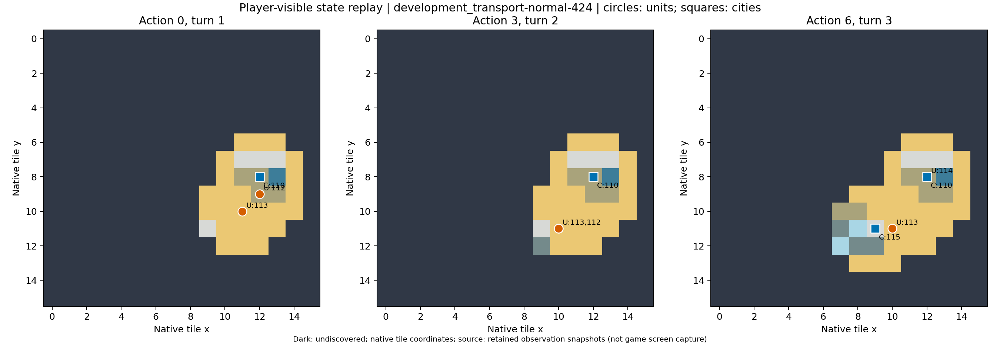

# development_transport-normal-424：成功参照

初始粮食盈余为零、没有粮荒损失的短成功轨迹，且成功纠正一次截断JSON；展示场景条件差异。

原生成功=True；停止原因=native_success；动作=6；调用=8；耗时=120.8秒。

[完整状态回放](../../../../runs/local_review/development-baseline-v5-20261101/episodes/development_transport-normal-424/attempt0/player_visible_replay.mp4) · [本地交互时间线](index.html) · [逐步结构化摘要](timeline.json) · [全部请求与输出](../../../../runs/local_review/development-baseline-v5-20261101/episodes/development_transport-normal-424/attempt0/api_calls.jsonl) · [原始轨迹](../../../../runs/local_review/development-baseline-v5-20261101/episodes/development_transport-normal-424/attempt0/steps.jsonl)

回放依据真实玩家观察重建，并非游戏屏幕录制。原始JSON中的服务器路径保持不变，本地映射见本材料索引。

| 决策 | 回合 | 实际动作 | 模型简短理由 | 原生通知/输出错误 |
|---|---:|---|---|---|
| 0000 | 1 | ['unit', 112, 'embark_5_113'] | 让移民登上相邻的三角帆船，开始向新大陆运输，以便后续登陆建城。 |  |
| 0001 | 1 | ['unit', 113, 'goto_5'] | 将三角帆船向西南移动到(10,11)，使其紧邻新大陆草地，下回合即可让移民登陆建城。 | [{'call_id': 'development_transport-normal-424-attempt0-decision0001-call0', 'error': 'Unterminated string starting at: line 1 column 29 (char 28)'}] |
| 0002 | 1 | END_TURN | 移民本回合移动力已耗尽，无法登陆建城；先结束回合恢复移动力，下回合再让移民登陆新大陆草地并建城。 | Year: 3950 BCE |
| 0003 | 2 | ['unit', 112, 'disembark_3'] | 让移民从三角帆船向西南方向登陆至相邻草地，随后即可在新大陆建城。 |  |
| 0004 | 2 | END_TURN | 移民已在西南独立陆地的草地(9,11)登陆，但本回合移动力为0，无法建城。先结束回合恢复移动力，下回合在原位建立城市即完成目标。 | Hannover is finished building Warriors. / Year: 3900 BCE |
| 0005 | 3 | ['unit', 112, 'build_city'] | 移民已在(9,11)草地登陆且本回合有3点移动力，直接在此建立新城市即可完成运输建城目标。 | You have founded Osnabrück. / You scored 0>=1, congratulations on the successful completion of this mission! |
