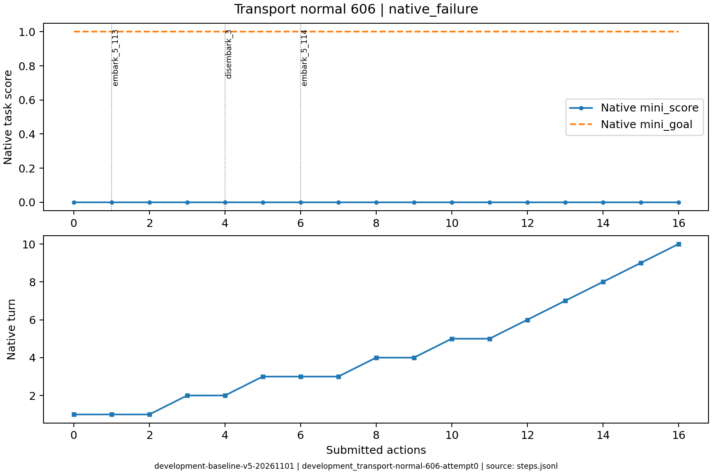
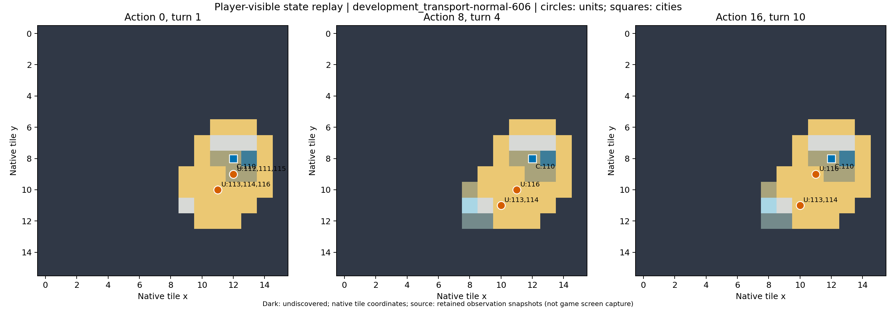

# development_transport-normal-606：原生失败

曾登陆，但后续关键单位损失并到期；与从未登陆的失败区别阅读。

原生成功=False；停止原因=native_failure；动作=16；调用=22；耗时=628.6秒。

[完整状态回放](../../../../runs/local_review/development-baseline-v5-20261101/episodes/development_transport-normal-606/attempt0/player_visible_replay.mp4) · [本地交互时间线](index.html) · [逐步结构化摘要](timeline.json) · [全部请求与输出](../../../../runs/local_review/development-baseline-v5-20261101/episodes/development_transport-normal-606/attempt0/api_calls.jsonl) · [原始轨迹](../../../../runs/local_review/development-baseline-v5-20261101/episodes/development_transport-normal-606/attempt0/steps.jsonl)

回放依据真实玩家观察重建，并非游戏屏幕录制。原始JSON中的服务器路径保持不变，本地映射见本材料索引。

| 决策 | 回合 | 实际动作 | 模型简短理由 | 原生通知/输出错误 |
|---|---:|---|---|---|
| 0000 | 1 | ['unit', 112, 'embark_5_113'] | 让移民112登上相邻的三列桨战船113，开始向海外新大陆运输。 |  |
| 0001 | 1 | ['unit', 113, 'goto_5'] | 让载有移民的113号三列桨战船向西南驶至(10,11)海域，靠近已知的(9,11)草原，为下回合移民登陆建城做准备。 |  |
| 0002 | 1 | END_TURN | 移民112本回合移动力已耗尽，无法立即离船登陆。113号战船停于(10,11)近岸，旁邻(9,11)即隔海新大陆。结束回合，待下回合让该移民登陆并建城。 | Famine feared in Hannover, Settlers lost! / Warning: Famine feared in Hannover. / Year: 3950 BCE |
| 0003 | 2 | ['unit', 112, 'disembark_3'] | 移民112已在(10,11)船上，向西登陆相邻(9,11)草原新大陆，下回合即可建城。 |  |
| 0004 | 2 | END_TURN | 移民112已登陆新大陆(9,11)草原但移动力耗尽，结束回合待下回合建城。 | Famine feared in Hannover, Settlers lost! / Warning: Famine feared in Hannover. / Year: 3900 BCE |
| 0005 | 3 | ['unit', 111, 'embark_5_114'] | 移民111号位于(12,9)，西南邻(11,10)有114号三列桨船。先登船，随后由船载向西侧新大陆(约9,11)航行，才能登陆建城。 |  |
| 0006 | 3 | ['unit', 114, 'goto_5'] | 载有移民111的三列桨船114现位于(11,10)全被海洋包围，无法直接登陆。向西南驶至(10,11)，即紧邻新大陆草原(9,11)，下回合让移民向西登陆并建城。 |  |
| 0007 | 3 | END_TURN | 移民111已在(10,11)船上但移动力为0，本回合无法登陆；结束回合待下回合让其向西登陆(9,11)并建城。 | Famine feared in Hannover, Settlers lost! / Year: 3850 BCE |
| 0008 | 4 | ['city', 110, 'produce_Settlers'] | 原有移民因饥荒损耗，现无移民可用。令汉诺威生产移民，待其完成后由附近三列桨船运至西侧(约9,11)草原登陆建城。 | Hannover is building Settlers. |
| 0009 | 4 | END_TURN | 当前无移民可用，汉诺威正在生产Settlers；但城市规模不足且需13回合，无法在期限内完成。结束回合以推进生产，等待后续机会。 | Year: 3800 BCE |
| 0010 | 5 | ['unit', 116, 'goto_1'] | 新移民尚在生产；先将三列桨船116从(11,10)北移泊到汉诺威旁海面(11,9)，以便移民建成后可立刻登船，再西渡至(9,10)附近靠岸登陆(9,11)草原建城。 |  |
| 0011 | 5 | END_TURN | 移民111已在饥荒中损失，三列桨船无陆战单位可载。汉诺威仍在生产Settlers（约12回合），本回合无合法登陆/建城动作，先结束回合推进生产，船116留在(11,9)以待接运。 | Year: 3750 BCE |
| 0012 | 6 | END_TURN | 无移民可用，汉诺威仍在生产Settlers；先结束回合推进生产，船116留在(11,9)待接运。 | Year: 3700 BCE |
| 0013 | 7 | END_TURN | 当前仅有3艘三列桨船，无移民可用；此前移民已因饥荒损失，汉诺威生产Settlers仍需约10回合，远超第10回合期限，建城目标客观上无法完成。先结束回合推进生产并保持船只待命。 | Year: 3650 BCE |
| 0014 | 8 | END_TURN | 无移民可用，汉诺威仍在生产Settlers（约9回合），剩余回合内无法完成跨海建城；先结束回合推进生产，三列桨船116留在(11,9)待接运。 | Year: 3600 BCE |
| 0015 | 9 | END_TURN | 城中仍在建造Settlers（还需约8回合），三艘三列桨船无移民可载，58金币不足以买出，且菜单无移民/登陆选项，本回合无可达成建城的合法动作，只能结束回合。 | Year: 3550 BCE / You scored 0<1, unfortunately this mission failed! |
