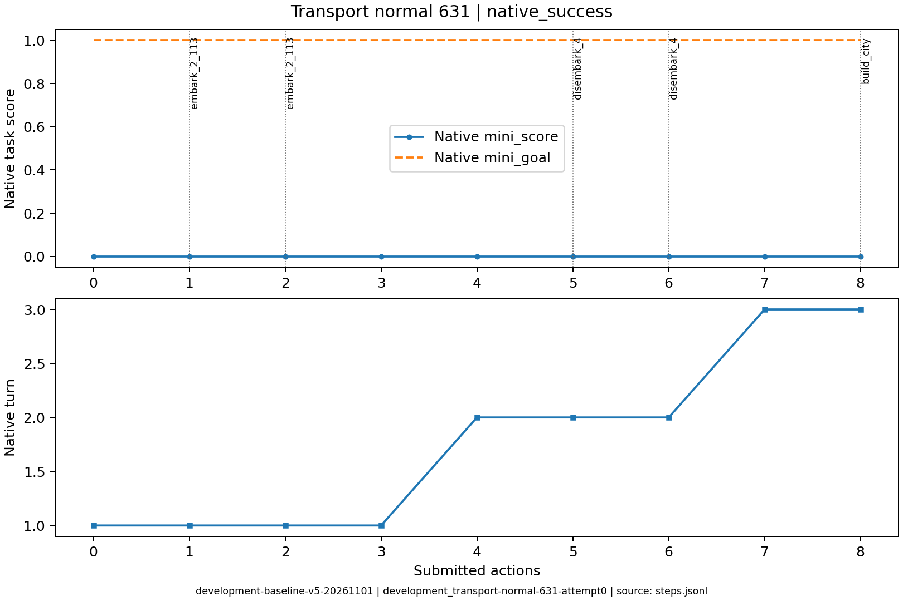
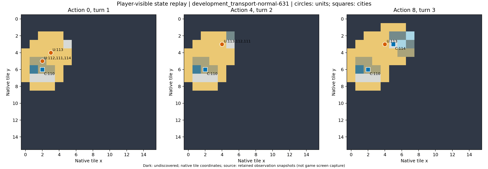

# development_transport-normal-631：成功参照

同船载运两名移民，粮荒后仍有幸存者在登陆地建城；包含完整同一单位证据链。

原生成功=True；停止原因=native_success；动作=8；调用=9；耗时=127.3秒。

[完整状态回放](../../../../runs/local_review/development-baseline-v5-20261101/episodes/development_transport-normal-631/attempt0/player_visible_replay.mp4) · [本地交互时间线](index.html) · [逐步结构化摘要](timeline.json) · [全部请求与输出](../../../../runs/local_review/development-baseline-v5-20261101/episodes/development_transport-normal-631/attempt0/api_calls.jsonl) · [原始轨迹](../../../../runs/local_review/development-baseline-v5-20261101/episodes/development_transport-normal-631/attempt0/steps.jsonl)

回放依据真实玩家观察重建，并非游戏屏幕录制。原始JSON中的服务器路径保持不变，本地映射见本材料索引。

| 决策 | 回合 | 实际动作 | 模型简短理由 | 原生通知/输出错误 |
|---|---:|---|---|---|
| 0000 | 1 | ['unit', 112, 'embark_2_113'] | 让一名开拓者登上相邻的三列桨战船，开始向新大陆运输。 |  |
| 0001 | 1 | ['unit', 111, 'embark_2_113'] | 让第二名开拓者登上相邻的三列桨战船，与已登船的开拓者一同前往新大陆，随后再移动船只登陆建城。 |  |
| 0002 | 1 | ['unit', 113, 'goto_2'] | 三列桨战船先向东北驶向已知的 (5,3) 草原，准备让船上开拓者在该新大陆登岸建城。 |  |
| 0003 | 1 | END_TURN | 结束当前回合以恢复船上开拓者的行动力，下回合即可从(4,3)向相邻的(5,3)草原执行登陆并建城。 | Famine feared in Hannover, Settlers lost! / Warning: Famine feared in Hannover. / Year: 3950 BCE |
| 0004 | 2 | ['unit', 112, 'disembark_4'] | 船上开拓者已在(4,3)三列桨战船旁，正东(5,3)为草原新大陆，执行向东登陆，随后即可建城。 |  |
| 0005 | 2 | ['unit', 111, 'disembark_4'] | 让111向东登陆到(5,3)与112同格草原，形成双保险：下回合若饥荒解散一名开拓者，幸存者仍能在此建城，符合新大陆建城目标。 |  |
| 0006 | 2 | END_TURN | 两名开拓者已在(5,3)新大陆草原登陆但行动力耗尽，结束回合以恢复行动力，下回合即可建城完成目标。 | Famine feared in Hannover, Settlers lost! / Warning: Famine feared in Hannover. / Year: 3900 BCE |
| 0007 | 3 | ['unit', 111, 'build_city'] | 开拓者111已在新大陆草原(5,3)且行动力充足，立即建城可完成运输并建城目标。 | You have founded Osnabrück. / You scored 0>=1, congratulations on the successful completion of this mission! |
