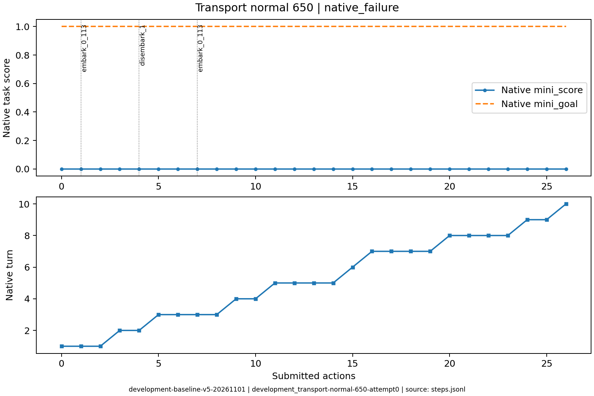
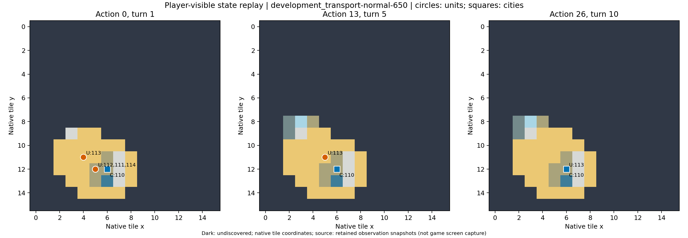

# development_transport-normal-650：原生失败

登陆、粮荒损失、重建与人口条件相互制约，保留全部原生失败之一。

原生成功=False；停止原因=native_failure；动作=26；调用=38；耗时=1180.4秒。

[完整状态回放](../../../../runs/local_review/development-baseline-v5-20261101/episodes/development_transport-normal-650/attempt0/player_visible_replay.mp4) · [本地交互时间线](index.html) · [逐步结构化摘要](timeline.json) · [全部请求与输出](../../../../runs/local_review/development-baseline-v5-20261101/episodes/development_transport-normal-650/attempt0/api_calls.jsonl) · [原始轨迹](../../../../runs/local_review/development-baseline-v5-20261101/episodes/development_transport-normal-650/attempt0/steps.jsonl)

回放依据真实玩家观察重建，并非游戏屏幕录制。原始JSON中的服务器路径保持不变，本地映射见本材料索引。

| 决策 | 回合 | 实际动作 | 模型简短理由 | 原生通知/输出错误 |
|---|---:|---|---|---|
| 0000 | 1 | ['unit', 112, 'embark_0_113'] | 让一名移民登上相邻的三列桨船，准备渡海前往新大陆建城。 |  |
| 0001 | 1 | ['unit', 113, 'goto_0'] | 将载有移民的三列桨船向西北移动至(3,10)，靠近西北方新大陆的草原(3,9)，为下一步登陆建城做准备。 |  |
| 0002 | 1 | END_TURN | 等待下一回合恢复移民移动力，再让船上的移民登陆(3,9)草原建城。 | Famine feared in Hannover, Settlers lost! / Warning: Famine feared in Hannover. / Year: 3950 BCE |
| 0003 | 2 | ['unit', 112, 'disembark_1'] | 让船上的移民向北登陆(3,9)草原，准备在新大陆建城。 |  |
| 0004 | 2 | END_TURN | 移民112已在(3,9)新大陆草原上但移动力耗尽，无法执行建城动作；结束回合以恢复移动力，下回合即可建城。 | Famine feared in Hannover, Settlers lost! / Warning: Famine feared in Hannover. / Year: 3900 BCE |
| 0005 | 3 | ['unit', 113, 'goto_7'] | 三列桨船在(3,10)，移民111在(5,12)。先将船东南移到(4,11)，使其与移民相邻，便于下一步移民登船。 |  |
| 0006 | 3 | ['unit', 111, 'embark_0_113'] | 让移民111向西北登上相邻的三列桨船113，开始海上运输。 | [{'call_id': 'development_transport-normal-650-attempt0-decision0006-call0', 'error': 'Expecting value: line 1 column 1 (char 0)'}] |
| 0007 | 3 | ['unit', 113, 'goto_0'] | 将三列桨船向西北移动到(3,10)，靠近新大陆草原(3,9)，为下回合移民登陆建城做准备。 | [{'call_id': 'development_transport-normal-650-attempt0-decision0007-call0', 'error': 'Expecting value: line 1 column 1 (char 0)'}] |
| 0008 | 3 | END_TURN | 移民111已在(3,10)船上但本回合移动力耗尽，无法登陆建城。结束回合以恢复移动力，下回合可登陆(3,9)草原建城。 | Famine feared in Hannover, Settlers lost! / Year: 3850 BCE |
| 0009 | 4 | ['city', 110, 'produce_Settlers'] | 汉诺威已失去移民，先改为生产新移民，恢复运输并前往新大陆建城的能力。 | Hannover is building Settlers. |
| 0010 | 4 | END_TURN | 汉诺威已在生产移民，结束回合推进建造；待移民完成后由三列桨船运往新大陆建城。 | Year: 3800 BCE |
| 0011 | 5 | ['unit', 113, 'goto_7'] | 汉诺威已在生产移民；三列桨船南下至(4,11)海格，靠近城市岸线(5,11)以便移民完成后登船运往新大陆。 |  |
| 0012 | 5 | ['unit', 113, 'goto_4'] | 三列桨船东移至(5,11)，贴近汉诺威，便于新移民完成后立即登船运往新大陆。 | [{'call_id': 'development_transport-normal-650-attempt0-decision0012-call0', 'error': 'Expecting value: line 1 column 1 (char 0)'}] |
| 0013 | 5 | ['unit', 113, 'goto_7'] | 将三列桨船移入沿海城市汉诺威同格待命，待移民完成后可同格登船，随后运往新大陆登陆建城。 |  No action probability query needed. |
| 0014 | 5 | END_TURN | 汉诺威正在建造移民（盾11/40，约需10回合），当前三列桨船无移动力且无其他可用动作。结束回合推进移民建造，待其完成后由同格三列桨船运往新大陆建城。 | Year: 3750 BCE |
| 0015 | 6 | END_TURN | 汉诺威正在建造移民，三列桨船同格待命；结束回合推进生产，待移民完成后装船运往新大陆建城。 | Year: 3700 BCE |
| 0016 | 7 | ['unit', 113, 'goto_0'] | 三列桨船已恢复移动力，先向西北海洋探索，寻找可登陆的新大陆并接应后续移民。 | [{'call_id': 'development_transport-normal-650-attempt0-decision0016-call0', 'error': 'Expecting value: line 1 column 1 (char 0)'}] |
| 0017 | 7 | ['unit', 113, 'goto_1'] | 汉诺威继续建造移民（盾17/40，约8回合），不必改产。三列桨船有6点移动力，向北探索已知有森林、山地、铁矿的未探明大陆，为移民寻找可登陆建城的新陆地。 |  |
| 0018 | 7 | ['unit', 113, 'goto_6'] | 将三列桨船移至汉诺威相邻海域（南），便于移民完成后立即登船，并保持向新大陆登陆的航程。 | [{'call_id': 'development_transport-normal-650-attempt0-decision0018-call0', 'error': 'Expecting value: line 1 column 1 (char 0)'}] |
| 0019 | 7 | END_TURN | 三列桨船移动力为0且无可用单位动作；汉诺威已在建造移民，保留现产不变，结束回合推进生产并恢复船只移动力，以便后续运移民登陆新大陆建城。 |  No action probability query needed. / Year: 3650 BCE |
| 0020 | 8 | ['unit', 113, 'goto_3'] | 无移民可造（城市规模仅1），三列桨船仍有9点移动力；继续向西探索海域，寻找可登陆的新大陆以接应后续建城。 | [{'call_id': 'development_transport-normal-650-attempt0-decision0020-call0', 'error': 'Expecting value: line 1 column 1 (char 0)'}] |
| 0021 | 8 | ['unit', 113, 'goto_4'] | 三列桨船东移至汉诺威相邻海域，靠近城市以便后续接运移民，为前往新大陆建城做准备。 |  |
| 0022 | 8 | ['unit', 113, 'goto_7'] | 将三列桨船驶入汉诺威城，等待城中建造的移民完成后直接登船，再运往新大陆建城。 |  |
| 0023 | 8 | END_TURN | 保留汉诺威现有生产以完成移民，结束回合推进建造并恢复三列桨船移动力，随后再安排移民登船前往新大陆建城。 |  No action probability query needed. / Year: 3600 BCE |
| 0024 | 9 | ['city', 110, 'city_buy_production'] | 汉诺威正建约40盾的移民（余23盾、6回合完成），用48金币立即买成，尽快让移民登上同格三列桨船，运往西北新大陆建城，赶上期限。 | You bought Settlers in Hannover. |
| 0025 | 9 | END_TURN | 移民已买出但尚无行动力，三列桨船需留在汉诺威同格等待；结束回合让移民恢复移动力后再登船运往新大陆建城。 | Hannover can't build Settlers yet. (city size: 1, unit population cost: 1) / Year: 3550 BCE / You scored 0<1, unfortunately this mission failed! |
