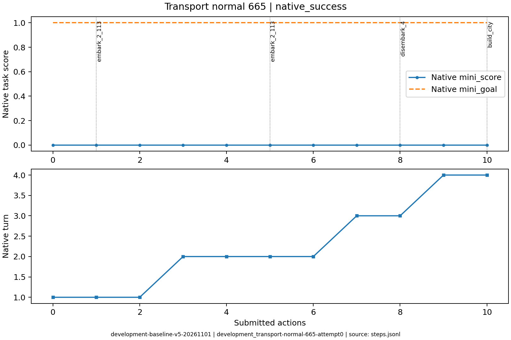
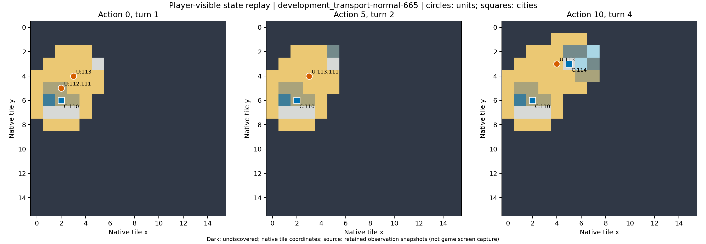

# development_transport-normal-665：协议异常后成功

一次finish_reason=stop的最终输出包含多段JSON及额外文本，严格解析失败，纠错后继续并原生成功。

原生成功=True；停止原因=native_success；动作=10；调用=11；耗时=109.5秒。

[完整状态回放](../../../../runs/local_review/development-baseline-v5-20261101/episodes/development_transport-normal-665/attempt0/player_visible_replay.mp4) · [本地交互时间线](index.html) · [逐步结构化摘要](timeline.json) · [全部请求与输出](../../../../runs/local_review/development-baseline-v5-20261101/episodes/development_transport-normal-665/attempt0/api_calls.jsonl) · [原始轨迹](../../../../runs/local_review/development-baseline-v5-20261101/episodes/development_transport-normal-665/attempt0/steps.jsonl)

回放依据真实玩家观察重建，并非游戏屏幕录制。原始JSON中的服务器路径保持不变，本地映射见本材料索引。

| 决策 | 回合 | 实际动作 | 模型简短理由 | 原生通知/输出错误 |
|---|---:|---|---|---|
| 0000 | 1 | ['unit', 112, 'embark_2_113'] | 让移民112登上相邻的三列桨战船，以便随后运往新大陆登陆建城。 |  |
| 0001 | 1 | ['unit', 113, 'goto_2'] | 让载有移民的三列桨战船向东北移动到靠近新大陆海岸的格子，为下回合登陆建城做准备。 |  |
| 0002 | 1 | END_TURN | Trireme with settler is at (4,3), adjacent to the grassland at (5,3). The settler has 0 moves left after embarking, so end the turn to restore its movement, then disembark and found the city next turn. | Famine feared in Hannover, Settlers lost! / Year: 3950 BCE |
| 0003 | 2 | ['unit', 113, 'goto_5'] | 将三列桨战船向西南移动到(3,4)，与移民111相邻，便于下一步让移民登船。 |  |
| 0004 | 2 | ['unit', 111, 'embark_2_113'] | 让移民111登上相邻的三列桨战船，以便随后运往新大陆登陆建城。 |  |
| 0005 | 2 | ['unit', 113, 'goto_2'] | 三列桨战船载移民向东北移至(4,3)，紧邻新大陆草地(5,3)，待下回合移民恢复移动力后登陆建城。 | [{'call_id': 'development_transport-normal-665-attempt0-decision0005-call0', 'error': 'Extra data: line 3 column 1 (char 136)'}] |
| 0006 | 2 | END_TURN | 移民当前移动力为0，本回合无法登陆。三列桨战船已位于(4,3)紧邻新大陆草地(5,3)，结束回合可恢复移民移动力，下回合即可登陆并建城。 | Year: 3900 BCE |
| 0007 | 3 | ['unit', 111, 'disembark_4'] | 移民在三列桨船上，向东登陆新大陆草地(5,3)，随后可建城。 |  |
| 0008 | 3 | END_TURN | 移民已登陆新大陆草地(5,3)但移动力为0，无法建城。结束回合恢复移动力，下回合即可建城完成目标。 | Year: 3850 BCE |
| 0009 | 4 | ['unit', 111, 'build_city'] | 移民已登陆新大陆草地(5,3)，移动力充足，立即建城以完成目标。 | You have founded Osnabrück. / You scored 0>=1, congratulations on the successful completion of this mission! |
