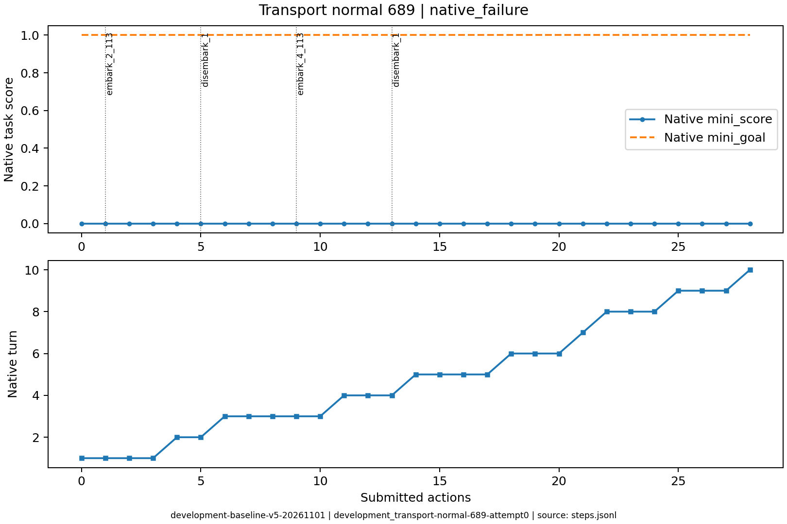
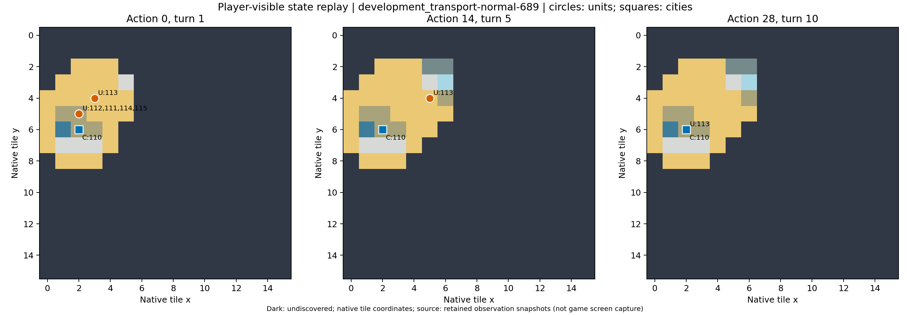

# development_transport-normal-689：原生失败

两次登陆和多次粮荒损失后，重建受人口限制而失败，保留完整恢复过程。

原生成功=False；停止原因=native_failure；动作=28；调用=37；耗时=1048.8秒。

[完整状态回放](../../../../runs/local_review/development-baseline-v5-20261101/episodes/development_transport-normal-689/attempt0/player_visible_replay.mp4) · [本地交互时间线](index.html) · [逐步结构化摘要](timeline.json) · [全部请求与输出](../../../../runs/local_review/development-baseline-v5-20261101/episodes/development_transport-normal-689/attempt0/api_calls.jsonl) · [原始轨迹](../../../../runs/local_review/development-baseline-v5-20261101/episodes/development_transport-normal-689/attempt0/steps.jsonl)

回放依据真实玩家观察重建，并非游戏屏幕录制。原始JSON中的服务器路径保持不变，本地映射见本材料索引。

| 决策 | 回合 | 实际动作 | 模型简短理由 | 原生通知/输出错误 |
|---|---:|---|---|---|
| 0000 | 1 | ['unit', 112, 'embark_2_113'] | 将112号定居者登上相邻的113号三列桨战船，开始跨海运输。 |  |
| 0001 | 1 | ['unit', 113, 'goto_4'] | 将载有定居者的三列桨战船向东航行，接近已知的东侧新陆地（5,3 草原），为下一步登陆建城做准备。 |  |
| 0002 | 1 | ['unit', 113, 'goto_4'] | 将载有定居者的三列桨战船向东驶至(5,4)，紧邻已知草原新陆地(5,3)，为下回合定居者登陆并建城做准备。 |  |
| 0003 | 1 | END_TURN | 定居者112已登上三列桨战船但本回合移动力耗尽(0)，无法登陆(5,3)草原。先结束回合让其恢复移动力，下回合再执行登�陆建城。战船在(5,4)紧邻陆地，不会有沉没风险。 | Famine feared in Hannover, Settlers lost! / Warning: Famine feared in Hannover. / Year: 3950 BCE |
| 0004 | 2 | ['unit', 112, 'disembark_1'] | 定居者已在(5,4)船中，向北登陆(5,3)草原新大陆，为随后建城做准备。 |  |
| 0005 | 2 | END_TURN | 定居者112已在(5,3)草原登陆但移动力为0，本回合无法建城。结束回合恢复移动力，下回合执行plant建城。 | Famine feared in Hannover, Settlers lost! / Warning: Famine feared in Hannover. / Year: 3900 BCE |
| 0006 | 3 | ['unit', 113, 'goto_3'] | 定居者112已损失，需用另一名定居者。三列桨战船从(5,4)向西驶向(2,5)定居者附近的海岸(2,4)接人，再运往新大陆建城。 |  |
| 0007 | 3 | ['unit', 113, 'goto_5'] | 三列桨战船移到(3,5)海洋，与(2,5)的定居者正交相邻，下回合即可登船，再驶向(5,3)草原建城。 |  |
| 0008 | 3 | ['unit', 111, 'embark_4_113'] | 让定居者111在东侧登上三列桨战船113，准备由海路运往新大陆建城；留下另一名定居者以防补给损失。 |  |
| 0009 | 3 | ['unit', 113, 'goto_4'] | 三列桨战船113载着定居者111在(3,5)，先向东驶到(4,5)海洋，逐步接近(5,3)草原海岸，便于下回合登陆建城。 |  |
| 0010 | 3 | END_TURN | 三列桨战船本回合移动力已耗尽，结束回合以恢复移动力，下回合继续载运定居者驶向新大陆登陆建城。 | Famine feared in Hannover, Settlers lost! / Warning: Famine feared in Hannover. / Year: 3850 BCE |
| 0011 | 4 | ['unit', 113, 'goto_2'] | 三列桨战船113载定居者111在(4,5)，向东北驶到(5,4)海洋，紧邻(5,3)草原新大陆，下回合定居者向北登陆即可建城。 |  |
| 0012 | 4 | ['unit', 111, 'disembark_1'] | 让定居者111从三列桨战船向北登陆(5,3)草原，随后在该新大陆地块建城。 |  |
| 0013 | 4 | END_TURN | 定居者111已登陆(5,3)草原但本回合移动力为0，当前无建城动作可选；结束回合待其恢复移动力，下回合在(5,3)建城即完成新大陆建城目标。 | Famine feared in Hannover, Settlers lost! / Year: 3800 BCE |
| 0014 | 5 | ['city', 110, 'produce_Settlers'] | 定居者已在饥荒中损失，需让汉诺威生产新的定居者，之后运至新大陆建城以完成目标。 | Hannover is building Settlers. |
| 0015 | 5 | ['unit', 113, 'goto_5'] | 让三列桨战船向西南驶向汉诺威附近海域，准备接应新城建好的定居者，同时本回合仍可推进城市生产。 | [{'call_id': 'development_transport-normal-689-attempt0-decision0015-call0', 'error': 'Expecting value: line 1 column 1 (char 0)'}] |
| 0016 | 5 | ['unit', 113, 'goto_3'] | 让三列桨战船向西驶至汉诺威相邻海域(3,5)，以便城市建好定居者后立即登船，运往新大陆建城。 |  |
| 0017 | 5 | END_TURN | 汉诺威正在生产定居者(约11回合)，三列桨战船已停在(3,5)海域、紧邻汉诺威，便于定居者建好后相邻登船。本回合无更优操作，结束回合推进生产。 | Year: 3750 BCE |
| 0018 | 6 | ['unit', 113, 'goto_2'] | 陆上无港口，定居者尚在建造；先让三列桨船向东北探索海中带铁山的岛屿，确认新大陆与可登陆海岸，为随后接运定居者做准备。 | [{'call_id': 'development_transport-normal-689-attempt0-decision0018-call0', 'error': 'Expecting value: line 1 column 1 (char 0)'}] |
| 0019 | 6 | ['unit', 113, 'goto_5'] | 将三列桨战船移回汉诺威相邻海域(3,5)，便于城市完成定居者后立即登船并运往新大陆建城。 | [{'call_id': 'development_transport-normal-689-attempt0-decision0019-call0', 'error': 'Expecting value: line 1 column 1 (char 0)'}] |
| 0020 | 6 | END_TURN | 三列桨战船已在(3,5)海域，正对可登陆的(3,6)陆地，汉诺威(2,6)的定居者建好后可步行至(3,6)登船。当前无更优操作，结束回合以推进城市生产。 | Year: 3700 BCE |
| 0021 | 7 | END_TURN | 汉诺威正在建造定居者，三列桨战船已停在城市旁海域等待接运；本回合无需移动船只，结束回合以推进定居者生产。 | Year: 3650 BCE |
| 0022 | 8 | ['city', 110, 'city_unwork_16_-1_2'] | 城市食物无盈余，先解除当前低粮格的劳作，随后改配高粮格以增加余粮，尽快让汉诺威成长到可生产定居者的规模。 | [{'call_id': 'development_transport-normal-689-attempt0-decision0022-call0', 'error': 'Expecting value: line 1 column 1 (char 0)'}] |
| 0023 | 8 | ['city', 110, 'city_work_4_1_0'] | 让汉诺威改耕(3,6)森林，提升盾牌产量并避免断粮，使定居者更快完成。 |  |
| 0024 | 8 | END_TURN | 当前仅有汉诺威一座城与一艘三列桨船，尚未产出定居者，也无法即刻买下生产；先结束回合推进城市生产，待定居者完成后再由船只运往对岸建城。 | Year: 3600 BCE |
| 0025 | 9 | ['city', 110, 'city_buy_production'] | 立即买下汉诺威当前生产（预计为定居者），以节省3回合并在期限前获得可装船的定居者。 | You bought Settlers in Hannover. |
| 0026 | 9 | ['unit', 113, 'goto_5'] | 让三列桨船向西南驶入汉诺威，以便装载刚购买的定居者。 |  |
| 0027 | 9 | END_TURN | 汉诺威的定居者尚差1回合（turns_to_prod_complete=1），三列桨船已停泊城内等待装载；先结束回合让其完工，下回合同格登船再驶向东北方新大陆，避免船先离开导致无法装运。 | Hannover can't build Settlers yet. (city size: 1, unit population cost: 1) / Year: 3550 BCE / You scored 0<1, unfortunately this mission failed! |
