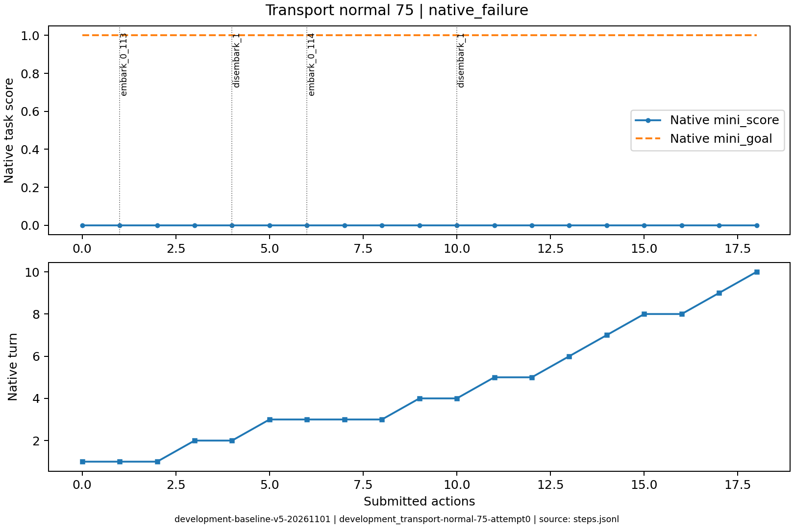
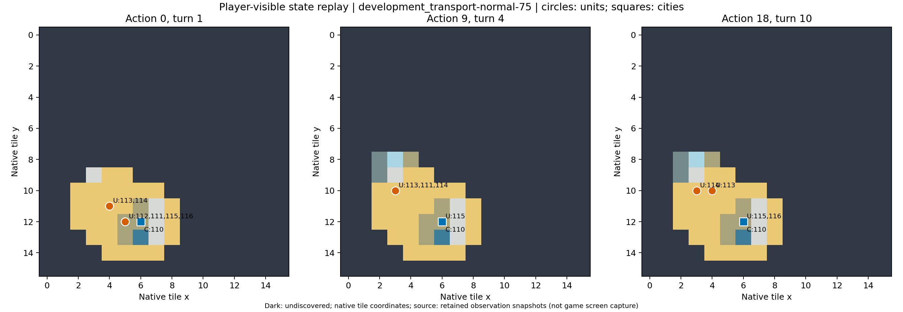

# development_transport-normal-75：原生失败

两次登陆但都未完成建城，展示登陆不等于任务完成。

原生成功=False；停止原因=native_failure；动作=18；调用=23；耗时=540.3秒。

[完整状态回放](../../../../runs/local_review/development-baseline-v5-20261101/episodes/development_transport-normal-75/attempt0/player_visible_replay.mp4) · [本地交互时间线](index.html) · [逐步结构化摘要](timeline.json) · [全部请求与输出](../../../../runs/local_review/development-baseline-v5-20261101/episodes/development_transport-normal-75/attempt0/api_calls.jsonl) · [原始轨迹](../../../../runs/local_review/development-baseline-v5-20261101/episodes/development_transport-normal-75/attempt0/steps.jsonl)

回放依据真实玩家观察重建，并非游戏屏幕录制。原始JSON中的服务器路径保持不变，本地映射见本材料索引。

| 决策 | 回合 | 实际动作 | 模型简短理由 | 原生通知/输出错误 |
|---|---:|---|---|---|
| 0000 | 1 | ['unit', 112, 'embark_0_113'] | 让移民 112 登上相邻的三列桨战船 113，开始向新大陆运输。 |  |
| 0001 | 1 | ['unit', 113, 'goto_0'] | 让载有移民112的三列桨战船113向西北航行至(3,10)，靠近(3,9)的未占领陆地，准备下回合登陆建城。 |  |
| 0002 | 1 | END_TURN | 移民112已随三列桨战船113抵达(3,10)，北侧(3,9)为可登陆的草原新陆地。但112当前移动力为0，需结束回合恢复移动力，下回合再向北登陆并建城。 | Famine feared in Hannover, Settlers lost! / Warning: Famine feared in Hannover. / Year: 3950 BCE |
| 0003 | 2 | ['unit', 112, 'disembark_1'] | 移民112已随三列桨战船113抵达(3,10)，北侧(3,9)是可登陆的草原新陆地。执行向北登陆，下回合即可建城完成任务。 |  |
| 0004 | 2 | END_TURN | 移民112已登陆新大陆(3,9)草原，但当前移动力为0，无法建城；结束回合恢复移动力，下回合即可在此建城完成任务。 | Famine feared in Hannover, Settlers lost! / Warning: Famine feared in Hannover. / Year: 3900 BCE |
| 0005 | 3 | ['unit', 111, 'embark_0_114'] | 让移民111登上西北侧的三列桨战船114，准备渡海前往新大陆(3,9)草原建城；因饥荒已损失一名移民，需尽快完成。 |  |
| 0006 | 3 | ['unit', 114, 'goto_1'] | 移民111已在三列桨战船114上但本回合移动力为0；先把船向北驶近新大陆的草原(3,9)，下回合移民即可登陆并随后建城。 |  |
| 0007 | 3 | ['unit', 114, 'goto_3'] | 迁移者111已载于三列桨船114(4,10)，其本回合移动力为0。先让船向西驶至(3,10)海域，紧邻西岸新大陆草原(3,9)，下回合迁移者即可登陆建城完成任务。 | [{'call_id': 'development_transport-normal-75-attempt0-decision0007-call0', 'error': 'Expecting value: line 1 column 1 (char 0)'}] |
| 0008 | 3 | END_TURN | 移民111已在(3,10)船上但本回合移动力为0，无法登陆；结束回合恢复移动力后即可登陆(3,9)草原并建城。 | Hannover is finished building Warriors. / Famine feared in Hannover, Settlers lost! / Warning: Famine feared in Hannover. / Year: 3850 BCE |
| 0009 | 4 | ['unit', 111, 'disembark_1'] | 移民111已在三列桨战船114上，紧邻北侧(3,9)草原新大陆；执行向北登陆，随后即可建城完成任务。 |  |
| 0010 | 4 | END_TURN | 移民已成功登陆新大陆草原(3,9)，但本回合移动力为0，无法建城。结束回合恢复移动力，下回合即可原地建城完成任务。 | Hannover is finished building Warriors. / Famine feared in Hannover, Settlers lost! / Year: 3800 BCE |
| 0011 | 5 | ['city', 110, 'produce_Settlers'] | 起始移民已被饥荒损失，新大陆无法建城。必须先在Hannover将生产切换为Settlers，造出新移民后再由三列桨船运往西岸新大陆登陆建城；这是唯一通往目标的路径。 | Hannover is building Settlers. |
| 0012 | 5 | END_TURN | 移民已在饥荒中损失，Hannover正在生产新Settlers（约7回合）。当前无可用的运兵或登陆动作，只能结束回合推进生产，待新移民造出后再由三列桨船运往新大陆建城。 | Year: 3750 BCE |
| 0013 | 6 | END_TURN | 当前无可用的移民或登陆动作，Hannover正在生产Settlers；结束回合以推进生产，待新移民完成后继续运输建城。 | Year: 3700 BCE |
| 0014 | 7 | END_TURN | 移民已在饥荒中损失，Hannover 正在生产新 Settlers（约5回合完成）。当前无移民可运输或登陆，两艘三列桨船已在(3,10)临岸海域待命，只能结束回合推进生产，待新移民造出后再装船西渡建城。 | Year: 3650 BCE |
| 0015 | 8 | ['unit', 113, 'goto_4'] | 让三列桨船113先向东驶向Hannover邻海，为接载即将完成的Settlers并运往新大陆登陆建城做准备；城市保持建造Settlers。 | [{'call_id': 'development_transport-normal-75-attempt0-decision0015-call0', 'error': 'Expecting value: line 1 column 1 (char 0)'}] |
| 0016 | 8 | END_TURN | 移民已在饥荒中损失，Hannover仅1人口且内陆不临海，无法生产或装载移民；新移民约需4回合而期限仅余2回合，本局已无法完成建城。结束回合推进游戏。 | Year: 3600 BCE |
| 0017 | 9 | END_TURN | Hannover仅1人口且粮食盈余为0，无法在不毁城的情况下造出移民，历史显示移民反复因饥荒损失；当前无移民可装船，两艘三列桨船虽在近海待命但运无可运，只能在期限内结束回合。 | Year: 3550 BCE / You scored 0<1, unfortunately this mission failed! |
