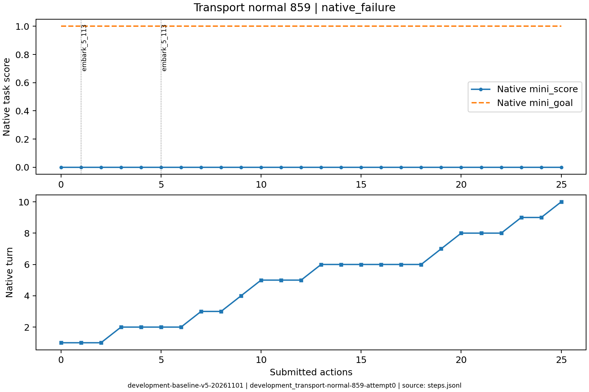
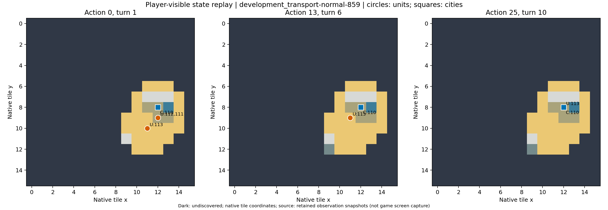

# development_transport-normal-859：原生失败

没有完成登陆，移民损失后重建受人口限制；本正式版本原生胜负已知。

原生成功=False；停止原因=native_failure；动作=25；调用=37；耗时=1292.7秒。

[完整状态回放](../../../../runs/local_review/development-baseline-v5-20261101/episodes/development_transport-normal-859/attempt0/player_visible_replay.mp4) · [本地交互时间线](index.html) · [逐步结构化摘要](timeline.json) · [全部请求与输出](../../../../runs/local_review/development-baseline-v5-20261101/episodes/development_transport-normal-859/attempt0/api_calls.jsonl) · [原始轨迹](../../../../runs/local_review/development-baseline-v5-20261101/episodes/development_transport-normal-859/attempt0/steps.jsonl)

回放依据真实玩家观察重建，并非游戏屏幕录制。原始JSON中的服务器路径保持不变，本地映射见本材料索引。

| 决策 | 回合 | 实际动作 | 模型简短理由 | 原生通知/输出错误 |
|---|---:|---|---|---|
| 0000 | 1 | ['unit', 112, 'embark_5_113'] | 让一名移民登上相邻的三角帆船，准备运往新大陆建城。 |  |
| 0001 | 1 | ['unit', 113, 'goto_5'] | 让载有移民的三角帆船向西南驶往已知的(9,11)草原新大陆，该处远离本城且为空地；下回合在相邻海岸登陆建城。 |  |
| 0002 | 1 | END_TURN | 三角帆船已载移民到达目标海岸旁，但移民本回合移动力为0；结束回合刷新移动力，下回合让移民在相邻(9,11)草原登陆并建城。 | Famine feared in Hannover, Settlers lost! / Warning: Famine feared in Hannover. / Year: 3950 BCE |
| 0003 | 2 | ['unit', 113, 'goto_2'] | 将三角帆船向东北移到(11,10)，靠近仍在本土森林的移民，以便下一步让移民登船。 | [{'call_id': 'development_transport-normal-859-attempt0-decision0003-call0', 'error': 'Expecting value: line 1 column 1 (char 0)'}] |
| 0004 | 2 | ['unit', 111, 'embark_5_113'] | 让移民111登上相邻的三角帆船113（西南方向），开始向新大陆运输；下回合再用船驶近(9,11)草原并登陆建城。 |  |
| 0005 | 2 | ['unit', 113, 'goto_5'] | 让载有移民的三角帆船从(11,10)向西南驶到(10,11)，紧邻新大陆草原(9,11)；下回合移民登陆并在该草原建城。 |  |
| 0006 | 2 | END_TURN | 移民111本回合移动力为0无法登陆(9,11)草原。结束回合刷新移动力，下回合让其从三角帆船登陆并在新大陆建城。 | Famine feared in Hannover, Settlers lost! / Year: 3900 BCE |
| 0007 | 3 | ['city', 110, 'produce_Settlers'] | 让汉诺威改造移民，准备随后用金币加速完成，再运往新大陆建城。 | Hannover is building Settlers. |
| 0008 | 3 | END_TURN | 移民已在饥荒中损失，本回合无地面单位可登陆。三角帆船已停在目标草原(9,11)旁的(10,11)待命；结束回合，让汉诺威继续生产移民并推进局势。 | Year: 3850 BCE |
| 0009 | 4 | END_TURN | 当前无地面移民可登陆，汉诺威已在生产移民；结束回合推进生产，等待新移民完成后运往新大陆建城。 | Year: 3800 BCE |
| 0010 | 5 | ['unit', 113, 'goto_2'] | 先让三角帆船向汉诺威附近海岸移动，为之后接运新移民做准备；生产仍由城市继续推进。 | [{'call_id': 'development_transport-normal-859-attempt0-decision0010-call0', 'error': 'Expecting value: line 1 column 1 (char 0)'}] |
| 0011 | 5 | ['unit', 113, 'goto_1'] | 将三角帆船北移到汉诺威旁的海域，便于新移民完成后直接登船，同时城市继续生产移民。 | [{'call_id': 'development_transport-normal-859-attempt0-decision0011-call0', 'error': 'Expecting value: line 1 column 1 (char 0)'}] |
| 0012 | 5 | END_TURN | 当前仅有三角帆船，尚无地面移民可登陆；汉诺威正在生产移民。结束回合推进城市生产，待移民完成后立即运往新大陆建城。 | Year: 3750 BCE |
| 0013 | 6 | ['city', 110, 'city_unwork_6_-1_1'] | 当前城市粮食盈余为0，无法增长人口建造移民；先取消低产地块工作，让城市自动改配更高粮地块，争取尽快增长并生产移民。 | [{'call_id': 'development_transport-normal-859-attempt0-decision0013-call0', 'error': 'Expecting value: line 1 column 1 (char 0)'}] |
| 0014 | 6 | ['city', 110, 'city_work_2_0_-1'] | 让汉诺威改工作北侧草原地块以获得更多粮食，先解决饥荒并尽快增长人口，为生产移民做准备。 | [{'call_id': 'development_transport-normal-859-attempt0-decision0014-call0', 'error': 'Expecting value: line 1 column 1 (char 0)'}] |
| 0015 | 6 | ['unit', 113, 'goto_2'] | 将三角帆船驶入汉诺威，提前在城内待命，便于移民完成后同格登船并运往新大陆建城。 | [{'call_id': 'development_transport-normal-859-attempt0-decision0015-call0', 'error': 'Expecting value: line 1 column 1 (char 0)'}] |
| 0016 | 6 | ['unit', 113, 'goto_5'] | 三角帆船在城内，先驶向西南海域侦察通往新大陆的航路，为后续运送移民建城做准备。 |  |
| 0017 | 6 | ['unit', 113, 'goto_2'] | 把三角帆船驶回汉诺威城内待命，便于移民完成后同格登船并运往新大陆建城。 |  No action probability query needed. |
| 0018 | 6 | END_TURN | 当前三角帆船移动力已耗尽，城内生产继续进行；结束回合以恢复移动力并等待移民/船只就绪后再运输建城。 | Year: 3700 BCE |
| 0019 | 7 | END_TURN | 汉诺威正在生产40盾单位（应为移民），需保持三列桨帆船在城内等待其完成并同格登船；结束回合以推进生产。 | Year: 3650 BCE |
| 0020 | 8 | ['unit', 113, 'goto_5'] | 派三列桨帆船向西南探索通往新大陆的航路，同时城内继续建造移民；发现陆地后返回接运。 | [{'call_id': 'development_transport-normal-859-attempt0-decision0020-call0', 'error': 'Expecting value: line 1 column 1 (char 0)'}] |
| 0021 | 8 | ['unit', 113, 'goto_2'] | 将三列桨帆船驶入汉诺威等待移民完成，随后同格登船并运往西南方已发现的陆地建城。 |  |
| 0022 | 8 | END_TURN | 汉诺威正在建造移民（约7回合完成），三列桨帆船113留城内等待同格登船。结束回合以推进移民生产，待其完成后装载、驶向新大陆登陆建城。 | Year: 3600 BCE |
| 0023 | 9 | ['city', 110, 'city_buy_production'] | 金币足够，立即买出汉诺威正在建造的移民，使其本回合出现，随后即可同格登上三列桨帆船运往西南陆地建城。 | You bought Settlers in Hannover. |
| 0024 | 9 | END_TURN | 三列桨帆船113留港待命；结束回合让刚购买的移民完成并出现在汉诺威，下回合同格装载后驶向西南陆地建城。 | Hannover can't build Settlers yet. (city size: 1, unit population cost: 1) / Year: 3550 BCE / You scored 0<1, unfortunately this mission failed! |
