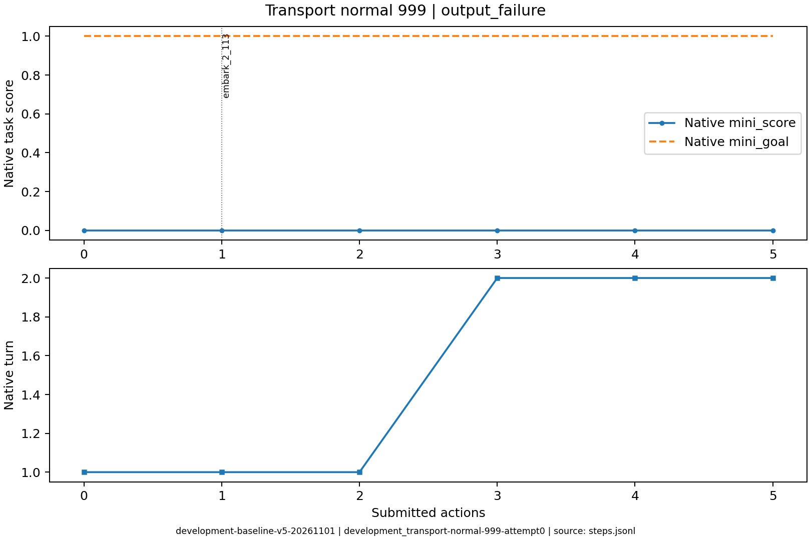
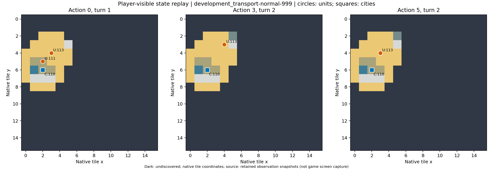

# development_transport-normal-999：未触顶空响应

一次finish_reason=stop、5533个思考tokens即返回空内容，纠错后继续，后来才因连续触顶空输出停止；区别两种空响应。

原生成功=False；停止原因=output_failure；动作=5；调用=9；耗时=257.6秒。

[完整状态回放](../../../../runs/local_review/development-baseline-v5-20261101/episodes/development_transport-normal-999/attempt0/player_visible_replay.mp4) · [本地交互时间线](index.html) · [逐步结构化摘要](timeline.json) · [全部请求与输出](../../../../runs/local_review/development-baseline-v5-20261101/episodes/development_transport-normal-999/attempt0/api_calls.jsonl) · [原始轨迹](../../../../runs/local_review/development-baseline-v5-20261101/episodes/development_transport-normal-999/attempt0/steps.jsonl)

回放依据真实玩家观察重建，并非游戏屏幕录制。原始JSON中的服务器路径保持不变，本地映射见本材料索引。

| 决策 | 回合 | 实际动作 | 模型简短理由 | 原生通知/输出错误 |
|---|---:|---|---|---|
| 0000 | 1 | ['unit', 111, 'embark_2_113'] | 让移民登上一旁的三角帆船，准备运往新大陆建立城市。 |  |
| 0001 | 1 | ['unit', 113, 'goto_2'] | 让三角帆船向东北航行至新大陆旁的 (4,3) 海域，以便下一回合移民登陆 (5,3) 草原建城。 |  |
| 0002 | 1 | END_TURN | 移民已上船且位于可登陆的草原旁，但本回合移民移动力为0；结束回合以恢复移动力，下回合再登陆建城。 | Famine feared in Hannover, Settlers lost! / Year: 3950 BCE |
| 0003 | 2 | ['city', 110, 'produce_Settlers'] | 上一回合移民因饥荒损失，需在汉诺威重新生产移民，再运往新大陆建城。 | Hannover is building Settlers. |
| 0004 | 2 | ['unit', 113, 'goto_5'] | 移民因饥荒损失，汉诺威正续造移民。让三角帆船向西南驶近汉诺威旁海岸，便于新移民登船运往新大陆。 | [{'call_id': 'development_transport-normal-999-attempt0-decision0004-call0', 'error': 'Expecting value: line 1 column 1 (char 0)'}] |
| 0005 | 2 | 未提交动作 |  | [{'call_id': 'development_transport-normal-999-attempt0-decision0005-call0', 'error': 'Expecting value: line 1 column 1 (char 0)'}, {'call_id': 'development_transport-normal-999-attempt0-decision0005-call1', 'error': 'Expecting value: line 1 column 1 (char 0)'}] |
