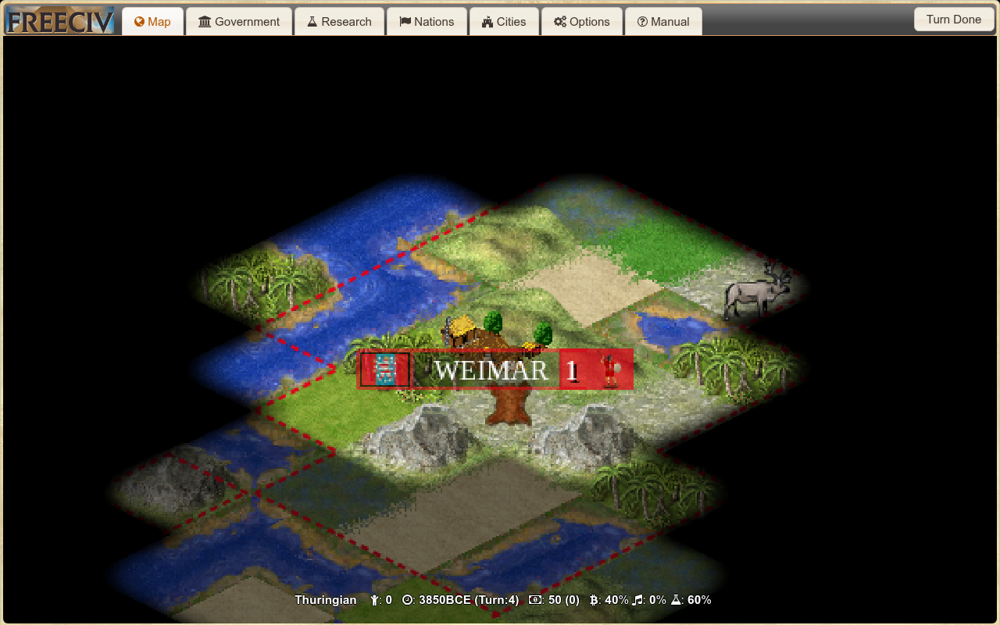
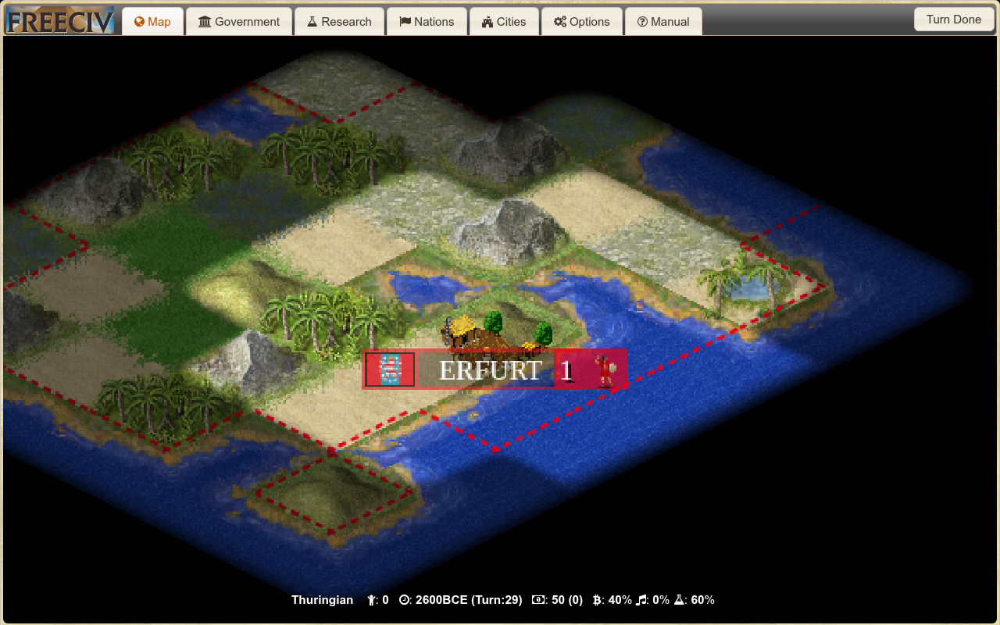
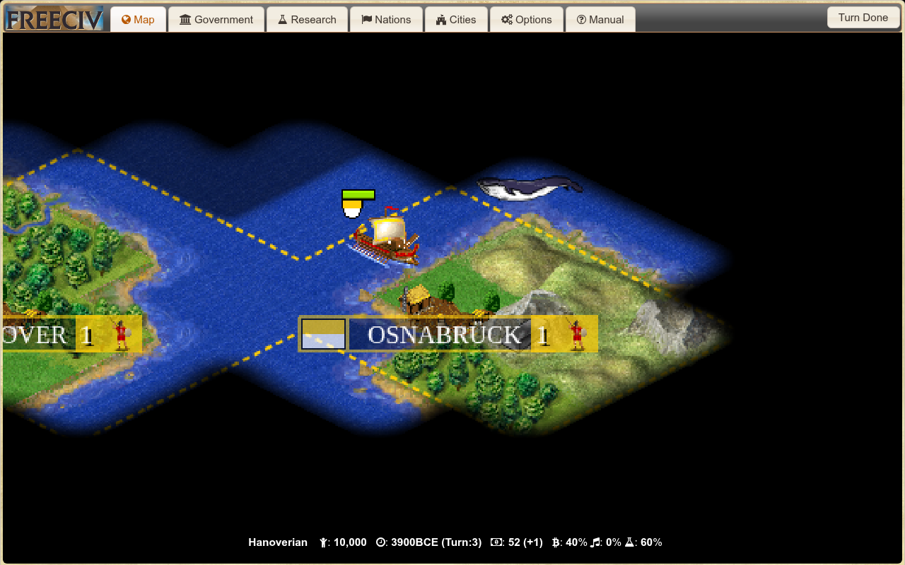
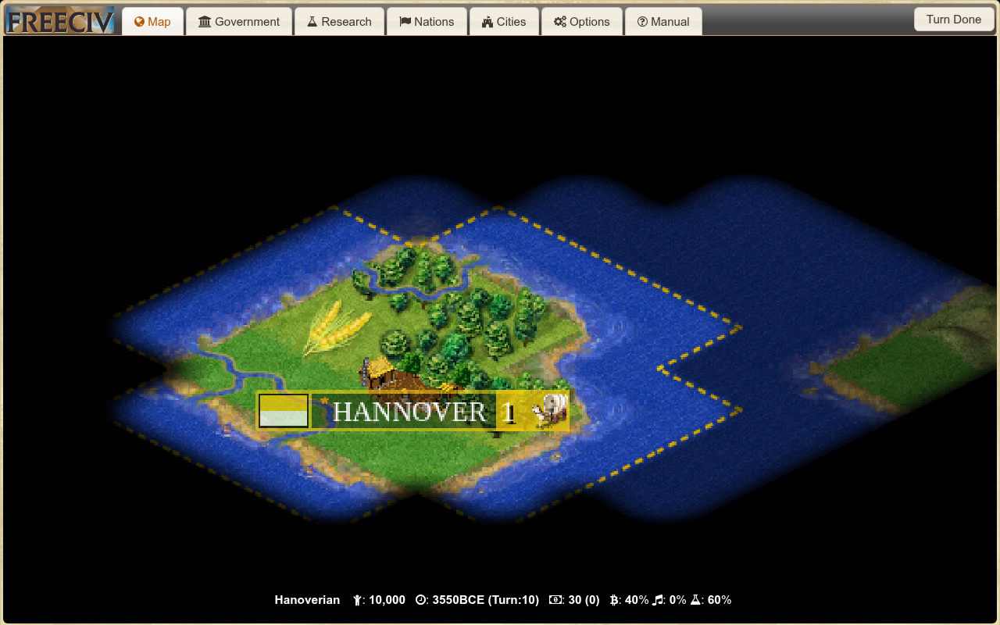

# Freeciv 原生游戏界面示例

以下是按已有案例动作重新演示时截取的 Freeciv-web 界面，用于展示成功与失败过程。不是第一轮采集当时的原始截图，也不替代正式实验结果；本次不调用模型。

| 案例 | 本次原生结局 | 与原案例结局一致 | 画面 |
| --- | --- | --- | --- |
| development_build_city-normal-93 | 成功 | True | [initial](development_build_city-normal-93/initial.png) · [process](development_build_city-normal-93/process.png) · [final](development_build_city-normal-93/final.png) |
| development_build_city-normal-349 | 原生失败 | True | [initial](development_build_city-normal-349/initial.png) · [process](development_build_city-normal-349/process.png) · [final](development_build_city-normal-349/final.png) |
| development_transport-normal-631 | 成功 | True | [initial](development_transport-normal-631/initial.png) · [process](development_transport-normal-631/process.png) · [final](development_transport-normal-631/final.png) |
| development_transport-normal-351 | 原生失败 | True | [initial](development_transport-normal-351/initial.png) · [process](development_transport-normal-351/process.png) · [before_terminal](development_transport-normal-351/before_terminal.png) · [final](development_transport-normal-351/final.png) |

完整复演与截图元数据见各案例 capture.json。画面通过独立观察者客户端观察玩家视角，界面弹窗已关闭，原生地图显示放大至2.2倍；截图说明在本页和元数据中保留。模型与第一轮行为的分析仍应引用原轨迹。

## 建城成功（93）

## 建城失败（349）

## 跨海建城成功（631）

## 跨海建城失败（351）

